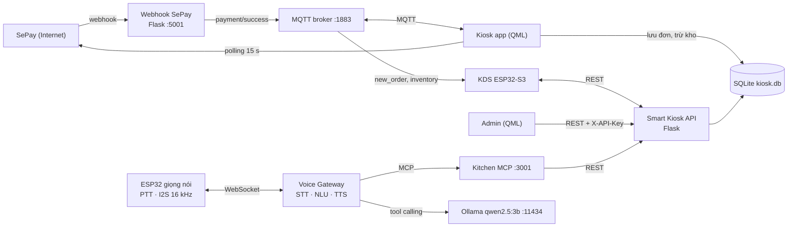

# Báo cáo Đồ án Tốt nghiệp

**Đề tài:** Thiết kế và xây dựng hệ thống điều phối vận hành nhà hàng thông minh tích hợp Smart Kiosk, màn hình bếp và trợ lý giọng nói Edge AI

Nov 3, 2026 · @gosi

## LỜI CAM ĐOAN

Tôi xin cam đoan đồ án tốt nghiệp "Thiết kế và xây dựng hệ thống điều phối vận hành nhà hàng thông minh tích hợp Smart Kiosk, màn hình bếp và trợ lý giọng nói Edge AI" là kết quả nghiên cứu của bản thân dưới sự hướng dẫn của \[họ tên giảng viên hướng dẫn\]. Các số liệu và kết quả trong đồ án là trung thực. Các tài liệu tham khảo được trích dẫn đầy đủ. Nếu sai, tôi xin hoàn toàn chịu trách nhiệm.

*\[Địa điểm\], ngày ... tháng ... năm 2026*

*Sinh viên thực hiện: \[Họ và tên\]*

## LỜI CẢM ƠN

Em xin chân thành cảm ơn \[giảng viên hướng dẫn\] đã tận tình hướng dẫn trong suốt quá trình thực hiện đồ án. Em cũng xin cảm ơn các thầy cô \[khoa/bộ môn\] đã truyền đạt kiến thức nền tảng, cùng gia đình và bạn bè đã động viên, hỗ trợ em.

Do thời gian và kinh nghiệm còn hạn chế, đồ án khó tránh khỏi thiếu sót. Em rất mong nhận được góp ý của quý thầy cô.

## TÓM TẮT ĐỒ ÁN

Đồ án xây dựng một hệ thống điều phối vận hành nhà hàng chạy cục bộ (local-first), gồm ba phân hệ phối hợp qua mạng LAN: Smart Kiosk cho khách tự gọi món và thanh toán, màn hình bếp KDS trên ESP32-S3, và trợ lý giọng nói Edge AI cho nhân viên bếp.

Smart Kiosk được viết bằng Python với giao diện Qt/QML. Khách chọn món, chọn size và đá, rồi thanh toán bằng mã VietQR qua SePay. Giao dịch được xác nhận theo hai đường: webhook SePay gửi qua MQTT và truy vấn định kỳ API SePay. Đơn đã thanh toán được lưu vào SQLite, đồng thời hệ thống trừ nguyên liệu theo công thức trong cùng một transaction. Phần mềm quản trị cho phép quản lý thực đơn, nguyên liệu, công thức, đơn hàng và xuất báo cáo doanh thu.

KDS chạy trên bo JC4827W543C (ESP32-S3, màn 4.3 inch 480×272, cảm ứng GT911), giao diện dựng bằng LVGL. KDS nhận đơn mới và tồn kho qua MQTT, tự đồng bộ lại qua REST API mỗi 30 giây, và báo hoàn thành đơn bằng HTTP có xác thực.

Trợ lý giọng nói dùng ESP32-S3 với micro INMP441, loa MAX98357A và nút nhấn để nói (PTT). Âm thanh được gửi qua WebSocket có xác thực tới Voice Gateway. Gateway chuyển giọng nói thành văn bản bằng Faster-Whisper, phân loại ý định bằng NLU dạng luật, tra dữ liệu bếp qua Kitchen MCP, dùng Ollama (qwen2.5:3b) khi luật không xử lý được câu hỏi, và đọc câu trả lời bằng Piper TTS tiếng Việt. Mọi thao tác ghi dữ liệu đều phải qua phân quyền, xác nhận, chống phát lại (replay) và ghi nhật ký kiểm toán.

Kết quả kiểm thử tự động trên mã nguồn hiện tại: Voice Gateway đạt 996/1001 ca, Kitchen MCP đạt 365/367 ca.

**Từ khóa:** Smart Kiosk, Kitchen Display System, ESP32-S3, Edge AI, MQTT, Model Context Protocol, Faster-Whisper, Ollama, Piper TTS.

## ABSTRACT

This thesis builds a local-first restaurant operations system made of three subsystems on a shared LAN: a self-service Smart Kiosk, an ESP32-S3 Kitchen Display System (KDS), and an Edge AI voice assistant for kitchen staff.

The kiosk (Python, Qt/QML) handles ordering and VietQR payment through SePay, confirmed by both a webhook relayed over MQTT and API polling. Each paid order is stored in SQLite, and ingredients are deducted by recipe in the same transaction. The KDS (LVGL on a 480×272 touch display) receives orders and inventory over MQTT, resynchronises over REST, and reports completed orders over authenticated HTTP.

The voice assistant streams push-to-talk audio from an ESP32-S3 over an authenticated WebSocket to a Voice Gateway. The gateway runs Faster-Whisper STT, rule-based Vietnamese NLU, Kitchen MCP tools, an Ollama LLM fallback and Piper TTS. Write actions require authorization, confirmation, replay protection and auditing. Automated tests pass 996 of 1001 gateway cases and 365 of 367 Kitchen MCP cases.

**Keywords:** self-service kiosk, KDS, ESP32-S3, edge AI, MQTT, MCP, speech recognition, LLM.

## MỤC LỤC

*Mục lục, danh mục hình và danh mục bảng được tạo tự động trong Word sau khi xuất file: References → Table of Contents và Insert Table of Figures. Các đề mục trong tài liệu này đã dùng đúng cấp Heading.*

## DANH MỤC TỪ VIẾT TẮT

| Từ viết tắt | Tiếng Anh | Nghĩa tiếng Việt |
| --- | --- | --- |
| AGC | Automatic Gain Control | Tự động điều chỉnh độ lợi |
| API | Application Programming Interface | Giao diện lập trình ứng dụng |
| CSDL |  | Cơ sở dữ liệu |
| ERD | Entity Relationship Diagram | Sơ đồ thực thể liên kết |
| HMAC | Hash-based Message Authentication Code | Mã xác thực thông điệp dựa trên hàm băm |
| I2S | Inter-IC Sound | Chuẩn truyền âm thanh số giữa các vi mạch |
| KDS | Kitchen Display System | Màn hình hiển thị đơn trong bếp |
| KWS | Keyword Spotting | Nhận dạng từ khóa |
| LLM | Large Language Model | Mô hình ngôn ngữ lớn |
| LVGL | Light and Versatile Graphics Library | Thư viện đồ họa cho vi điều khiển |
| MCP | Model Context Protocol | Giao thức ngữ cảnh mô hình |
| MFCC | Mel-Frequency Cepstral Coefficients | Hệ số cepstral theo thang Mel |
| MQTT | Message Queuing Telemetry Transport | Giao thức truyền thông điệp publish/subscribe |
| NLU | Natural Language Understanding | Hiểu ngôn ngữ tự nhiên |
| OTP | One-Time Password | Mật khẩu dùng một lần |
| PCM | Pulse-Code Modulation | Điều chế xung mã |
| PTT | Push-to-Talk | Nhấn để nói |
| QoS | Quality of Service | Mức đảm bảo chất lượng dịch vụ |
| REST | Representational State Transfer | Kiến trúc API dựa trên tài nguyên |
| RTOS | Real-Time Operating System | Hệ điều hành thời gian thực |
| STT | Speech-to-Text | Chuyển giọng nói thành văn bản |
| TTS | Text-to-Speech | Chuyển văn bản thành giọng nói |
| VAD | Voice Activity Detection | Phát hiện hoạt động giọng nói |
| WAL | Write-Ahead Logging | Ghi nhật ký trước |

## DANH MỤC HÌNH VẼ

- Hình 2.1. Kiến trúc tổng thể hệ thống
- Hình 2.2. Giao diện Smart Kiosk *(ảnh chụp)*
- Hình 2.3. Sơ đồ tuần tự luồng thanh toán *(cần vẽ)*
- Hình 2.4. Giao diện phần mềm quản trị *(ảnh chụp)*
- Hình 2.5. Sơ đồ thực thể liên kết (ERD) *(cần vẽ)*
- Hình 2.6. Kiến trúc đa nhiệm của KDS *(cần vẽ)*
- Hình 2.7. Giao diện KDS *(ảnh chụp)*
- Hình 2.8. Sơ đồ kết nối phần cứng thiết bị giọng nói *(cần vẽ)*
- Hình 2.9. Sơ đồ trạng thái của VoiceManager *(cần vẽ)*
- Hình 2.10. Sơ đồ tuần tự một lượt hỏi đáp qua WebSocket *(cần vẽ)*
- Hình 2.11. Luồng kiểm soát một thao tác ghi bằng giọng nói *(cần vẽ)*

## DANH MỤC BẢNG BIỂU

**Chương 1:** Bảng 1.1 Chỉ tiêu ngành dịch vụ ăn uống 6 tháng đầu 2026 · 1.2 Kiến trúc bốn tầng IoT · 1.3 Chỉ tiêu thanh toán không dùng tiền mặt · 1.4 Vai trò trong mô hình nghiệp vụ · 1.5 So sánh giải pháp gọi món · 1.6 Hai cơ chế xác nhận giao dịch · 1.7 Mức độ phù hợp theo mô hình kinh doanh · 1.8 Thành phần KDS · 1.9 So sánh giải pháp truyền đơn · 1.10 Cơ chế đồng bộ KDS · 1.11 Cách kích hoạt trợ lý · 1.12 Đám mây và cục bộ · 1.13 Các khâu xử lý tiếng nói · 1.14 WER của PhoWhisper · 1.15 Hai hướng NLU · 1.16 Hướng tiếp cận trợ lý giọng nói · 1.17 Thách thức trong bếp · 1.18 Đặc tính ESP32-S3 · 1.19 Khái niệm FreeRTOS · 1.20 So sánh giao thức · 1.21 Công nghệ AI được chọn.

**Chương 2:** Bảng 2.1 Yêu cầu chức năng · 2.2 Yêu cầu phi chức năng · 2.3 Phân tầng kiến trúc · 2.4 Phân chia trách nhiệm · 2.5 Cấu trúc mã nguồn Smart Kiosk · 2.6 Thành phần giao diện khách hàng · 2.7 Giao tiếp QML–KioskBridge · 2.8 Hai đường xác nhận thanh toán · 2.9 Màn hình quản trị · 2.10 Bảng CSDL · 2.11 Endpoint API · 2.12 Phần cứng KDS · 2.13 Đối tượng FreeRTOS của KDS · 2.14 Quy ước màu thời gian chờ · 2.15 Chủ đề MQTT của KDS · 2.16 Thông số đồng bộ KDS · 2.17 Trạng thái thẻ đơn · 2.18 Kết nối phần cứng thiết bị giọng nói · 2.19 Các lớp firmware · 2.20 Chuỗi xử lý âm thanh đầu vào · 2.21 Trạng thái VoiceManager · 2.22 Cấu hình Faster-Whisper · 2.23 Ý định lệnh thiết bị · 2.24 Định tuyến truy vấn nghiệp vụ · 2.25 Chuẩn hóa phát âm · 2.26 Công cụ Kitchen MCP · 2.27 Lớp kiểm soát thao tác ghi · 2.28 Giao thức theo kênh · 2.29 Vòng đời trạng thái đơn · 2.30 Mô hình triển khai · 2.31 Kiểm tra sức khỏe.

**Chương 3:** Bảng 3.1 Môi trường phần cứng · 3.2 Môi trường phần mềm · 3.3 Tổng hợp kịch bản · 3.4 Các cấp kiểm thử · 3.5 Tiêu chí đánh giá · 3.6 Chọn món và giỏ hàng · 3.7 Thanh toán · 3.8 Quản trị · 3.9 Kiểm thử tự động Smart Kiosk · 3.10 Tiếp nhận đơn trên KDS · 3.11 Thời gian chờ · 3.12 Đồng bộ tồn kho · 3.13 Hoàn thành đơn và phục hồi · 3.14 Kiểm thử hồi quy trợ lý · 3.15 Ca không đạt · 3.16 Kiểm thử phần cứng firmware · 3.17 Truy vấn bằng giọng nói · 3.18 Bảo mật, lỗi, phục hồi · 3.19 Độ trễ từng chặng · 3.20 Đối chiếu yêu cầu · 3.21 Đánh giá bảo mật · 3.22 Checksum CSDL · 3.23 Hạn chế và hướng khắc phục.

## MỞ ĐẦU

### 1. Lý do chọn đề tài

Ngành dịch vụ ăn uống tại Việt Nam có quy mô lớn nhưng cạnh tranh ngày càng gay gắt. Sáu tháng đầu năm 2026, doanh thu toàn ngành đạt khoảng 432,7 nghìn tỷ đồng, trong khi số cửa hàng dịch vụ ăn uống vào khoảng 329.200 \[5\]. Doanh thu bình quân mỗi điểm bán gần như không tăng, còn chi phí nguyên liệu, nhân công và mặt bằng đều tăng \[6\]. Trong điều kiện đó, năng lực vận hành, gồm độ chính xác của đơn hàng, tốc độ phục vụ và khả năng kiểm soát nguyên liệu, ảnh hưởng trực tiếp đến hiệu quả kinh doanh của từng cơ sở.

Tuy vậy, ở nhiều quán cà phê và cửa hàng quy mô nhỏ, các khâu gọi món, thanh toán, chuyển đơn xuống bếp và kiểm kho vẫn làm thủ công. Thông tin phải qua nhiều người trung gian nên dễ sai lệch, thu ngân quá tải vào giờ cao điểm, giao dịch chuyển khoản phải đối soát bằng mắt, còn tồn kho chỉ được biết sau khi kiểm kê cuối ca. Trong khi đó, điều kiện để tự động hóa đã khá thuận lợi: hơn 89% người dân từ 15 tuổi trở lên có tài khoản thanh toán, và số lượng thanh toán bằng mã QR đã tăng gấp 20 lần trong năm năm \[9\]\[10\].

Khu vực bếp có một đặc thù riêng. Nhân viên bếp thường có tay ướt, bẩn hoặc đang đeo găng, nên việc dừng tay để tra cứu đơn chờ, tồn kho hay công thức trên màn hình vừa mất thời gian vừa ảnh hưởng vệ sinh. Trợ lý giọng nói giải quyết được vấn đề này, nhưng các trợ lý thương mại hiện nay chủ yếu xử lý trên đám mây. Cách làm đó phụ thuộc Internet, phát sinh chi phí theo lượt dùng và phải đưa giọng nói cùng dữ liệu kinh doanh ra khỏi cơ sở \[46\].

Từ những lý do trên, đề tài "Thiết kế và xây dựng hệ thống điều phối vận hành nhà hàng thông minh tích hợp Smart Kiosk, màn hình bếp và trợ lý giọng nói Edge AI" được lựa chọn. Đề tài hướng đến một hệ thống nối liền các khâu từ lúc khách gọi món đến lúc bếp hoàn thành, đồng thời ưu tiên xử lý cục bộ (local-first) để dữ liệu và trí tuệ nhân tạo vận hành ngay trong mạng nội bộ của cơ sở.

### 2. Mục tiêu nghiên cứu

#### 2.1. Mục tiêu tổng quát

Thiết kế và xây dựng một hệ thống điều phối vận hành nhà hàng hoàn chỉnh, hoạt động trong mạng LAN, bao phủ toàn bộ luồng nghiệp vụ: khách tự gọi món và thanh toán, đơn hàng tự động đến bếp, tồn kho tự động cập nhật theo công thức, và nhân viên bếp tra cứu thông tin bằng giọng nói tiếng Việt.

#### 2.2. Mục tiêu cụ thể

1. **Smart Kiosk:** xây dựng giao diện cảm ứng cho khách xem thực đơn, chọn món và tùy chọn, quản lý giỏ hàng, thanh toán bằng mã VietQR động và tự xác nhận giao dịch.
2. **Phần mềm quản trị:** quản lý thực đơn, nguyên liệu, công thức chế biến, đơn hàng, báo cáo doanh thu và bảo mật tài khoản quản trị.
3. **Màn hình bếp (KDS):** xây dựng thiết bị trên vi điều khiển ESP32-S3 hiển thị đơn hàng và tồn kho theo thời gian thực, báo hoàn thành đơn và tự phục hồi sau mất kết nối.
4. **Trợ lý giọng nói:** xây dựng thiết bị thu phát âm thanh trên ESP32-S3 và Voice Gateway xử lý nhận dạng tiếng nói, hiểu yêu cầu, truy vấn nghiệp vụ và tổng hợp giọng nói tiếng Việt.
5. **Tích hợp Gateway, MCP và Ollama:** đóng gói dữ liệu bếp thành các công cụ theo giao thức MCP, kết hợp phân tích tất định với mô hình ngôn ngữ lớn chạy cục bộ.
6. **Bảo mật và kiểm thử:** bảo vệ các thao tác ghi dữ liệu bằng xác thực, phân quyền và xác nhận; kiểm thử hệ thống ở các cấp đơn vị, tích hợp, hợp đồng giao tiếp, đầu cuối và phần cứng.

### 3. Đối tượng và phạm vi nghiên cứu

#### 3.1. Đối tượng nghiên cứu

- Quy trình gọi món, thanh toán, chế biến và quản lý nguyên liệu tại quán cà phê, tiệm bánh quy mô nhỏ.
- Vi điều khiển ESP32-S3 cùng các ngoại vi hiển thị, cảm ứng, micro số và khuếch đại âm thanh.
- Các giao thức truyền thông HTTP, MQTT, WebSocket và Model Context Protocol.
- Các mô hình nhận dạng tiếng nói, mô hình ngôn ngữ lớn và tổng hợp tiếng nói chạy cục bộ.

#### 3.2. Phạm vi nghiên cứu

- **Môi trường mạng:** một Kiosk, một KDS và một thiết bị giọng nói trong cùng mạng LAN. Chỉ chức năng thanh toán cần Internet để liên lạc với dịch vụ SePay.
- **Ngôn ngữ:** tiếng Việt; tên món có thể là từ vay mượn (Cappuccino, Tiramisu…).
- **Phân bổ xử lý AI:** toàn bộ nhận dạng tiếng nói, hiểu ngôn ngữ, mô hình ngôn ngữ lớn và tổng hợp tiếng nói chạy trên máy Gateway. ESP32-S3 chỉ thu, phát âm thanh và quản lý trạng thái.
- **Thanh toán:** chuyển khoản bằng mã VietQR động qua SePay. Đề tài chưa xử lý tiền mặt và hoàn tiền.
- **Kiểm thử trên dữ liệu thật:** chỉ dùng truy vấn đọc. Thao tác ghi được kiểm thử trên cơ sở dữ liệu tạm, cô lập.

### 4. Phương pháp nghiên cứu

- **Nghiên cứu tài liệu:** tổng hợp các công bố khoa học, tiêu chuẩn giao thức, tài liệu kỹ thuật của nhà sản xuất và báo cáo thị trường về kiosk tự phục vụ, KDS và trợ lý giọng nói.
- **Phân tích và thiết kế hướng module:** chia hệ thống thành các phân hệ có ranh giới trách nhiệm rõ ràng, giao tiếp qua hợp đồng dữ liệu được đặc tả trước.
- **Phát triển lặp có bảo toàn baseline:** mỗi module được đọc, phân loại (giữ nguyên, di chuyển, tái cấu trúc, bổ sung), chuyển sang kiến trúc mới và chỉ được coi là hoàn thành khi các kiểm thử đơn vị, hợp đồng và tích hợp đều đạt.
- **Thực nghiệm:** kết hợp kiểm thử tự động với thử nghiệm trên phần cứng thật, đo độ chính xác và độ trễ của từng chặng.

### 5. Đóng góp và bố cục báo cáo

**Đóng góp của đồ án:**

- Xây dựng hoàn chỉnh một hệ thống ba phân hệ phối hợp qua REST, MQTT, WebSocket và MCP, lấy Smart Kiosk API làm nguồn dữ liệu trung tâm.
- Đề xuất luồng thanh toán có hai đường xác nhận (webhook và truy vấn định kỳ), chống ghi trùng đơn, lưu đơn và trừ kho trong cùng một giao dịch cơ sở dữ liệu.
- Xây dựng trợ lý giọng nói tiếng Việt chạy cục bộ, kết hợp phân tích tất định với mô hình ngôn ngữ lớn dự phòng, có cơ chế kiểm soát thao tác ghi gồm phân quyền thiết bị, xác nhận có thời hạn, chống phát lại và ghi nhật ký.

**Bố cục báo cáo:** ngoài Mở đầu, Kết luận, Tài liệu tham khảo và Phụ lục, báo cáo gồm ba chương:

- **Chương 1. Tổng quan hệ thống vận hành nhà hàng và công nghệ nền tảng:** phân tích bài toán vận hành, tổng quan về kiosk tự phục vụ, KDS, trợ lý giọng nói Edge AI và các công nghệ được lựa chọn.
- **Chương 2. Thiết kế kiến trúc và xây dựng hệ thống:** phân tích yêu cầu, thiết kế kiến trúc tổng thể, thiết kế và hiện thực từng phân hệ, tích hợp và triển khai.
- **Chương 3. Thực nghiệm và đánh giá:** môi trường, kịch bản, kết quả thực nghiệm của từng phân hệ và đánh giá tổng thể.

## CHƯƠNG 1. TỔNG QUAN HỆ THỐNG VẬN HÀNH NHÀ HÀNG VÀ CÔNG NGHỆ NỀN TẢNG

### 1.1. Bài toán vận hành nhà hàng

#### 1.1.1. Quy trình phục vụ truyền thống

Trong mô hình phục vụ truyền thống, thông tin về yêu cầu của khách hàng được truyền đi chủ yếu bằng lời nói, sổ ghi chép hoặc phiếu in. Quy trình thường gồm năm bước:

1. **Gọi món:** khách hàng tham khảo thực đơn in sẵn và gọi món với nhân viên phục vụ hoặc thu ngân.
2. **Ghi đơn:** nhân viên ghi lại tên món, số lượng cùng các yêu cầu riêng như kích cỡ, mức đá hay ghi chú.
3. **Chuyển đơn xuống bếp:** phiếu được in hoặc viết tay rồi đưa vào bếp. Bếp trưởng đọc từng phiếu hoặc cử người đọc to toàn bộ đơn hàng \[1\].
4. **Chế biến và phục vụ:** bếp sắp xếp thứ tự chế biến dựa trên các phiếu nhận được, món hoàn thành được mang đến cho khách.
5. **Thanh toán và tổng hợp:** thu ngân tính tiền, kiểm tra giao dịch chuyển khoản trên điện thoại. Cuối ca, người quản lý kiểm kê nguyên liệu và đối chiếu doanh thu.

Cách vận hành này đơn giản, chi phí đầu tư thấp nên vẫn được nhiều cơ sở quy mô nhỏ áp dụng. Tuy nhiên, mọi khâu đều phụ thuộc trực tiếp vào con người, và thông tin phải đi qua nhiều khâu trung gian trước khi đến nơi xử lý.

#### 1.1.2. Hạn chế của quy trình thủ công

Khi lượng khách tăng hoặc thực đơn đa dạng hơn, quy trình thủ công bộc lộ hạn chế ở năm phương diện:

- **Thông tin dễ sai lệch:** sai sót có thể xảy ra sau mỗi lần ghi chép và đọc lại. Nhân viên nghe nhầm hoặc nhập thiếu tùy chọn, bếp đọc sai phiếu ghi tắt. Phiếu in nhiệt có thể bị ướt hoặc mờ chữ, các ghi chú nhỏ như yêu cầu dị ứng dễ bị bỏ sót \[2\].
- **Thời gian chờ khó kiểm soát:** vào giờ cao điểm, quầy thu ngân quá tải. Khi nhiều phiếu dồn về cùng lúc, việc giữ nguyên tắc đơn đến trước làm trước gặp khó khăn, đầu bếp có thể bỏ sót đơn hoặc làm trùng món \[1\]\[2\].
- **Thanh toán phụ thuộc thao tác thủ công:** việc kiểm tra từng giao dịch chuyển khoản vừa tốn thời gian vừa tiềm ẩn sai sót.
- **Tồn kho chỉ được biết sau kiểm kê:** lượng nguyên liệu tiêu hao không được ghi nhận theo từng đơn, nên có thể xảy ra tình huống đơn đã thanh toán nhưng bếp không còn đủ nguyên liệu.
- **Dữ liệu rời rạc:** số liệu doanh thu và món bán chạy nằm rải rác, việc tổng hợp thủ công tốn thời gian và dễ gây thất thoát.

Những hạn chế này càng đáng quan tâm trong bối cảnh kinh doanh hiện nay. Theo báo cáo thị trường kinh doanh ẩm thực sáu tháng đầu năm 2026 do iPOS.vn phối hợp với Nestlé Professional công bố \[3\], doanh thu toàn ngành tăng danh nghĩa 6,55% nhưng chịu tác động của lạm phát, còn doanh thu bình quân trên mỗi điểm bán gần như không đổi \[4\]\[5\].

| Chỉ tiêu | Số liệu | Nguồn |
| --- | --- | --- |
| Doanh thu toàn ngành, sáu tháng đầu năm 2026 | Khoảng 432,7 nghìn tỷ đồng, tăng 6,55% so với cùng kỳ (406,1 nghìn tỷ đồng) | \[4\]\[5\] |
| Chỉ số giá tiêu dùng bình quân cùng kỳ | Tăng 4,38%; riêng nhóm ăn uống ngoài gia đình tăng 6,85% | \[5\] |
| Số cửa hàng đến hết tháng 6 năm 2026 | Khoảng 329.200, giảm 0,1% so với cuối năm 2025 | \[5\]\[6\] |
| Số cửa hàng so với cuối quý hai năm 2025 | Tăng thêm gần 30.000 (từ khoảng 299.900) | \[5\] |
| Doanh nghiệp ghi nhận doanh thu giảm | 43%, trong đó 27,53% giảm từ 5% đến 20% và 15,17% giảm trên 20% | \[6\] |
| Doanh nghiệp giữ doanh thu ổn định | 37,08% | \[6\] |
| Doanh nghiệp tăng trưởng trên 5% | 20,22% | \[6\] |

*Bảng 1.1. Một số chỉ tiêu về ngành dịch vụ ăn uống tại Việt Nam trong sáu tháng đầu năm 2026.*

Số liệu khảo sát cho thấy sự phân hóa rõ rệt: 43% doanh nghiệp ghi nhận doanh thu giảm, trong khi chỉ khoảng một phần năm tăng trưởng trên 5% \[6\]. Giá nguyên liệu, nhân công và mặt bằng cùng tăng, tạo áp lực lên chi phí của từng cửa hàng \[6\]. Vì vậy, năng lực vận hành có ý nghĩa trực tiếp đối với kết quả kinh doanh. Cần lưu ý iPOS.vn là đơn vị cung cấp giải pháp quản lý bán hàng, nên số liệu của báo cáo chỉ được dùng ở mức mô tả quy mô và xu hướng.

#### 1.1.3. Nhu cầu số hóa và tự động hóa

**Internet vạn vật làm nền tảng.** Internet vạn vật (Internet of Things – IoT) là hệ thống liên kết các thiết bị nhúng và đối tượng vật lý qua mạng, cho phép chúng tự thu thập, trao đổi dữ liệu và thực hiện tác vụ mà không phải lúc nào cũng cần con người can thiệp. Thuật ngữ này do Kevin Ashton đưa ra năm 1999 khi làm việc tại Procter & Gamble. Lập luận cốt lõi của ông là máy tính khi đó phụ thuộc gần như hoàn toàn vào con người để có dữ liệu, trong khi con người bị giới hạn về thời gian, sự chú ý và độ chính xác. Nếu vật thể có thể tự thu thập và gửi dữ liệu về chính mình, máy tính sẽ theo dõi và quản lý chúng chính xác hơn \[7\]. Theo dự báo của IoT Analytics, số thiết bị IoT kết nối trên toàn cầu năm 2026 ước đạt khoảng 23,9 tỷ và có thể tăng lên 39 tỷ vào năm 2030 \[8\].

Về kiến trúc, một hệ thống IoT phổ biến được chia thành bốn tầng:

| Tầng | Chức năng | Tương ứng trong đề tài |
| --- | --- | --- |
| Thiết bị (Things) | Cảm biến thu dữ liệu, cơ cấu chấp hành thực thi lệnh, vi điều khiển điều phối | KDS và thiết bị giọng nói ESP32-S3: màn hình, cảm ứng, micro, loa, nút nhấn |
| Cổng kết nối (Gateway) | Tổng hợp dữ liệu, tiền xử lý, chuyển đổi giao thức, kiểm soát truy cập | Voice Gateway, MQTT broker |
| Mạng và xử lý | Truyền tải, lưu trữ, xử lý và phân tích dữ liệu | Mạng LAN, Smart Kiosk API, SQLite, Kitchen MCP, Ollama |
| Dịch vụ (Services) | Giao diện và ứng dụng cho người dùng cuối | Kiosk, phần mềm quản trị, giao diện KDS, câu trả lời bằng giọng nói |

*Bảng 1.2. Kiến trúc bốn tầng của hệ thống IoT và cách ánh xạ vào đề tài.*

Đối với dịch vụ ăn uống, khái niệm bếp kết nối (connected kitchen) chỉ môi trường mà thiết bị chế biến, quản lý nguyên liệu, điều phối đơn hàng và kiểm soát chất lượng được liên kết qua một hạ tầng số thống nhất. Lĩnh vực này có nhiều khâu nối tiếp trong thời gian ngắn, lượng khách biến động theo khung giờ và nguyên liệu dễ hư hỏng. Vì vậy, dữ liệu chỉ có giá trị khi vừa chính xác vừa đến đúng thời điểm.

**Điều kiện thanh toán số đã sẵn sàng.** Theo Ngân hàng Nhà nước, thanh toán không dùng tiền mặt tăng mạnh cả về số lượng lẫn giá trị (Bảng 1.3).

| Kỳ thống kê | Chỉ tiêu | Số liệu | Nguồn |
| --- | --- | --- | --- |
| Sáu tháng đầu năm 2026 | Thanh toán không dùng tiền mặt | Hơn 15 tỷ giao dịch, trên 190 triệu tỷ đồng; tăng 34,28% về số lượng, 12,24% về giá trị | \[9\] |
| Tám tháng đầu năm 2026 | Thanh toán không dùng tiền mặt | Hơn 21 tỷ giao dịch, trên 260 triệu tỷ đồng; tăng 34,56% về số lượng, 13,26% về giá trị | \[10\] |
| Năm năm gần đây | Số lượng thanh toán bằng mã QR | Tăng gấp 20 lần | \[10\] |
| Tám tháng đầu năm 2026 | Thanh toán bằng mã QR tại đơn vị chấp nhận thanh toán | Tăng 6,66% về số lượng, 25,85% về giá trị | \[11\] |
| Hiện nay | Người từ 15 tuổi trở lên có tài khoản thanh toán | Hơn 89% | \[9\] |

*Bảng 1.3. Một số chỉ tiêu về thanh toán không dùng tiền mặt tại Việt Nam năm 2026.*

Song song với đà tăng này là yêu cầu an toàn. Hệ thống phòng ngừa gian lận của Ngân hàng Nhà nước đã gửi cảnh báo đến hơn 4,6 triệu lượt khách hàng tính đến tháng 7 năm 2026 \[9\]. Điều này cho thấy một hệ thống nhận thanh toán tự động cần xác thực giao dịch cẩn thận, không chấp nhận mọi thông báo gửi đến.

**Bốn nhu cầu số hóa.** Từ những phân tích trên, có thể xác định bốn nhu cầu:

1. Khách hàng trực tiếp tạo đơn hàng, loại bỏ khâu ghi chép trung gian.
2. Xác nhận thanh toán tự động và chính xác, để đơn hàng chỉ đến bếp khi đã thanh toán.
3. Gắn đơn hàng với nguyên liệu theo công thức, để biết mức tiêu hao và tồn kho gần với thời gian thực.
4. Cung cấp thông tin cho khu bếp mà không bắt nhân viên rời tay khỏi công việc, qua màn hình bếp và giọng nói.

#### 1.1.4. Mô hình nghiệp vụ đề xuất

Để đáp ứng bốn nhu cầu trên, đề tài đề xuất mô hình nghiệp vụ gồm hai luồng chính, dùng chung một nguồn dữ liệu trung tâm.

**Luồng khách hàng → Kiosk → KDS:**

1. Khách chọn món và tùy chọn trên Kiosk, kiểm tra giỏ hàng.
2. Kiosk tạo mã đơn và mã VietQR động chứa số tiền và nội dung chuyển khoản.
3. Khách quét mã và chuyển khoản. Hệ thống tự xác nhận giao dịch.
4. Đơn được lưu vào cơ sở dữ liệu, nguyên liệu được trừ theo công thức.
5. Đơn hiện ngay trên KDS. Bếp chế biến rồi chạm "Hoàn thành" để cập nhật trạng thái.

**Luồng nhân viên bếp → trợ lý giọng nói → Gateway:**

1. Nhân viên nhấn nút và hỏi, ví dụ "còn bao nhiêu đơn chờ" hay "công thức Cappuccino".
2. Thiết bị gửi âm thanh đến Voice Gateway trong mạng nội bộ.
3. Gateway nhận dạng, hiểu yêu cầu, truy vấn dữ liệu qua Kitchen MCP và tổng hợp câu trả lời.
4. Thiết bị phát câu trả lời ra loa.

| Vai trò | Nhu cầu | Phân hệ đáp ứng |
| --- | --- | --- |
| Khách hàng | Tự gọi món nhanh, thanh toán không tiền mặt | Smart Kiosk |
| Chủ quán | Quản lý thực đơn, kho, công thức, xem doanh thu | Phần mềm quản trị, Smart Kiosk API |
| Nhân viên bếp | Biết đơn cần làm, báo hoàn thành, tra cứu không dùng tay | KDS, trợ lý giọng nói |
| Dịch vụ thanh toán | Báo giao dịch đến hệ thống | Webhook SePay |

*Bảng 1.4. Các vai trò trong mô hình nghiệp vụ đề xuất.*

Điểm cốt lõi của mô hình là hai luồng cùng đọc ghi một cơ sở dữ liệu trung tâm thông qua một API duy nhất. Nhờ vậy, thông tin mà khách, bếp và chủ quán nhìn thấy luôn thống nhất.

### 1.2. Tổng quan Smart Kiosk

#### 1.2.1. Khái niệm kiosk tự phục vụ

Kiosk tự gọi món là trạm màn hình cảm ứng cho phép khách hàng tự đặt và tùy chỉnh món mà không cần nhân viên hỗ trợ trực tiếp. Thiết bị thường được tích hợp với hệ thống bán hàng, hệ thống hiển thị bếp và cổng thanh toán, để quy trình từ lúc đặt món đến lúc hoàn tất đơn diễn ra liền mạch \[12\]. Khi khách hàng tự nhập đơn, dữ liệu được tạo ngay tại nguồn nên hạn chế được những hiểu nhầm khi ghi món \[12\]. Sau khi khách xác nhận và thanh toán, đơn được chuyển xuống bếp hoặc màn hình bếp, còn khách nhận số thứ tự hoặc phiếu nhận món \[13\].

Điểm khác biệt cơ bản giữa kiosk và máy bán hàng tại quầy nằm ở người tạo ra dữ liệu. Ở máy bán hàng tại quầy, nhân viên nhập đơn vào máy. Ở kiosk, khách hàng trực tiếp chọn món và dữ liệu đi thẳng đến các bộ phận liên quan. Nhờ vậy kiosk không chỉ là công cụ đặt món mà còn là điểm khởi đầu của một mạng thông tin liên tục giữa khách hàng, nhà bếp và người quản lý.

**Cấu tạo.** Một kiosk thương mại gồm màn hình cảm ứng, phần mềm bán hàng và các thiết bị ngoại vi như máy quét mã, máy in hóa đơn, đầu đọc thanh toán. Theo hình thức lắp đặt, kiosk chia thành loại đứng sàn và loại đặt bàn \[14\]\[15\]\[16\]. Giá thiết bị trên thị trường trong nước từ khoảng 30 triệu đồng trở lên \[14\]\[15\].

**Các hướng số hóa khâu gọi món hiện nay.** Kiosk là một trong năm hướng phổ biến:

- **Hệ thống bán hàng tại quầy (POS) cài đặt tại chỗ:** ghi đơn, chuyển món xuống bếp, quản lý bàn, in hóa đơn, quản lý kho và báo cáo. Dữ liệu lưu cục bộ và có thể hoạt động không cần Internet, nhưng chi phí ban đầu cao, khó nâng cấp và không quản lý từ xa được \[17\]\[18\].
- **Phần mềm quản lý trên đám mây:** truy cập mọi nơi, xem doanh thu từng điểm bán theo thời gian thực. Gói miễn phí thường chỉ có gọi món, tính tiền, in hóa đơn; các tính năng kho hay nhân viên thường phải trả phí \[18\].
- **Thực đơn điện tử dạng hiển thị:** khách quét mã tại bàn để xem thực đơn nhưng vẫn gọi món với nhân viên \[20\].
- **Gọi món qua mã QR:** khách chọn món trên điện thoại cá nhân, đơn chạy thẳng xuống bếp. Hướng này giảm thời gian chờ và sai món, nhưng phụ thuộc mạng không dây và thực đơn có hình ảnh rõ ràng \[19\]\[20\].
- **Kiosk tự phục vụ:** khách tự đặt, tùy chỉnh và thanh toán trên thiết bị của cửa hàng \[12\]\[13\].

| Giải pháp | Ưu điểm | Hạn chế |
| --- | --- | --- |
| POS cài đặt tại chỗ | Dữ liệu lưu cục bộ; hoạt động không cần Internet \[17\] | Chi phí đầu tư cao; khó nâng cấp; không quản lý từ xa \[17\]; khâu tiếp nhận vẫn do nhân viên làm |
| Phần mềm trên đám mây | Truy cập mọi nơi; xem báo cáo từ xa \[17\] | Cần Internet; phí định kỳ; tính năng kho thường ở gói trả phí \[18\] |
| Thực đơn điện tử dạng hiển thị | Chi phí thấp; cập nhật giá nhanh \[20\] | Khách lớn tuổi lúng túng; vẫn gọi món qua nhân viên \[20\] |
| Gọi món qua mã QR | Không phải chờ nhân viên; giảm sai món; tăng món gọi thêm \[19\] | Vẫn cần người chạy món, dọn bàn; không hợp nhà hàng cao cấp \[19\] |
| Kiosk tự phục vụ thương mại | Khách tự thao tác; tích hợp bán hàng, bếp, thanh toán \[12\]\[13\] | Thiết bị từ khoảng 30 triệu đồng \[14\]\[15\]; phụ thuộc nhà cung cấp; cần hỗ trợ khách mới \[21\] |
| Kiosk tự phát triển (hướng của đề tài) | Chủ động dữ liệu, giao diện và tích hợp; nối trực tiếp với KDS và trợ lý giọng nói; dùng mã QR động gắn mã đơn | Cần kiến thức phần mềm và phần cứng; tự bảo trì; thanh toán vẫn cần Internet |

*Bảng 1.5. So sánh các giải pháp số hóa khâu gọi món và thanh toán.*

Từ bảng so sánh có thể rút ra hai nhận xét. Thứ nhất, các hướng đầu chủ yếu giải bài toán lưu trữ và xem dữ liệu, còn hướng kiosk giải thêm bài toán nối liền khâu tiếp nhận với khâu chế biến. Thứ hai, hướng kiosk đặt ra yêu cầu cao hơn về độ tin cậy, vì dữ liệu không còn đi qua con người nên sai sót ở bất kỳ khâu nào cũng ảnh hưởng trực tiếp đến vận hành.

#### 1.2.2. Chọn món, tùy chọn và giỏ hàng

Quy trình của một hệ thống gọi món tự động có thể chia thành bốn giai đoạn: tiếp nhận, thanh toán và đối soát, chế biến, quản trị. Phần này trình bày giai đoạn tiếp nhận; các giai đoạn sau được trình bày ở mục 1.2.3, 1.2.4 và 1.3.

**Thực đơn có cấu trúc.** Khách xem thực đơn có hình ảnh và giá, được chia theo danh mục (đồ uống, đồ ăn). Chỉ những món đang bán mới được hiển thị. Việc chọn từ danh sách xác định trước giúp dữ liệu đơn hàng có cấu trúc thống nhất để máy xử lý tự động, khác với ghi chép tự do trên phiếu giấy.

**Tùy chọn món.** Mỗi món có thể có tùy chọn ảnh hưởng đến giá (kích cỡ) và tùy chọn không ảnh hưởng đến giá (mức đá, ghi chú riêng cho bếp). Đồ uống là nhóm có nhiều tùy chọn nhất, nên cửa hàng đồ uống là nơi kiosk phát huy hiệu quả rõ nhất \[13\]\[19\].

**Giỏ hàng.** Các lựa chọn ở giai đoạn này chỉ là dữ liệu tạm. Giỏ hàng cần đáp ứng ba yêu cầu:

- Gộp các dòng có cùng món và cùng tùy chọn thành một dòng, tăng số lượng thay vì tạo dòng mới; cùng món nhưng khác tùy chọn phải là hai dòng riêng.
- Tính tổng tiền theo thời gian thực bằng tổng đơn giá nhân số lượng của từng dòng.
- Chốt (snapshot) nội dung giỏ và số tiền tại thời điểm tạo mã thanh toán, để thay đổi sau đó không làm sai lệch số tiền cần đối soát.

#### 1.2.3. Thanh toán điện tử

Thanh toán tự động là thành phần quyết định để kiosk không cần thu ngân.

**Mã tĩnh và mã động.** Mã QR dùng trong thanh toán chia thành hai loại. Mã tĩnh chỉ chứa thông tin tài khoản người nhận, khách phải tự nhập số tiền và nội dung. Mã động được tạo riêng cho từng đơn, nhúng sẵn tài khoản, số tiền cần thanh toán và nội dung chuyển khoản là mã đơn hàng \[24\]. VietQR là chuẩn mã chung do Công ty cổ phần Thanh toán Quốc gia Việt Nam (NAPAS) phát hành, được nhiều ngân hàng tích hợp trong ứng dụng. Bộ API của VietQR được tổ chức theo trình tự tạo mã, đồng bộ giao dịch về hệ thống đối tác và tra cứu giao dịch theo mã đơn \[23\].

**Xác nhận giao dịch tự động.** Quy trình thường gặp gồm ba bước: hệ thống giữ đơn ở trạng thái chờ, tạo mã động cho khách quét, rồi nhận biết giao dịch \[24\]. Có hai cách để nhận biết:

| Cơ chế | Cách hoạt động | Ưu điểm | Hạn chế |
| --- | --- | --- | --- |
| Webhook (đẩy) | Dịch vụ trung gian gọi một địa chỉ HTTP của hệ thống ngay khi có tiền vào \[22\] | Nhanh, không tốn tài nguyên hỏi liên tục | Cần địa chỉ công khai nhận được yêu cầu; có thể lạc thông báo khi mạng lỗi; phải xác thực nguồn gửi |
| Truy vấn định kỳ (kéo) | Hệ thống chủ động gọi API tra cứu giao dịch theo mã đơn sau mỗi chu kỳ \[23\]\[24\] | Không cần mở cổng nhận; không phụ thuộc thông báo | Có độ trễ bằng chu kỳ hỏi; tốn lượt gọi API |

*Bảng 1.6. Hai cơ chế xác nhận giao dịch chuyển khoản.*

SePay là một dịch vụ trung gian theo dõi biến động số dư tài khoản, hỗ trợ cả hai cơ chế và cho phép hệ thống tự nhận biết dòng tiền, cập nhật trạng thái đơn mà không cần thu ngân đối chiếu \[22\]. Kết hợp cả hai cơ chế giúp hệ thống vừa nhanh vừa không bỏ lỡ giao dịch.

**Yêu cầu an toàn.** Vì thanh toán quyết định việc đơn có được chế biến hay không, hệ thống phải bảo đảm bốn điều:

1. Chỉ chấp nhận thông báo từ nguồn đã xác thực.
2. Đối chiếu đúng mã đơn và không chấp nhận số tiền thiếu.
3. Mỗi giao dịch chỉ được ghi nhận một lần, dù nhận thông báo nhiều lần (tính lũy đẳng – idempotency).
4. Có thời hạn chờ và cách xử lý khi khách hủy hoặc quá hạn.

#### 1.2.4. Quản trị thực đơn, nguyên liệu và báo cáo

Giai đoạn quản trị khai thác toàn bộ dữ liệu phát sinh từ các giai đoạn trước. Chức năng quản trị gồm bốn nhóm:

- **Quản lý thực đơn:** thêm, sửa, xóa món kèm hình ảnh, đổi giá, tạm ngừng bán món mà không xóa dữ liệu lịch sử.
- **Quản lý nguyên liệu và công thức:** khai báo nguyên liệu, đơn vị tính, ngưỡng cảnh báo; khai báo định lượng nguyên liệu cho mỗi phần món. Khi bán hàng, hệ thống tự trừ kho theo công thức và cảnh báo khi nguyên liệu chạm ngưỡng.
- **Báo cáo:** tổng hợp doanh thu theo ngày, tuần, tháng, năm; thống kê món bán chạy; xuất file để lưu trữ. Các phần mềm thương mại còn cho phép xem báo cáo từ xa trên điện thoại \[25\]\[26\].
- **Bảo mật tài khoản:** đăng nhập, đổi mật khẩu, khôi phục mật khẩu qua email.

Ngoài quản lý theo công thức, kho thực phẩm còn có thể được giám sát bằng cảm biến nhiệt độ, độ ẩm đặt trong tủ lạnh và kho lạnh. Cảm biến thương mại thường gửi số đọc mỗi 1 đến 15 phút, so với hai lần kiểm tra thủ công mỗi ngày \[27\]\[28\]. Hướng này nằm ngoài phạm vi đề tài nhưng cho thấy khả năng mở rộng của hệ thống.

Mức độ phù hợp của hệ thống gọi món tự động phụ thuộc vào đặc điểm từng mô hình kinh doanh (Bảng 1.7).

| Mô hình | Đặc điểm | Mức độ phù hợp |
| --- | --- | --- |
| Cửa hàng đồ uống, quán cà phê, trà sữa | Khách xếp hàng giờ cao điểm; nhiều tùy chọn đá, đường, topping | Cao: khách tự chọn tùy chọn, giảm hàng chờ \[19\]\[13\] |
| Cửa hàng bánh mì, thức ăn nhanh, căn tin | Thực đơn gọn, đơn nhỏ, cần phục vụ nhanh | Cao: kiosk đặt tại quầy tiếp nhận \[13\]\[16\] |
| Nhà hàng lẩu, nướng tự phục vụ | Khách ngồi lâu, gọi thêm nhiều đợt | Cao với thiết bị hoặc mã QR tại bàn \[19\]\[29\] |
| Khu ẩm thực nhiều quầy | Nhiều quầy cùng phục vụ một khách | Có thể: đơn được phân về đúng bếp theo từng chủ đề thông điệp \[29\] |
| Nhà hàng cao cấp, quán vắng | Khách trả tiền cho sự phục vụ; thực đơn đơn giản | Thấp: tự phục vụ có thể làm giảm trải nghiệm \[19\] |

*Bảng 1.7. Mức độ phù hợp của hệ thống gọi món tự động với một số mô hình kinh doanh.*

Đề tài chọn mô hình quán cà phê kết hợp tiệm bánh, thuộc nhóm có mức độ phù hợp cao, làm bối cảnh triển khai và thử nghiệm.

### 1.3. Tổng quan Kitchen Display System

#### 1.3.1. Khái niệm KDS

Hệ thống hiển thị bếp (Kitchen Display System – KDS) là thiết bị hiển thị kỹ thuật số cung cấp thông tin cho khu vực chế biến trên một màn hình. Thiết bị kết nối với hệ thống bán hàng để nhận và hiển thị đơn tự động, giúp đầu bếp nắm trạng thái của từng đơn chỉ bằng một cái nhìn \[1\]. Khi có đơn mới, màn hình hiển thị tên món, số lượng và các yêu cầu bổ sung của khách \[30\]. Đơn có thể phát sinh từ máy bán hàng, thiết bị cầm tay của nhân viên, mã quét tại bàn, kiosk hoặc nền tảng đặt hàng trực tuyến, sau đó được chuyển tự động đến trạm chế biến phù hợp kèm tùy chỉnh, thông tin thời gian và cập nhật trạng thái \[31\].

Trong mô hình dùng phiếu giấy, thu ngân in hóa đơn rồi đưa vào bếp. Khi số đơn nhiều, đầu bếp có thể bỏ sót đơn hoặc làm trùng món vì không chắc đơn nào đã có người nhận, còn hóa đơn dễ thất lạc \[1\]. Với KDS, đơn hàng và màn hình dùng chung một dữ liệu, nên thông tin không bị rơi rớt trên đường đi \[32\]. Hệ thống không chỉ thay thế máy in mà còn đóng vai trò điều phối trung tâm của khu chế biến \[2\]. Tuy nhiên, nếu không được nối với khâu tiếp nhận đơn, thiết bị chỉ là thêm một màn hình để quan sát, chưa phải công cụ vận hành \[33\].

Một KDS gồm năm thành phần (Bảng 1.8).

| Thành phần | Vai trò | Lựa chọn kỹ thuật phổ biến |
| --- | --- | --- |
| Thiết bị hiển thị và tương tác | Trình bày đơn hàng, tiếp nhận thao tác chạm | Màn hình cảm ứng chuyên dụng hoặc máy tính bảng \[37\]\[38\]\[39\] |
| Khối xử lý và kết nối | Nhận dữ liệu qua mạng, quản lý danh sách đơn, gửi trạng thái về máy chủ | Vi điều khiển có Wi-Fi, máy tính nhúng hoặc thiết bị có hệ điều hành đầy đủ \[38\]\[39\] |
| Kênh đồng bộ dữ liệu | Đưa đơn hàng và tồn kho từ máy chủ đến thiết bị | Giao thức publish/subscribe như MQTT hoặc truy vấn HTTP định kỳ \[40\]\[41\] |
| Phần mềm giao diện | Vẽ thẻ đơn, bộ đếm thời gian, xử lý thao tác chạm | Thư viện đồ họa nhúng hoặc ứng dụng trên hệ điều hành \[42\] |
| Cơ chế phản hồi trạng thái | Báo về hệ thống trung tâm khi đơn hoàn thành | Yêu cầu cập nhật có kiểm tra điều kiện và xử lý lỗi mạng \[31\]\[33\] |

*Bảng 1.8. Các thành phần của một hệ thống hiển thị bếp.*

#### 1.3.2. Vai trò của KDS trong điều phối đơn hàng

Vai trò của KDS thể hiện ở bốn khía cạnh:

- **Tổ chức hàng đợi công việc:** mỗi đơn xuất hiện dưới dạng một thẻ riêng, hiển thị món, số lượng, tùy chỉnh và ghi chú. Nhiều phần mềm tách món theo khu vực chế biến (bếp nóng, bếp lạnh, quầy pha chế) để mỗi trạm chỉ thấy phần việc của mình \[34\]\[36\], hoặc gom các món giống nhau để chế biến một lần \[35\]\[2\].
- **Hỗ trợ kiểm soát thời gian:** tiêu đề thẻ có thể đổi màu theo thời gian chờ để xác định thứ tự ưu tiên \[37\]\[34\]. Hệ thống cũng có thể cảnh báo đơn trễ và ghi nhận thời gian chế biến để phân tích hiệu suất bếp \[35\]\[1\].
- **Phản hồi trạng thái về hệ thống:** khi hoàn tất, nhân viên bếp xác nhận bằng một lần chạm và trạng thái đơn được cập nhật để khâu phục vụ biết món nào đã sẵn sàng \[32\]. Đây là đường phản hồi mà phiếu giấy không có.
- **Cung cấp thông tin hỗ trợ chế biến:** màn hình có thể hiển thị thêm nguyên liệu và công thức \[1\], hoặc cho phép bếp đánh dấu một món tạm ngừng khi hết nguyên liệu \[35\]. Đây là điểm nối giữa bếp với dữ liệu kho.

**Các giải pháp truyền đơn đến bếp hiện nay.** Có ba hướng, ứng với ba mức độ số hóa:

- **Phiếu bếp in giấy:** máy in trong bếp in phiếu chứa danh sách món. Cách này đơn giản nhưng tốn giấy in nhiệt, bảo trì máy in \[1\]. Khi đơn đến từ nhiều kênh, phiếu chồng chất, dễ thất lạc hoặc bị làm sai thứ tự \[2\].
- **Phần mềm KDS trên thiết bị có sẵn:** ứng dụng màn hình bếp của Loyverse chạy trên máy tính bảng iOS và Android, miễn phí và hiển thị đơn từ hệ thống bán hàng cùng hãng \[37\]. ChotMon chạy trên điện thoại hoặc máy tính bảng sẵn có \[32\]. SealSales chạy trên trình duyệt và chỉ đẩy xuống bếp những đơn đã xác nhận \[36\].
- **Thiết bị KDS chuyên dụng:** một màn hình cảm ứng 22 inch trên thị trường trong nước chạy Android 11, độ sáng 400 cd/m², kết nối có dây và không dây, giá niêm yết khoảng 13,3 triệu đồng \[38\]. Thiết bị chuyên dụng thường chống nước, chống bụi, chịu nhiệt và thao tác được khi tay ướt hoặc đeo găng \[39\].

| Giải pháp | Ưu điểm | Hạn chế |
| --- | --- | --- |
| Phiếu bếp in giấy | Đơn giản; không cần màn hình; quen thao tác | Dễ thất lạc, ướt, mờ; khó giữ thứ tự \[2\]; tốn giấy, bảo trì máy in \[1\]; không có phản hồi hoàn thành |
| Phần mềm KDS trên thiết bị có sẵn | Không cần màn hình chuyên dụng \[32\]; có gói miễn phí \[37\]\[36\] | Thường gắn với phần mềm bán hàng cùng hãng \[37\]; độ bền phụ thuộc thiết bị |
| Thiết bị KDS chuyên dụng | Thiết kế cho môi trường bếp \[39\]; hoạt động liên tục \[38\] | Khoảng 13,3 triệu đồng cho màn hình 22 inch \[38\]; cần tương thích hệ thống bán hàng \[39\] |
| KDS dựa trên vi điều khiển (hướng của đề tài) | Chi phí linh kiện thấp; chủ động nội dung, kể cả bảng tồn kho; nối trực tiếp với dữ liệu Kiosk và trợ lý giọng nói | Phải tự phát triển phần mềm nhúng; bộ nhớ và xử lý giới hạn; màn hình nhỏ; độ bền trong bếp chưa được đánh giá |

*Bảng 1.9. So sánh các giải pháp truyền đơn đến khu vực bếp.*

#### 1.3.3. Đồng bộ đơn hàng và tồn kho

Một KDS phải giải hai bài toán kỹ thuật: đưa dữ liệu đến màn hình nhanh và đầy đủ, và giữ cho giao diện luôn phản hồi khi thiết bị đang làm việc với đường truyền mạng.

**Cơ chế đẩy (push).** Máy chủ phát sự kiện đến thiết bị ngay khi phát sinh, thường qua giao thức publish/subscribe như MQTT. Bên gửi và bên nhận không giao tiếp trực tiếp mà qua một broker trung gian theo chủ đề (topic) \[40\]. MQTT còn có cơ chế thông điệp lưu giữ (retained message): broker giữ thông điệp gần nhất của mỗi chủ đề và gửi ngay cho bên vừa đăng ký \[40\]. Đây là cách phù hợp cho dữ liệu dạng "trạng thái hiện hành" như bảng tồn kho. Hạn chế của cơ chế đẩy là thông điệp phát trong lúc thiết bị mất kết nối có thể không đến được, tùy cấu hình phiên và mức chất lượng dịch vụ (QoS).

**Cơ chế kéo (pull).** Thiết bị chủ động truy vấn máy chủ theo chu kỳ qua HTTP theo mô hình yêu cầu – phản hồi \[41\]. Cách này chắc chắn hơn vì thiết bị luôn lấy được danh sách hiện hành, nhưng thông tin trễ tối đa bằng một chu kỳ và lưu lượng mạng tăng.

**Cơ chế kết hợp.** Vì mỗi cách có điểm yếu riêng, thiết kế thường gặp là dùng kênh đẩy để thông tin đến nhanh và kênh kéo để bù thông điệp bị lỡ, khôi phục trạng thái khi thiết bị khởi động lại hoặc vừa kết nối trở lại. Trong thiết kế này, trạng thái gốc của đơn luôn được xác định từ cơ sở dữ liệu trung tâm, còn kênh sự kiện chỉ là thông báo nhanh. Một hệ quả quan trọng là thiết bị phải khử trùng theo mã đơn, vì cùng một đơn có thể đến từ cả hai kênh.

| Cơ chế | Độ trễ | Khả năng bỏ lỡ dữ liệu | Tải mạng | Vai trò trong đề tài |
| --- | --- | --- | --- | --- |
| Đẩy qua MQTT | Thấp, gần tức thời | Có, khi mất kết nối | Thấp | Báo đơn mới, cập nhật tồn kho |
| Kéo qua HTTP | Bằng chu kỳ truy vấn | Không | Cao hơn | Khôi phục khi khởi động, đồng bộ định kỳ |
| Kết hợp | Thấp | Không (được bù) | Trung bình | Thiết kế được chọn |

*Bảng 1.10. So sánh các cơ chế đồng bộ dữ liệu cho KDS.*

**Tổ chức xử lý trên thiết bị.** Thiết bị vừa phải duy trì kết nối mạng, vừa vẽ giao diện và xử lý thao tác chạm. Nếu hai việc này chạy tuần tự trong một vòng lặp, giao diện có thể đứng mỗi khi đường truyền chậm. Với vi điều khiển, giải pháp phổ biến là dùng hệ điều hành thời gian thực (RTOS) để chia chương trình thành các tác vụ độc lập, ví dụ một tác vụ mạng và một tác vụ giao diện. Các tác vụ trao đổi dữ liệu qua hàng đợi, hoạt động như bộ đệm vào trước ra trước an toàn đa luồng. Dữ liệu dùng chung được bảo vệ bằng khóa loại trừ tương hỗ (mutex) \[43\].

**Đồng bộ tồn kho.** Ngoài đơn hàng, KDS trong đề tài còn hiển thị tồn kho. Khi đơn được thanh toán, hệ thống trừ nguyên liệu theo công thức và phát bảng tồn kho mới. Bếp nhìn thấy ngay nguyên liệu nào đã chạm ngưỡng cảnh báo mà không cần kiểm kê, đáp ứng nhu cầu thứ ba ở mục 1.1.3.

### 1.4. Tổng quan trợ lý giọng nói Edge AI

#### 1.4.1. Khái niệm trợ lý giọng nói

Trợ lý ảo (Virtual Assistant) là phần mềm tiếp nhận yêu cầu của người dùng, thực hiện tác vụ tương ứng và phản hồi kết quả. Trợ lý giọng nói (Voice Assistant) là dạng trợ lý ảo tương tác bằng lời nói: hệ thống tiếp nhận yêu cầu bằng giọng nói, xác định ý định, thực hiện tác vụ và trả lời bằng giọng nói tổng hợp. Trong lĩnh vực bếp, trợ lý giọng nói được mô tả là thiết bị hoặc phần mềm dùng công nghệ nhận diện giọng nói để hỗ trợ nấu ăn và quản lý bếp, với mục đích tăng sự tiện lợi khi tay đang bận, giảm nguy cơ mất vệ sinh do chạm vào thiết bị và truy cập nhanh thông tin \[44\]. Với bếp của một cơ sở kinh doanh, bài toán có thêm yêu cầu về dữ liệu nghiệp vụ như thực đơn, công thức và tồn kho.

Một số nền tảng thương mại đã đi theo hướng này. SoundHound công bố sản phẩm cho phép nhân viên phục vụ và nhân viên bếp hỏi một trợ lý được huấn luyện riêng, qua tai nghe hoặc máy tính bảng. Trợ lý học từ tài liệu hướng dẫn và thông tin thành phần món, trả lời được cả câu hỏi nối tiếp. Mục tiêu là để nhân viên không phải tháo găng, tra sổ tay hay làm phiền đồng nghiệp \[45\]. Có thể tổng hợp vai trò của trợ lý giọng nói trong bếp ở ba khía cạnh: rút ngắn đường truy cập thông tin vận hành, hỗ trợ nhân viên ít kinh nghiệm, và giảm số lần phải rời vị trí hoặc chạm vào thiết bị.

**Cách kích hoạt.** Thiết bị cần biết khi nào câu nói bắt đầu và kết thúc. Có hai cách phổ biến:

| Cách kích hoạt | Nguyên lý | Ưu điểm | Hạn chế |
| --- | --- | --- | --- |
| Từ khóa đánh thức (wake word) | Thiết bị liên tục lắng nghe để nhận ra một cụm từ cố định | Rảnh tay hoàn toàn | Dễ kích hoạt nhầm trong môi trường ồn; phải lắng nghe liên tục; cần mô hình nhận dạng từ khóa |
| Nhấn để nói (Push-to-Talk) | Người dùng giữ nút khi nói, nhả nút khi xong | Xác định rõ điểm đầu và cuối; hạn chế kích hoạt nhầm; không thu âm liên tục nên tôn trọng quyền riêng tư | Vẫn cần một thao tác nhấn trước mỗi câu |

*Bảng 1.11. So sánh hai cách kích hoạt trợ lý giọng nói.*

Theo phạm vi ứng dụng, trợ lý giọng nói chia thành hai nhóm. Trợ lý đa dụng phục vụ nhiều loại yêu cầu và thường cần mô hình ngôn ngữ lớn trên đám mây \[46\]. Trợ lý chuyên biệt chỉ phục vụ một miền nghiệp vụ với tập câu hỏi và dữ liệu giới hạn, nên dễ kiểm soát hành vi, dễ kiểm thử và có thể triển khai tại chỗ. Trợ lý trong đề tài thuộc nhóm thứ hai.

#### 1.4.2. Edge AI và mô hình local-first

Trí tuệ nhân tạo biên (Edge AI) là hướng triển khai đưa quá trình suy luận của mô hình AI đến gần nơi phát sinh dữ liệu, trên dải điện toán trải từ đám mây đến biên của mạng \[46\]. "Biên" có thể là chính thiết bị đầu cuối hoặc một máy chủ đặt cùng mạng với thiết bị. Động lực của hướng này là các hạn chế của mô hình trên đám mây: phụ thuộc kết nối ổn định, độ trễ khứ hồi qua mạng, chi phí vận hành cao và các mối quan ngại về quyền riêng tư; dịch vụ còn có thể bị giới hạn tốc độ hoặc quá tải \[46\]. Các mô hình ngôn ngữ cỡ nhỏ và kỹ thuật nén mô hình đã cho phép suy luận trên thiết bị có tài nguyên hạn chế, dù phương án dự phòng trên đám mây vẫn cần trong một số tình huống \[46\].

**Mô hình ưu tiên xử lý cục bộ (local-first)** là cách áp dụng nguyên tắc trên: các chức năng cốt lõi chạy trên máy chủ cùng mạng nội bộ với thiết bị thay vì dịch vụ đám mây. Cần phân biệt hai khái niệm: mạng nội bộ là điều kiện để thiết bị trao đổi với máy chủ, còn Internet chỉ cần cho chức năng phải liên lạc với hệ thống bên ngoài. Điểm khác biệt nằm ở nơi dữ liệu được xử lý, không phải ở việc hệ thống có cần mạng hay không.

| Tiêu chí | Xử lý trên đám mây | Xử lý cục bộ (local-first) |
| --- | --- | --- |
| Dữ liệu giọng nói và kinh doanh | Rời khỏi cơ sở \[46\] | Ở lại trong mạng nội bộ |
| Phụ thuộc Internet | Bắt buộc | Không (trừ chức năng liên lạc bên ngoài) |
| Độ trễ | Gồm thời gian khứ hồi qua mạng \[46\] | Chỉ còn thời gian xử lý và truyền trong LAN |
| Chi phí | Theo lượt sử dụng | Đầu tư phần cứng một lần |
| Năng lực mô hình | Mô hình lớn, mạnh | Bị giới hạn bởi cấu hình máy chủ \[47\] |
| Bảo trì | Nhà cung cấp lo | Cơ sở tự lo |

*Bảng 1.12. So sánh xử lý trên đám mây và xử lý cục bộ.*

Hạn chế lớn nhất của hướng cục bộ là tài nguyên. Một mô hình ngôn ngữ cỡ 8 tỷ tham số cần khoảng 8 GB bộ nhớ, còn mô hình 70 tỷ tham số cần từ 64 GB trở lên \[47\]. Ở khâu nhận dạng tiếng nói, các phiên bản PhoWhisper có từ 39 triệu đến 1,55 tỷ tham số, tỷ lệ lỗi giảm dần khi mô hình lớn hơn \[48\]. Vì vậy phải chọn kích thước mô hình phù hợp với cấu hình máy chủ.

**Kiến trúc hai tầng.** Do nhận dạng tiếng nói và mô hình ngôn ngữ lớn đòi hỏi tài nguyên vượt xa khả năng của vi điều khiển, kiến trúc thường được chia hai tầng. Tầng thiết bị thu âm, truyền dữ liệu, nhận và phát âm thanh phản hồi. Tầng máy chủ biên đảm nhận phần xử lý nặng. Cách phân tầng này giữ thiết bị đơn giản, chi phí thấp, dễ bảo trì, và khi cần nâng cấp mô hình chỉ phải thay đổi trên máy chủ.

#### 1.4.3. Pipeline xử lý tiếng nói

Mục này trình bày cơ sở lý thuyết của từng khâu; cách hiện thực trong đề tài được trình bày ở Chương 2. Một trợ lý giọng nói vận hành theo chuỗi các khâu nối tiếp, đầu ra của khâu trước là đầu vào của khâu sau. Vì vậy sai sót ở khâu đầu lan sang các khâu sau, và độ trễ cuối cùng bằng tổng thời gian của từng khâu.

| Khâu | Đầu vào | Đầu ra | Ví dụ công nghệ |
| --- | --- | --- | --- |
| Thu nhận và truyền âm thanh | Sóng âm | Dữ liệu âm thanh số | Micro số; HTTP \[41\] hoặc WebSocket \[49\] |
| Nhận dạng tiếng nói (ASR/STT) | Âm thanh số | Văn bản thô | Whisper \[50\], PhoWhisper \[51\], Faster-Whisper \[52\] |
| Chuẩn hóa văn bản | Văn bản thô | Văn bản thống nhất cách viết, tên món chuẩn | Quy tắc xử lý văn bản, bảng bí danh |
| Hiểu ngôn ngữ tự nhiên (NLU) | Văn bản đã chuẩn hóa | Ý định và thực thể | Quy tắc tất định; LLM cục bộ \[54\] |
| Thực thi nghiệp vụ | Ý định, thực thể | Kết quả có cấu trúc | Model Context Protocol \[55\] |
| Sinh câu trả lời | Kết quả có cấu trúc | Câu trả lời ngắn | Khuôn mẫu câu hoặc LLM |
| Tổng hợp tiếng nói (TTS) | Văn bản | Tín hiệu âm thanh | Piper \[58\] |

*Bảng 1.13. Các khâu trong chuỗi xử lý tiếng nói.*

**Thu nhận và truyền âm thanh.** Micro biến dao động không khí thành tín hiệu điện, tín hiệu được lấy mẫu và lượng tử hóa thành dữ liệu số. Với tiếng nói, tần số lấy mẫu 16 kHz, độ phân giải 16 bit là mức thường dùng; PhoWhisper cũng yêu cầu âm thanh đầu vào 16 kHz \[48\]. Dữ liệu được truyền đến máy chủ theo hai cách: gửi toàn bộ đoạn âm thanh sau khi nói xong qua HTTP \[41\], hoặc duy trì kết nối hai chiều liên tục qua WebSocket để gửi từng đoạn và nhận phản hồi trên cùng kết nối \[49\]. Kết nối duy trì cho phép nhiều lượt hỏi đáp mà không phải thiết lập lại ở mỗi lượt.

**Nhận dạng tiếng nói tự động.** Whisper là mô hình Transformer dạng mã hóa – giải mã, được huấn luyện trên 680.000 giờ âm thanh đa ngôn ngữ và đa nhiệm. Mô hình khái quát tốt trên các bộ kiểm thử chuẩn mà không cần tinh chỉnh riêng \[50\]. Faster-Whisper chạy lại Whisper bằng bộ máy suy luận CTranslate2, nhanh hơn tới 4 lần bản gốc ở cùng độ chính xác và dùng ít bộ nhớ hơn, hiệu quả tăng thêm khi lượng tử hóa 8 bit \[52\]. Với tiếng Việt, VinAI tinh chỉnh Whisper trên 844 giờ dữ liệu nhiều giọng vùng miền để tạo ra PhoWhisper \[51\].

| Phiên bản | Số tham số | Common Voice tiếng Việt | VIVOS | VLSP 2020 Task-1 | VLSP 2020 Task-2 |
| --- | --- | --- | --- | --- | --- |
| PhoWhisper-tiny | 39 triệu | 19,05 | 10,41 | 20,74 | 49,85 |
| PhoWhisper-base | 74 triệu | 16,19 | 8,46 | 19,70 | 43,01 |
| PhoWhisper-small | 244 triệu | 11,08 | 6,33 | 15,93 | 32,96 |
| PhoWhisper-medium | 769 triệu | 8,27 | 4,97 | 14,12 | 26,85 |
| PhoWhisper-large | 1,55 tỷ | 8,14 | 4,67 | 13,75 | 26,68 |

*Bảng 1.14. Tỷ lệ lỗi từ (%) của PhoWhisper trên các tập kiểm thử tiếng Việt \[48\].*

Bảng 1.14 cho thấy bước nhảy từ bản base lên small giảm lỗi rõ rệt (16,19% xuống 11,08% trên Common Voice), trong khi từ medium lên large gần như không cải thiện. Đây là cơ sở để cân nhắc giữa độ chính xác và tài nguyên khi chọn mô hình.

**Chuẩn hóa văn bản.** Văn bản từ khâu nhận dạng có thể sai chính tả, sai dấu hoặc cách viết không thống nhất. Khâu chuẩn hóa thống nhất chữ hoa thường, dấu câu, cách viết số và đơn vị, đồng thời ánh xạ các biến thể bị nhận dạng sai về tên đúng qua bảng bí danh. Chuẩn hóa cũng là bước bắt buộc khi đánh giá độ chính xác; nếu không, tỷ lệ lỗi bị tính cao giả tạo \[53\].

**Hiểu ngôn ngữ tự nhiên.** Khâu này xác định ý định (intent) và trích xuất thực thể (entity) như tên món, mã đơn, tên nguyên liệu. Có hai hướng:

| Hướng | Nguyên lý | Ưu điểm | Hạn chế |
| --- | --- | --- | --- |
| Tất định dựa trên luật | Tập quy tắc, từ khóa, mẫu câu xác định trước | Nhất quán, dễ kiểm thử, tốc độ cao | Chỉ xử lý được mẫu câu đã dự liệu |
| Mô hình ngôn ngữ lớn (LLM) | Mô hình tự hiểu câu và chọn công cụ cần gọi | Linh hoạt với cách diễn đạt đa dạng | Kết quả có thể thiếu nhất quán; tốn tài nguyên; có thể "bịa" số liệu |

*Bảng 1.15. Hai hướng tiếp cận hiểu ngôn ngữ tự nhiên.*

Kiến trúc kết hợp thường ưu tiên phân tích tất định cho các yêu cầu nghiệp vụ đã xác định, chỉ chuyển sang LLM khi câu hỏi nằm ngoài các mẫu. Ollama cho phép tải và chạy mô hình mã nguồn mở trên máy của cơ sở, cung cấp máy chủ cục bộ với API riêng và API tương thích OpenAI \[54\]\[47\].

**Thực thi nghiệp vụ qua MCP.** Sau khi xác định ý định, hệ thống gọi công cụ tương ứng để truy vấn dữ liệu. Model Context Protocol (MCP) là chuẩn mở cho việc này, theo kiến trúc ứng dụng chủ (host) – máy khách (client) – máy chủ (server), truyền thông điệp JSON-RPC. Máy chủ công bố các công cụ (tools), tài nguyên (resources) và gợi ý (prompts) mà ứng dụng có thể dùng \[55\]. Giao thức chỉ quy định cách trao đổi ngữ cảnh, không quy định cách ứng dụng dùng LLM \[56\]. Nhờ vậy phần hiểu ngôn ngữ được tách khỏi phần truy cập dữ liệu, và nghiệp vụ có thể mở rộng bằng cách thêm công cụ mới.

**Sinh câu trả lời.** Kết quả có cấu trúc được chuyển thành câu nói tự nhiên. Vì câu trả lời được đọc thành tiếng, nội dung cần ngắn, đưa thông tin quan trọng lên trước và tránh liệt kê dài. Với thao tác có thể thay đổi dữ liệu, các nền tảng thương mại thường đọc lại yêu cầu đã hiểu để người dùng xác nhận trước khi thực hiện \[57\].

**Tổng hợp tiếng nói.** Piper là hệ thống TTS mã nguồn mở dựa trên mạng nơ-ron, chạy cục bộ, tối ưu cho máy tính nhúng Raspberry Pi 4, hỗ trợ tiếng Việt và xuất tệp WAV \[58\]. Do thanh điệu tiếng Việt nằm ở dấu, văn bản mất dấu trở nên mơ hồ, nên câu trả lời đưa vào TTS phải giữ đầy đủ dấu \[59\].

**Chỉ số đánh giá.** Hiệu năng của chuỗi được đánh giá bằng hai nhóm chỉ số: độ chính xác từng khâu (tỷ lệ lỗi từ WER của nhận dạng, tỷ lệ xác định đúng ý định của NLU) và độ trễ đầu cuối từ lúc người dùng nói xong đến lúc bắt đầu nghe câu trả lời. WER được tính theo công thức:

```latex
\mathrm{WER} = \frac{S + D + I}{N}
```

trong đó S, D, I là số từ bị thay thế, bị xóa, bị chèn so với văn bản tham chiếu, còn N là số từ của văn bản tham chiếu. Một WER thấp vẫn có thể cho kết quả không dùng được nếu lỗi rơi vào từ khóa quan trọng như tên riêng hay số liệu \[53\]. Với trợ lý trong bếp, đó chính là tên món và tên nguyên liệu.

#### 1.4.4. Ứng dụng trong khu vực bếp

Công nghệ giọng nói trong ngành ăn uống hiện đi theo hai hướng, khác nhau ở đối tượng sử dụng. Hướng thứ nhất phục vụ khách hàng: tiếp nhận đơn qua điện thoại, làn xe hoặc kiosk, đối chiếu với thực đơn rồi đọc lại đơn để khách xác nhận \[57\]. Hướng thứ hai phục vụ nhân viên. Ngoài sản phẩm của SoundHound \[45\], tập đoàn Restaurant Brands International công bố tháng 2 năm 2026 một trợ lý trong tai nghe kết nối đám mây, hỗ trợ nhân viên bằng các câu hỏi về cách chế biến, đang được thử nghiệm ở 500 nhà hàng \[60\].

| Hướng tiếp cận | Đối tượng | Ưu điểm | Hạn chế |
| --- | --- | --- | --- |
| Trợ lý tiếp nhận đơn của khách | Khách hàng | Tiếp nhận đơn tự động, có bước xác nhận \[57\] | Phụ thuộc mạng và nhà cung cấp \[46\]; số liệu độ chính xác do nhà cung cấp công bố |
| Trợ lý hỗ trợ nhân viên trên đám mây | Nhân viên | Trả lời về món, thành phần, dị ứng, cách chế biến \[45\]\[60\] | Giọng nói và dữ liệu ra ngoài cơ sở; phí theo mức sử dụng \[46\]; chưa thấy hỗ trợ tiếng Việt |
| Trợ lý chuyên biệt xử lý cục bộ (hướng của đề tài) | Nhân viên bếp | Dựa trên thực đơn, công thức, tồn kho của cửa hàng; giọng nói không ra ngoài; không phí theo lượt | Cần máy chủ đủ tài nguyên \[47\]; tự bảo trì mô hình; độ chính xác trong môi trường ồn cần kiểm chứng \[48\]\[51\] |

*Bảng 1.16. Ưu điểm và hạn chế của các hướng tiếp cận trợ lý giọng nói trong ngành ăn uống.*

Trợ lý trong đề tài không thay thế KDS mà bổ sung một kênh tra cứu với thao tác tối giản, hỗ trợ bốn nhóm nghiệp vụ:

- **Tình trạng đơn hàng:** số đơn đang chờ, đơn chờ lâu nhất, đơn bị trễ, các đơn gần đây và tổng quan vận hành.
- **Tồn kho:** lượng tồn của một nguyên liệu, các nguyên liệu chạm ngưỡng cảnh báo, kho có đủ cho các đơn đang chờ hay không.
- **Công thức:** định lượng nguyên liệu cho một món, hữu ích với nhân viên mới hoặc món ít làm \[45\].
- **Hội thoại nhiều lượt và thao tác có xác nhận:** hỏi nối tiếp trong cùng phiên; đánh dấu hoàn thành đơn chỉ sau khi người dùng xác nhận.

| Thách thức | Biểu hiện | Biện pháp của đề tài |
| --- | --- | --- |
| Tiếng ồn | Tiếng ồn từ thiết bị, dụng cụ và hoạt động bếp; cần đánh giá mức ồn và kiểm thử bằng mẫu giọng thực tế \[61\] | Nhấn để nói; lọc nhiễu và tự động điều chỉnh độ lợi trên thiết bị; đo kiểm trong bếp |
| Giọng và thanh điệu tiếng Việt | Tỷ lệ lỗi thay đổi đáng kể giữa các tập kiểm thử \[48\]\[51\] | Chọn mô hình phù hợp; gợi ý từ khóa cho mô hình nhận dạng |
| Tên món và nguyên liệu | Từ vay mượn dễ bị nhận dạng sai; lỗi ở từ khóa ảnh hưởng lớn \[53\] | Bảng bí danh và so khớp phát âm, bổ sung theo lỗi thực tế |
| Độ trễ | Mỗi khâu cộng thêm thời gian; đám mây thêm thời gian khứ hồi \[46\] | Xử lý trong LAN; ưu tiên luật tất định; đo độ trễ từng khâu |
| Thay đổi dữ liệu do hiểu sai | Hiểu sai yêu cầu dẫn đến thay đổi ngoài ý muốn | Truy vấn chỉ đọc; thao tác ghi phải qua phân quyền, xác nhận, chống phát lại và ghi nhật ký \[57\]\[62\] |

*Bảng 1.17. Thách thức khi áp dụng trợ lý giọng nói trong bếp và biện pháp của đề tài.*

Kết hợp KDS với trợ lý giọng nói tạo ra hai kênh thông tin bổ trợ. Kênh hình ảnh cho cái nhìn tổng thể về hàng đợi và tiếp nhận thao tác hoàn thành đơn. Kênh âm thanh cho phép tra cứu nhanh thông tin cụ thể. Cả hai dùng chung một nguồn dữ liệu trung tâm nên thông tin luôn thống nhất.

### 1.5. Công nghệ sử dụng

#### 1.5.1. Nền tảng phần cứng ESP32-S3

ESP32-S3 là hệ thống trên chip (SoC) của Espressif, được dùng cho cả KDS và thiết bị giọng nói trong đề tài. Các đặc tính chính được tóm tắt trong Bảng 1.18 \[63\].

| Đặc tính | Thông số | Ý nghĩa với đề tài |
| --- | --- | --- |
| Bộ xử lý | Xtensa LX7 32 bit lõi kép, tối đa 240 MHz; có lệnh vector hỗ trợ xử lý tín hiệu và suy luận mô hình nhỏ | Chạy song song tác vụ mạng và giao diện/âm thanh trên hai lõi |
| Bộ nhớ trong | 512 KB SRAM | Đủ cho bộ đệm âm thanh và giao diện khi kết hợp PSRAM |
| Bộ nhớ ngoài | Hỗ trợ Flash và PSRAM ngoài qua SPI, Quad SPI, Octal SPI | PSRAM chứa bộ đệm khung hình LVGL và bộ đệm âm thanh |
| Kết nối không dây | Wi-Fi 802.11 b/g/n 2,4 GHz; Bluetooth 5 (LE) | Kết nối LAN với máy chủ |
| Giao tiếp âm thanh | 2 bộ I2S | Một bộ cho micro, một bộ cho loa |
| Ngoại vi khác | 45 GPIO lập trình được, I2C, SPI, giao tiếp LCD, USB OTG | Cảm ứng I2C, màn hình QSPI, nút nhấn, LED |

*Bảng 1.18. Một số đặc tính của ESP32-S3 \[63\].*

**Micro số INMP441.** Đây là micro MEMS đa hướng, xuất dữ liệu số trực tiếp qua giao tiếp I2S với độ phân giải 24 bit, tỷ số tín hiệu trên nhiễu 61 dBA, độ nhạy −26 dBFS và đáp ứng tần số khoảng 60 Hz đến 15 kHz \[64\]. Vì tín hiệu đã là số ngay tại micro, đường truyền ít bị nhiễu hơn micro tương tự và không cần bộ chuyển đổi tương tự – số.

**Khuếch đại MAX98357A.** Đây là bộ khuếch đại class D nhận dữ liệu số qua I2S, không cần xung nhịp chính (MCLK), hỗ trợ tần số lấy mẫu từ 8 kHz đến 96 kHz và cho công suất tới 3,2 W trên loa 4 Ω ở nguồn 5 V \[65\]. Chân SD cho phép tắt khuếch đại khi không phát để tránh tiếng rè.

**Bo hiển thị cho KDS.** KDS dùng bo JC4827W543C tích hợp ESP32-S3, màn hình 4,3 inch độ phân giải 480×272 (bộ điều khiển NV3041A giao tiếp QSPI) và cảm ứng điện dung GT911 giao tiếp I2C. Giải pháp này gọn và rẻ hơn nhiều so với màn hình KDS chuyên dụng (Bảng 1.9).

#### 1.5.2. Giao diện Qt/QML, LVGL và FreeRTOS

**Qt/QML.** Qt là bộ khung phát triển ứng dụng đa nền tảng. QML là ngôn ngữ khai báo của Qt để mô tả giao diện, hỗ trợ hiệu ứng chuyển động và thao tác cảm ứng \[66\]. Phần logic được viết bằng Python qua PyQt6/PySide6 và được "nối" với QML bằng cơ chế signal – slot: QML gọi slot để yêu cầu xử lý, Python phát signal để báo kết quả. Cách tách này giúp giao diện và nghiệp vụ được phát triển và kiểm thử độc lập. Qt/QML được dùng cho Kiosk và phần mềm quản trị.

**LVGL.** LVGL (Light and Versatile Graphics Library) là thư viện đồ họa mã nguồn mở cho vi điều khiển, cung cấp các đối tượng giao diện (nút, nhãn, bảng, tab), hệ thống kiểu (style), font tuỳ biến và xử lý sự kiện chạm \[42\]. LVGL không tự vẽ lên màn hình mà gọi hàm "flush" do người lập trình cung cấp, nên chạy được với nhiều loại bộ điều khiển màn hình. LVGL không an toàn đa luồng: mọi lời gọi phải nằm trong cùng một ngữ cảnh hoặc được bảo vệ bằng khóa \[42\]. Đề tài dùng LVGL 8.3 cho KDS, kèm font tiếng Việt được sinh riêng.

**FreeRTOS.** FreeRTOS là nhân hệ điều hành thời gian thực, được tích hợp sẵn trong nền tảng phát triển của ESP32 \[43\]. Các khái niệm được dùng trong đề tài:

| Khái niệm | Chức năng |
| --- | --- |
| Tác vụ (task) | Đơn vị thực thi độc lập có ngăn xếp và mức ưu tiên riêng; trên ESP32 có thể gắn vào một lõi cụ thể |
| Hàng đợi (queue) | Bộ đệm vào trước ra trước, sao chép dữ liệu giữa các tác vụ một cách an toàn |
| Mutex | Khóa loại trừ tương hỗ bảo vệ tài nguyên dùng chung, có cơ chế kế thừa ưu tiên để hạn chế đảo ưu tiên |
| Độ trễ có hạn (timeout) | Mọi thao tác chờ hàng đợi hoặc khóa đều có giới hạn thời gian, tránh treo hệ thống |

*Bảng 1.19. Các khái niệm FreeRTOS được sử dụng \[43\].*

#### 1.5.3. Backend Python, REST API và SQLite

**Python và REST API.** REST là phong cách thiết kế API dựa trên tài nguyên, dùng các phương thức HTTP (GET để đọc, POST để tạo hoặc thực thi hành động) và mã trạng thái (200, 400, 401, 409, 503…) để biểu diễn kết quả \[41\]. Đề tài dùng hai thư viện:

- **Flask:** khung web nhẹ, đồng bộ, dễ viết và dễ kiểm thử bằng test client có sẵn \[67\]. Phù hợp với Smart Kiosk API và webhook, nơi mỗi yêu cầu ngắn và độc lập.
- **FastAPI:** khung web bất đồng bộ, hỗ trợ WebSocket và kiểm tra kiểu dữ liệu tự động \[68\]. Phù hợp với Voice Gateway, nơi nhiều kết nối WebSocket tồn tại lâu và các khâu xử lý AI chạy nền.

**SQLite.** SQLite là hệ quản trị CSDL quan hệ nhúng, lưu toàn bộ dữ liệu trong một file, không cần tiến trình máy chủ riêng. Chế độ ghi nhật ký trước (Write-Ahead Logging – WAL) ghi thay đổi vào một file nhật ký riêng trước, cho phép nhiều tiến trình đọc đồng thời trong khi có một tiến trình ghi \[69\]. Điều này quan trọng vì trong đề tài, ứng dụng Kiosk ghi đơn trong khi API đồng thời phục vụ KDS, phần mềm quản trị và Kitchen MCP. Lệnh `BEGIN IMMEDIATE` giành quyền ghi ngay từ đầu giao dịch, tránh hai tiến trình cùng đọc rồi cùng ghi đè lên nhau.

#### 1.5.4. Giao thức truyền thông HTTP, MQTT, WebSocket và MCP

Mục này trình bày lý thuyết và so sánh; việc áp dụng cho từng kênh được trình bày ở mục 2.5.2.

**HTTP.** HTTP là giao thức tầng ứng dụng theo mô hình yêu cầu – phản hồi và không lưu trạng thái: mỗi yêu cầu chứa đủ thông tin để máy chủ xử lý \[41\]. Ngữ nghĩa phương thức và mã trạng thái được chuẩn hóa, nên HTTP dễ kiểm thử và dễ gắn cơ chế xác thực qua header. Hạn chế là máy chủ không thể chủ động gửi dữ liệu cho máy khách.

**MQTT.** MQTT là giao thức publish/subscribe nhẹ, chạy trên TCP, được thiết kế cho thiết bị có tài nguyên hạn chế và mạng không ổn định \[40\]. Bên phát gửi thông điệp lên một chủ đề (topic); broker chuyển thông điệp đến mọi bên đã đăng ký chủ đề đó. Các cơ chế chính:

- **Mức chất lượng dịch vụ (QoS):** QoS 0 gửi tối đa một lần, QoS 1 gửi ít nhất một lần (có thể trùng), QoS 2 gửi đúng một lần.
- **Thông điệp lưu giữ (retained):** broker giữ thông điệp cuối cùng của chủ đề và gửi ngay cho bên vừa đăng ký.
- **Keep-alive và Last Will:** phát hiện kết nối bị đứt và thông báo thay cho thiết bị.
- **Bảo mật:** MQTT hỗ trợ xác thực bằng tên và mật khẩu, TLS và phân quyền theo chủ đề, nhưng các cơ chế này phụ thuộc cấu hình broker.

**WebSocket.** WebSocket bắt đầu bằng một yêu cầu HTTP nâng cấp (Upgrade), sau đó giữ một kết nối TCP hai chiều, truyền các khung (frame) văn bản hoặc nhị phân với chi phí tiêu đề nhỏ \[49\]. Giao thức có khung ping/pong để kiểm tra kết nối và hỗ trợ đặt tên giao thức con (subprotocol). WebSocket phù hợp với luồng âm thanh: thiết bị gửi các khung PCM nhị phân và nhận kết quả JSON trên cùng một kết nối.

**Model Context Protocol (MCP).** MCP là chuẩn mở để ứng dụng AI kết nối với nguồn dữ liệu và công cụ bên ngoài, dùng thông điệp JSON-RPC 2.0 qua hai phương thức truyền tải chính: luồng chuẩn (stdio) cho tiến trình cục bộ và Streamable HTTP cho dịch vụ qua mạng \[55\]. Mỗi công cụ được mô tả bằng tên, mô tả và lược đồ JSON của tham số, nên cả mã nguồn lẫn LLM đều có thể khám phá (`tools/list`) và gọi (`tools/call`) theo cùng một cách.

| Tiêu chí | HTTP | MQTT | WebSocket | MCP |
| --- | --- | --- | --- | --- |
| Mô hình | Yêu cầu – phản hồi | Publish/subscribe qua broker | Kết nối hai chiều liên tục | JSON-RPC giữa client và server công cụ |
| Máy chủ chủ động gửi | Không | Có (qua broker) | Có | Có (thông báo) |
| Chi phí tiêu đề | Lớn | Rất nhỏ | Nhỏ sau bắt tay | Phụ thuộc truyền tải |
| Phù hợp | Truy vấn, ghi có mã trạng thái | Phát sự kiện đến nhiều bên | Luồng dữ liệu, hội thoại | Cho LLM gọi công cụ nghiệp vụ |
| Điểm yếu | Không đẩy được | Cần broker; bảo mật phụ thuộc cấu hình | Tự quản lý phiên, kết nối lại | Chuẩn còn mới |

*Bảng 1.20. So sánh các giao thức truyền thông \[40\]\[41\]\[49\]\[55\].*

#### 1.5.5. Faster-Whisper, Ollama và Piper TTS

Mục này trình bày các công nghệ AI cụ thể được chọn, lý do chọn và thông số.

**Faster-Whisper (nhận dạng tiếng nói).** Đây là bản triển khai lại Whisper trên CTranslate2, hỗ trợ lượng tử hóa int8 trên CPU và có sẵn bộ lọc phát hiện giọng nói (VAD) để cắt đoạn im lặng \[52\]. Whisper có năm cỡ mô hình từ tiny (39 triệu tham số) đến large (1,55 tỷ) \[50\]. Đề tài chọn cỡ `small` (244 triệu tham số) vì ba lý do: đây là mức có bước giảm lỗi lớn so với các cỡ nhỏ hơn (Bảng 1.14); chạy được trên CPU với int8; và hỗ trợ tham số `hotwords` để gợi ý tên món cho mô hình.

**Ollama và Qwen2.5 (mô hình ngôn ngữ lớn).** Ollama đóng gói việc tải, lượng tử hóa và chạy mô hình mở, cung cấp API HTTP tại cổng mặc định 11434 và hỗ trợ gọi công cụ (tool calling) \[54\]. Đề tài dùng `qwen2.5:3b`, mô hình khoảng 3 tỷ tham số thuộc họ Qwen2.5, được huấn luyện đa ngôn ngữ và hỗ trợ gọi hàm \[70\]. Cỡ 3B đủ nhỏ để chạy trên máy không có GPU rời (theo \[47\], cỡ 8B đã cần khoảng 8 GB bộ nhớ), và LLM chỉ đóng vai trò dự phòng khi luật tất định không xử lý được, nên không cần mô hình lớn.

**Piper (tổng hợp tiếng nói).** Piper chạy mô hình định dạng ONNX trên CPU, xuất WAV và có sẵn giọng tiếng Việt \[58\]. Đề tài dùng giọng `vi_VN-vais1000-medium` \[59\]; âm thanh đầu ra được chuyển về 16 kHz để thống nhất với định dạng âm thanh của thiết bị.

| Khâu | Công nghệ | Cấu hình trong đề tài | Lý do chọn |
| --- | --- | --- | --- |
| Nhận dạng tiếng nói | Faster-Whisper | Mô hình `small`, int8, CPU, ngôn ngữ `vi`, beam 5, VAD, hotwords | Cân bằng độ chính xác và tài nguyên; chạy cục bộ |
| Mô hình ngôn ngữ lớn | Ollama + Qwen2.5 | `qwen2.5:3b`, nhiệt độ 0,2, thời gian chờ 120 giây | Nhỏ, hỗ trợ tiếng Việt và gọi công cụ |
| Tổng hợp tiếng nói | Piper | `vi_VN-vais1000-medium`, chuyển về 16 kHz | Nhanh trên CPU; có giọng tiếng Việt; mã nguồn mở |

*Bảng 1.21. Các công nghệ AI được lựa chọn.*

### Kết luận chương 1

Chương 1 đã phân tích bài toán vận hành nhà hàng và xác định bốn nhu cầu số hóa: khách tự tạo đơn, xác nhận thanh toán tự động, gắn đơn với nguyên liệu, và cung cấp thông tin cho bếp mà không cần dùng tay. Qua tổng quan các giải pháp kiosk, KDS và trợ lý giọng nói hiện có, đề tài chọn hướng tự phát triển cả ba phân hệ trên nền tảng ESP32-S3 và phần mềm mã nguồn mở, theo mô hình local-first. Các công nghệ được lựa chọn gồm Qt/QML, LVGL, FreeRTOS, Flask, FastAPI, SQLite, các giao thức HTTP, MQTT, WebSocket, MCP, cùng bộ ba Faster-Whisper, Ollama và Piper. Chương 2 trình bày cách các công nghệ này được ghép thành một hệ thống hoàn chỉnh.

## CHƯƠNG 2. THIẾT KẾ KIẾN TRÚC VÀ XÂY DỰNG HỆ THỐNG

### 2.1. Phân tích yêu cầu và kiến trúc tổng thể

#### 2.1.1. Yêu cầu chức năng

Từ mô hình nghiệp vụ ở mục 1.1.4, hệ thống có bốn tác nhân: khách hàng, chủ quán, nhân viên bếp và dịch vụ thanh toán SePay. Các yêu cầu chức năng được tổng hợp trong Bảng 2.1.

| Mã | Phân hệ | Tác nhân | Yêu cầu |
| --- | --- | --- | --- |
| F01 | Kiosk | Khách hàng | Hiển thị thực đơn theo danh mục (đồ uống, đồ ăn), chỉ hiện món đang bán |
| F02 | Kiosk | Khách hàng | Thêm món kèm kích cỡ, mức đá, ghi chú; thay đổi số lượng, xóa món trong giỏ |
| F03 | Kiosk | Khách hàng | Tạo mã VietQR động theo số tiền và mã đơn, hiển thị đếm ngược 300 giây, cho phép hủy |
| F04 | Kiosk | SePay | Tự xác nhận giao dịch, lưu đơn, trừ kho theo công thức, gửi đơn xuống bếp |
| F05 | Quản trị | Chủ quán | Đăng nhập, đổi mật khẩu, khôi phục mật khẩu bằng OTP qua email |
| F06 | Quản trị | Chủ quán | Thêm, sửa, xóa món kèm ảnh; bật/tắt trạng thái bán |
| F07 | Quản trị | Chủ quán | Quản lý nguyên liệu, ngưỡng cảnh báo, nhập kho; thiết lập công thức món |
| F08 | Quản trị | Chủ quán | Tra cứu đơn hàng có phân trang, lọc; báo cáo doanh thu theo ngày, tuần, tháng, năm; xuất CSV |
| F09 | KDS | Nhân viên bếp | Nhận đơn mới theo thời gian thực, hiển thị thẻ đơn kèm thời gian chờ |
| F10 | KDS | Nhân viên bếp | Xem tồn kho, nhận biết nguyên liệu sắp hết |
| F11 | KDS | Nhân viên bếp | Báo hoàn thành đơn, tự thử lại khi lỗi, cho phép gửi lại thủ công |
| F12 | Trợ lý | Nhân viên bếp | Thu âm bằng nút nhấn để nói, gửi lên Gateway, phát câu trả lời |
| F13 | Trợ lý | Nhân viên bếp | Trả lời về đơn chờ, đơn trễ, đơn gần đây, tổng quan bếp, tồn kho, công thức |
| F14 | Trợ lý | Nhân viên bếp | Lệnh thiết bị: tăng/giảm âm lượng, bật/tắt loa, nhắc lại, trợ giúp, xác nhận, hủy |
| F15 | Trợ lý | Nhân viên bếp | Đánh dấu hoàn thành đơn bằng giọng nói, bắt buộc xác nhận trước khi thực hiện |

*Bảng 2.1. Yêu cầu chức năng của hệ thống.*

#### 2.1.2. Yêu cầu phi chức năng

| Mã | Nhóm | Yêu cầu | Cách đáp ứng |
| --- | --- | --- | --- |
| N01 | Local-first | STT, NLU, LLM, TTS và dữ liệu chạy trong LAN; chỉ thanh toán cần Internet | Mọi dịch vụ AI chạy trên máy Gateway |
| N02 | Toàn vẹn dữ liệu | Mỗi đơn chỉ ghi một lần; lưu đơn và trừ kho là một thao tác nguyên tử | Khóa chính `order_id`, giao dịch `BEGIN IMMEDIATE`, cờ xác nhận có khóa |
| N03 | Khả năng phục hồi | Thiết bị tự kết nối lại Wi-Fi, MQTT, WebSocket; KDS tự đồng bộ lại đơn | Kênh kéo HTTP định kỳ; trạng thái phục hồi trong máy trạng thái |
| N04 | Bảo mật | Thao tác ghi cần xác thực; từ chối khi chưa cấu hình khóa (fail-closed); ghi bằng giọng nói phải xác nhận | API key, Bearer token, danh sách thiết bị, phiếu xác nhận |
| N05 | Hiệu năng | KDS nhận đơn ngay khi thanh toán được xác nhận; câu hỏi thường gặp được trả lời trong vài giây | MQTT; định tuyến tất định không qua LLM |
| N06 | Khả năng kiểm thử | Mỗi module có kiểm thử đơn vị, hợp đồng, tích hợp | Kiến trúc tách lớp, phụ thuộc được tiêm vào |
| N07 | Khả năng bảo trì | Thay mô hình AI không cần nạp lại firmware; cấu hình qua biến môi trường | Phân tầng thiết bị – máy chủ; file `.env` |
| N08 | Tiếng Việt | Nhận dạng và đọc đúng tên món, số lượng, đơn vị | Hotwords, bảng bí danh, chuẩn hóa phát âm trước TTS |

*Bảng 2.2. Yêu cầu phi chức năng và cách đáp ứng.*

#### 2.1.3. Kiến trúc tổng thể

Hệ thống gồm 11 khối chức năng, chia thành ba phân hệ và các dịch vụ hạ tầng (Hình 2.1). Nguyên tắc thiết kế xuyên suốt là **cơ sở dữ liệu là nguồn sự thật duy nhất**: HTTP API dùng để truy vấn và thay đổi trạng thái, MQTT chỉ để phát sự kiện nhanh, KDS là giao diện bếp, còn trợ lý giọng nói là một máy khách thông minh. Trợ lý giọng nói không được đọc hay sửa file SQLite trực tiếp.



*Hình 2.1. Kiến trúc tổng thể hệ thống.*

| Tầng | Khối | Vị trí chạy |
| --- | --- | --- |
| Thiết bị | KDS (ESP32-S3), thiết bị giọng nói (ESP32-S3) | Trong bếp, qua Wi-Fi |
| Giao diện người dùng | Kiosk app, phần mềm quản trị (Qt/QML) | Máy Kiosk, máy quản trị |
| Dịch vụ nghiệp vụ | Smart Kiosk API, webhook SePay, SQLite | Máy chủ cục bộ |
| Dịch vụ AI | Voice Gateway, Kitchen MCP, Ollama | Máy chủ cục bộ |
| Trung gian và bên ngoài | MQTT broker; SePay | Trong LAN; Internet |

*Bảng 2.3. Phân tầng các khối trong kiến trúc tổng thể.*

#### 2.1.4. Phân chia trách nhiệm giữa các phân hệ

Ranh giới trách nhiệm được xác định rõ để mỗi phân hệ có thể phát triển và kiểm thử độc lập. Quyết định quan trọng nhất là **không đặt MCP, LLM hay logic nghiệp vụ trên ESP32**. Vi điều khiển không đủ bộ nhớ cho các mô hình này (mục 1.4.2), và đặt nghiệp vụ trên thiết bị sẽ buộc phải nạp lại firmware mỗi khi nghiệp vụ thay đổi.

| Phân hệ | Đảm nhiệm | Không đảm nhiệm |
| --- | --- | --- |
| Kiosk app | Giỏ hàng, tạo QR, xác nhận thanh toán, ghi đơn, phát MQTT đơn mới và tồn kho | Không phụ thuộc KDS để hoàn tất đơn |
| Smart Kiosk API | CRUD thực đơn, kho, công thức; báo cáo; danh sách đơn chờ; hoàn thành đơn; xác thực | Không chứa logic AI |
| Webhook SePay | Nhận thông báo giao dịch, lọc mã đơn, chuyển tiếp qua MQTT | Không ghi CSDL |
| KDS | Hiển thị đơn và kho, đồng bộ, báo hoàn thành | Không tính toán nghiệp vụ |
| Thiết bị giọng nói | Thu/phát âm thanh, xử lý âm thanh đầu vào, máy trạng thái, lệnh cục bộ (âm lượng, loa) | Không chạy STT, MCP, LLM, nghiệp vụ |
| Voice Gateway | Phiên WebSocket, STT, chuẩn hóa, NLU, định tuyến, chính sách công cụ, TTS, phục vụ WAV | Không truy cập thẳng CSDL |
| Kitchen MCP | Đóng gói dữ liệu bếp thành công cụ MCP, tính toán tổng hợp (đơn trễ, nhu cầu nguyên liệu) | Không tự quyết định thao tác ghi |
| Ollama | Hiểu câu hỏi ngoài mẫu, chọn công cụ, diễn đạt câu trả lời | Không tự gọi công cụ khi chưa qua kiểm tra chính sách |

*Bảng 2.4. Phân chia trách nhiệm giữa các phân hệ.*

#### 2.1.5. Luồng dữ liệu đầu cuối

**Luồng 1 – Đặt món và thanh toán.**

1. Khách bấm "Thanh toán". Kiosk sinh mã đơn dạng `DH` + 8 chữ số, chốt giỏ hàng và số tiền, tạo đường dẫn ảnh VietQR chứa tài khoản, số tiền và nội dung là mã đơn.
2. Khách quét mã và chuyển khoản.
3. SePay gọi `POST /sepay_webhook`. Webhook kiểm tra header `Authorization`, tìm mã đơn trong nội dung bằng biểu thức chính quy `DH\d{8}` rồi phát lên chủ đề `payment/success`. Song song, Kiosk tra cứu API SePay mỗi 15 giây.
4. Kiosk kiểm tra mã đơn trùng đơn đang chờ và số tiền không thiếu, rồi gọi `save_new_order` để lưu đơn và trừ kho trong một giao dịch.
5. Kiosk phát `kitchen/inventory` (retained) và `kitchen/new_order` (QoS 1), hiện thông báo thành công và xóa giỏ.

**Luồng 2 – Điều phối bếp.**

1. KDS nhận `kitchen/new_order`, kiểm tra và phân tích JSON, đẩy vào hàng đợi sự kiện; tác vụ mạng tạo thẻ đơn trên giao diện.
2. Thẻ hiển thị mã đơn, danh sách món, tùy chọn và thời gian chờ cập nhật mỗi giây.
3. Bếp chạm "Hoàn thành". Callback giao diện đẩy yêu cầu vào hàng đợi; tác vụ mạng gọi `POST /api/orders/done` kèm `X-API-Key`.
4. API chuyển `kitchen_status` từ `pending` sang `done` trong giao dịch có điều kiện; KDS gỡ thẻ.
5. Cứ 30 giây, KDS gọi `GET /api/orders/pending` và `GET /api/inventory` để bù dữ liệu bị lỡ.

**Luồng 3 – Truy vấn bằng giọng nói.**

1. Nhân viên giữ nút PTT và nói. Thiết bị thu PCM 16 kHz, 16 bit, mono qua micro I2S, lọc và chuẩn hóa độ lớn.
2. Thiết bị mở hoặc tái sử dụng phiên WebSocket có xác thực, gửi `audio_stream_begin`, các khung PCM nhị phân và `audio_stream_end`.
3. Gateway nhận dạng bằng Faster-Whisper, chuẩn hóa văn bản, chạy NLU tất định.
4. Nếu là lệnh thiết bị, Gateway trả lệnh cho thiết bị tự thực hiện. Nếu là câu hỏi nghiệp vụ, bộ định tuyến gọi công cụ Kitchen MCP tương ứng; nếu không khớp mẫu, chuyển cho Ollama chọn công cụ.
5. Kitchen MCP truy vấn Smart Kiosk API, trả kết quả có cấu trúc; Gateway định dạng câu trả lời tiếng Việt.
6. Piper tổng hợp WAV, Gateway lưu tạm trong bộ nhớ và trả đường dẫn âm thanh; thiết bị tải WAV có xác thực và phát ra loa.

Cả ba luồng đều đọc và ghi qua Smart Kiosk API hoặc hàm nghiệp vụ dùng chung của backend, nên mọi phân hệ nhìn thấy cùng một trạng thái đơn hàng.

### 2.2. Thiết kế và xây dựng Smart Kiosk

Smart Kiosk gồm năm thành phần trong thư mục `Smart_Kiosk_Backup` (Bảng 2.5).

| Thư mục | Thành phần | Vai trò |
| --- | --- | --- |
| `kiosk_app/` | `main.py`, `bridge.py`, 5 file QML | Ứng dụng cho khách: thực đơn, giỏ hàng, thanh toán |
| `admin_app/` | `main_admin.py`, `admin_bridge.py`, 7 màn hình QML | Phần mềm quản trị |
| `backend/` | `database.py`, `seed_inventory.py`, `update_menu.py` | Truy cập CSDL, nạp dữ liệu mẫu |
| `servers/` | `api_server.py` (Flask), `webhook_server.py` (Flask) | Smart Kiosk API và webhook SePay |
| `tests/` | 7 file pytest | Kiểm thử API, xác thực, hoàn thành đơn |

*Bảng 2.5. Cấu trúc mã nguồn Smart Kiosk.*

#### 2.2.1. Giao diện khách hàng

*Hình 2.2. Giao diện Smart Kiosk (ảnh chụp màn hình thực đơn và giỏ hàng).*

Giao diện được xây dựng bằng QML theo mô hình tách giao diện và nghiệp vụ. QML chỉ hiển thị và bắt thao tác; mọi xử lý nằm trong lớp `KioskBridge` viết bằng Python.

| Thành phần QML | Chức năng |
| --- | --- |
| `main.qml` | Bố cục tổng thể, thanh tiêu đề, đồng hồ cập nhật mỗi giây, chuyển danh mục |
| `ProductGrid.qml` | Lưới món có hình ảnh, tên, giá; lọc theo danh mục đồ uống/đồ ăn |
| `OptionPopup.qml` | Chọn kích cỡ (Size S, Size M +5.000 đ, Size L +10.000 đ) và mức đá (Không đá, 50% đá, 100% đá) cho đồ uống |
| `CartSidebar.qml` | Danh sách món trong giỏ, tăng/giảm số lượng, tổng tiền, nút thanh toán |
| `PaymentPopup.qml` | Hiển thị ảnh mã VietQR, đếm ngược 300 giây, nút hủy, thông báo thành công |

*Bảng 2.6. Các thành phần giao diện khách hàng.*

Giao tiếp giữa QML và Python dùng cơ chế slot – signal của Qt:

| Loại | Tên | Mô tả |
| --- | --- | --- |
| Slot | `getMenuData()` | Trả danh sách món đang bán từ CSDL |
| Slot | `addToCart(id, name, price, image, size, ice)` | Thêm món hoặc tăng số lượng |
| Slot | `removeFromCart(id)` | Giảm số lượng hoặc xóa dòng |
| Slot | `checkout()` | Tạo mã đơn, mã QR, bắt đầu chờ thanh toán |
| Slot | `cancelPayment()` | Hủy đơn đang chờ |
| Signal | `cartUpdated` | Báo QML vẽ lại giỏ |
| Signal | `qrGenerated(url)` | Gửi đường dẫn ảnh QR cho popup |
| Signal | `paymentSuccess` | Báo thanh toán thành công, đóng popup |

*Bảng 2.7. Giao tiếp giữa giao diện QML và KioskBridge.*

#### 2.2.2. Giỏ hàng và tùy chọn món

Mỗi dòng trong giỏ là một đối tượng gồm: `id` (khóa ghép), `product_id`, `base_name` (tên gốc), `name` (tên hiển thị kèm tùy chọn), `price`, `image`, `qty`, `size`, `ice`, `note`.

**Khóa ghép để gộp dòng.** Khóa của dòng được ghép từ mã món và các tùy chọn theo dạng `{product_id}_{size}_{ice}`. Khi khách thêm một món, hệ thống tìm dòng có cùng khóa: nếu có thì tăng `qty`, nếu chưa thì tạo dòng mới. Nhờ vậy "Cappuccino (Size L, 50% Đá)" và "Cappuccino (Size M, 100% Đá)" là hai dòng riêng, còn hai lần thêm cùng tùy chọn được gộp lại.

**Tính giá.** Phụ thu kích cỡ được cộng một lần khi thêm mới từ lưới món (Size M +5.000 đ, Size L +10.000 đ). Tổng tiền được tính lại sau mỗi thay đổi:

```latex
\text{Tổng} = \sum_{i} \text{price}_i \times \text{qty}_i
```

**Khóa giỏ khi đang thanh toán.** Khi đã tạo mã QR, mọi thao tác thêm hoặc bớt món bị từ chối. Điều này bảo đảm số tiền trên mã QR luôn khớp với nội dung đơn sẽ được ghi.

#### 2.2.3. Thanh toán và xác nhận giao dịch

*Hình 2.3. Sơ đồ tuần tự luồng thanh toán (Kiosk – SePay – Webhook – MQTT – CSDL – KDS).*

**Tạo đơn chờ thanh toán.** Hàm `checkout()` thực hiện trong vùng khóa `_payment_lock`:

1. Từ chối nếu giỏ trống, chưa cấu hình tài khoản ngân hàng, hoặc đang có một đơn chờ.
2. Sinh mã đơn `DH` + 6 chữ số cuối của thời điểm hiện tại (giây) + 2 chữ số ngẫu nhiên.
3. Chốt bản sao giỏ hàng và số tiền, đặt `_payment_in_progress = True`.
4. Tạo đường dẫn ảnh `https://qr.sepay.vn/img?acc=...&bank=...&amount=...&des=<mã đơn>` và phát signal `qrGenerated`.
5. Khởi động luồng polling riêng.

**Hai đường xác nhận.**

| Đường | Cơ chế | Thông số |
| --- | --- | --- |
| Webhook qua MQTT | Kiosk subscribe `payment/success`, kiểm tra JSON, `secret`, `status = PAID`, có `order_code` và `amount` | Tức thời |
| Polling SePay | Luồng nền gọi `GET my.sepay.vn/userapi/transactions/list?keyword=<mã đơn>` với Bearer token, tìm giao dịch có nội dung chứa mã đơn | Chu kỳ 15 giây, tối đa 300 giây, timeout mỗi lần 10 giây |

*Bảng 2.8. Hai đường xác nhận thanh toán.*

**Tính lũy đẳng (idempotency).** Cả hai đường đều gọi chung hàm `_finalize_payment`. Hàm này kiểm tra trong vùng khóa: nếu đơn đã được xác nhận (`_payment_confirmed`), hoặc mã đơn không phải đơn đang chờ, hoặc số tiền nhỏ hơn số tiền của đơn, thì bỏ qua. Chỉ lời gọi đầu tiên hợp lệ được tiếp tục. Ở tầng CSDL, `order_id` là khóa chính và được kiểm tra trùng trong giao dịch, tạo thêm một lớp bảo vệ. Nếu ghi CSDL thất bại, cờ xác nhận được trả về `False` và giỏ hàng được giữ nguyên để không mất đơn.

**Thứ tự hoàn tất.** Sau khi ghi CSDL thành công, hệ thống phát tồn kho mới, phát đơn xuống bếp (QoS 1, payload phiên bản 1, sự kiện `order.created`), phát `paymentSuccess` và xóa giỏ. Nếu phát MQTT lỗi, đơn vẫn đã nằm trong CSDL nên KDS lấy lại được qua API.

**Timeout và hủy.** Popup đếm ngược 300 giây rồi gọi `cancelPayment()`; khách cũng có thể bấm Hủy. Hàm này dừng polling và xóa trạng thái đơn chờ. Mọi tín hiệu đến sau cho mã đơn cũ bị bỏ qua vì không còn trùng đơn đang chờ.

**Webhook SePay.** `webhook_server.py` nhận `POST /sepay_webhook`, so header `Authorization` với token cấu hình (hỗ trợ dạng `Apikey <token>`), đọc `transferContent` và `transferAmount`, tìm mã đơn bằng biểu thức `DH\d{8}` và phát `payment/success` gồm `order_code`, `amount`, `status`. Webhook không ghi CSDL; mọi quyết định ghi đơn do Kiosk thực hiện.

#### 2.2.4. Phần mềm quản trị

*Hình 2.4. Giao diện phần mềm quản trị.*

Phần mềm quản trị là ứng dụng QML riêng, giao tiếp với Smart Kiosk API qua lớp `AdminBridge` (thư viện `requests`, timeout 3–5 giây). Mọi request ghi dữ liệu đều gửi kèm header `X-API-Key`.

| Màn hình | Chức năng |
| --- | --- |
| Login | Đăng nhập bằng mật khẩu; quên mật khẩu (gửi OTP qua email, nhập OTP và mật khẩu mới) |
| Dashboard | Doanh thu, số đơn trong tháng, biểu đồ doanh thu theo ngày |
| Menu | Thêm, sửa, xóa món kèm ảnh; bật/tắt trạng thái bán; thiết lập công thức |
| Inventory | Danh sách nguyên liệu, ngưỡng cảnh báo, nhập thêm kho, đánh dấu sắp hết |
| Orders | Danh sách đơn có phân trang, lọc theo trạng thái và từ khóa, xem chi tiết món |
| Reports | Doanh thu theo ngày, tuần, tháng, năm; xuất CSV (`BaoCao_Kiosk_<thời gian>.csv`) |
| Settings | Thông tin cửa hàng, đổi mật khẩu, cấu hình email khôi phục |

*Bảng 2.9. Các màn hình của phần mềm quản trị.*

**Bảo mật tài khoản.** Mật khẩu quản trị được lưu dưới dạng băm có muối bằng `werkzeug.security`. Mật khẩu mới phải có ít nhất 6 ký tự. Khi quên mật khẩu, hệ thống sinh OTP 6 chữ số, lưu kèm thời điểm hết hạn sau 10 phút, gửi qua SMTP (STARTTLS, cổng 587) đến email khôi phục và chỉ hiển thị email ở dạng che bớt (ví dụ `n***@gmail.com`). OTP bị xóa ngay sau khi dùng thành công.

#### 2.2.5. Cơ sở dữ liệu và API nghiệp vụ

*Hình 2.5. Sơ đồ thực thể liên kết (ERD) của CSDL Smart Kiosk.*

**Lược đồ CSDL.** CSDL gồm năm bảng:

| Bảng | Khóa chính | Trường chính | Ràng buộc |
| --- | --- | --- | --- |
| `product` | `id` (tự tăng) | `name`, `price`, `image`, `category` (`drink`/`food`), `status` | `name`, `price` bắt buộc |
| `orders` | `order_id` (mã `DH…`) | `total_amount`, `items_json`, `payment_status`, `kitchen_status`, `created_at` | Mặc định `PENDING`/`pending` |
| `ingredient` | `id` (tự tăng) | `name`, `unit`, `quantity`, `low_stock_threshold` | Số lượng mặc định 0 |
| `recipe` | (`product_id`, `ingredient_id`) | `qty_per_unit` | Khóa ngoại đến `product` và `ingredient` |
| `settings` | `id` (luôn bằng 1) | thông tin cửa hàng, `admin_password_hash`, `recovery_email`, `reset_otp_code`, `reset_otp_expires_at` | `CHECK (id = 1)` |

*Bảng 2.10. Các bảng trong CSDL Smart Kiosk.*

Quan hệ giữa `product` và `ingredient` là nhiều–nhiều qua bảng `recipe`. Bảng `orders` lưu danh sách món dưới dạng JSON (`items_json`) để giữ nguyên tên, tùy chọn và giá tại thời điểm bán, không bị ảnh hưởng khi thực đơn thay đổi sau này. Bảng `settings` chỉ có đúng một dòng nhờ ràng buộc `CHECK`. Dữ liệu mẫu gồm 34 món (12 đồ uống, 22 đồ ăn), 62 nguyên liệu và 133 dòng công thức.

**Cấu hình kết nối.** Mỗi kết nối bật `journal_mode=WAL`, `busy_timeout=10000` (chờ tối đa 10 giây khi CSDL đang bị khóa) và `foreign_keys=ON`. Đường dẫn CSDL có thể đổi qua biến `KIOSK_DB_PATH`, bắt buộc là đường dẫn tuyệt đối, phục vụ việc kiểm thử trên CSDL tạm.

**Giao dịch lưu đơn và trừ kho.** Hàm `save_new_order` là hàm nghiệp vụ quan trọng nhất:

1. Kiểm tra mã đơn, số tiền dương, danh sách món hợp lệ; chuẩn hóa từng món (`product_id`, `qty`, `price`, `name`).
2. Mở giao dịch `BEGIN IMMEDIATE`.
3. Nếu mã đơn đã tồn tại thì hủy giao dịch, trả `duplicate_order`.
4. Tổng hợp nhu cầu nguyên liệu: với mỗi món, cộng `qty_per_unit × qty` vào nguyên liệu tương ứng.
5. Chèn đơn với `payment_status = 'PAID'`, `kitchen_status = 'pending'`.
6. Trừ kho bằng `quantity = MAX(0, quantity − required)`.
7. Lấy danh sách nguyên liệu chạm ngưỡng để cảnh báo, rồi commit.

Bất kỳ lỗi nào ở bước 3–7 đều rollback toàn bộ. Quyết định nghiệp vụ là đơn đã thanh toán luôn được lưu; nếu kho thiếu, tồn kho dừng ở 0 và hàm trả danh sách `insufficient_stock` để cảnh báo.

**API nghiệp vụ.** Smart Kiosk API (Flask) cung cấp các nhóm endpoint trong Bảng 2.11.

| Nhóm | Endpoint | Phương thức | Xác thực |
| --- | --- | --- | --- |
| Thực đơn | `/api/menu` | GET | Không |
|  | `/api/menu/add`, `/update`, `/delete`, `/toggle` | POST | `X-API-Key` |
| Đơn hàng | `/api/orders?page&limit&status_filter&keyword` | GET | Không |
|  | `/api/orders/pending` | GET | Không |
|  | `/api/orders/done` | POST | `X-API-Key` |
| Kho | `/api/inventory` | GET | Không |
|  | `/api/inventory/add`, `/update`, `/delete`, `/restock` | POST | `X-API-Key` |
| Công thức | `/api/recipe?product_id` | GET | Không |
|  | `/api/recipe/save` | POST | `X-API-Key` |
| Báo cáo | `/api/stats`, `/api/report?period=day\|week\|month\|year` | GET | Không |
| Cửa hàng | `/api/store/info`; `/api/store/update` | GET; POST | Ghi: `X-API-Key` |
| Tài khoản | `/api/auth/login`, `/forgot_password`, `/reset_password` | POST | Không |
|  | `/api/auth/change_password`, `/recovery_email` | GET/POST | `X-API-Key` |

*Bảng 2.11. Các endpoint của Smart Kiosk API.*

API key được so sánh bằng `hmac.compare_digest` để tránh tấn công dựa vào thời gian so sánh. Khi `ADMIN_API_KEY` chưa được cấu hình, endpoint ghi trả mã 503 (fail-closed). Endpoint `/api/orders/done` trả 409 khi đơn không tồn tại hoặc đã hoàn thành, và câu lệnh cập nhật chỉ có hiệu lực khi `payment_status = 'PAID'` và `kitchen_status = 'pending'`. Endpoint `/api/orders/pending` trả đơn theo cùng cấu trúc với sự kiện MQTT (`version: 1`, `event: order.snapshot`), nên KDS dùng chung một hàm phân tích cho cả hai nguồn.

### 2.3. Thiết kế và xây dựng KDS

#### 2.3.1. Kiến trúc phần cứng

KDS được xây dựng trên bo JC4827W543C, tích hợp sẵn vi điều khiển, màn hình và cảm ứng trên một mạch, nên không cần đi dây giữa các khối.

| Khối | Linh kiện | Giao tiếp | Chân kết nối |
| --- | --- | --- | --- |
| Vi điều khiển | ESP32-S3 | – | – |
| Màn hình | 4,3 inch, 480×272, bộ điều khiển NV3041A | QSPI | CS 45, SCK 47, D0–D3: 21, 48, 40, 39 |
| Đèn nền | – | GPIO | 1 |
| Cảm ứng | GT911, điện dung | I2C 400 kHz, địa chỉ 0x5D hoặc 0x14 | SDA 8, SCL 4, INT 3, RST 38 |
| Nguồn và nạp | Cổng USB | Serial 115200 baud | – |

*Bảng 2.12. Phần cứng của KDS.*

Khi khởi động, firmware reset GT911 bằng trình tự kéo chân RST và INT, sau đó dò lần lượt hai địa chỉ I2C. Màn hình được khởi tạo qua thư viện Arduino\_GFX, bật đảo màu và đèn nền. Nếu tạo đối tượng RTOS, khởi tạo màn hình hoặc cấp phát bộ đệm thất bại, firmware dừng với thông báo `[FATAL]` trên Serial để dễ chẩn đoán.

#### 2.3.2. Kiến trúc phần mềm đa nhiệm

*Hình 2.6. Kiến trúc đa nhiệm của KDS (hai tác vụ, hai hàng đợi, hai khóa).*

Firmware chia công việc cho hai tác vụ FreeRTOS chạy trên hai lõi khác nhau. Thiết kế này giải quyết bài toán đã nêu ở mục 1.3.3: thao tác mạng chậm không được làm đứng giao diện.

| Đối tượng | Cấu hình | Vai trò |
| --- | --- | --- |
| `TaskUI` | Lõi 1, ưu tiên 2, ngăn xếp 6 KB | Cập nhật tick, chạy `lv_timer_handler` mỗi 5 ms, làm mới bảng kho khi có cờ |
| `TaskNetwork` | Lõi 0, ưu tiên 3, ngăn xếp 12 KB | Duy trì Wi-Fi, MQTT; đồng bộ HTTP; xử lý hai hàng đợi; cập nhật thanh tiêu đề mỗi giây |
| `lvglMutex` | Mutex | Bảo vệ mọi lời gọi LVGL giữa hai tác vụ |
| `dataMutex` | Mutex | Bảo vệ mảng tồn kho dùng chung (tối đa 80 nguyên liệu) |
| `orderEventQueue` | Hàng đợi phần tử `KdsOrderEvent` | Chuyển đơn đã phân tích từ MQTT/HTTP sang bước tạo thẻ |
| `doneOrderQueue` | Hàng đợi 4 phần tử `DoneOrderMsg` | Chuyển yêu cầu hoàn thành từ nút bấm sang tác vụ mạng, kèm số lần thử lại |

*Bảng 2.13. Các đối tượng FreeRTOS trong firmware KDS.*

Ba nguyên tắc được áp dụng để tránh lỗi đồng thời:

- **Callback giao diện không gọi mạng.** Khi bếp chạm nút "Hoàn thành", callback chỉ đổi trạng thái thẻ sang `COMPLETING`, khóa nút và đẩy mã đơn vào `doneOrderQueue`. Lời gọi HTTP do tác vụ mạng thực hiện.
- **Callback MQTT không chạm vào LVGL.** Hàm nhận thông điệp chỉ phân tích JSON vào cấu trúc có kích thước cố định rồi đẩy vào hàng đợi, hoặc cập nhật mảng tồn kho rồi bật cờ `inventoryUiDirty` để tác vụ giao diện tự vẽ lại.
- **Mọi thao tác chờ đều có hạn.** Lấy khóa LVGL tối đa 10–300 ms, lấy khóa dữ liệu tối đa 200 ms. Hàm bộ đếm thời gian chạy bên trong `lv_timer_handler` (đã giữ khóa) nên không lấy khóa lần nữa, tránh tự khóa chết (deadlock).

Dữ liệu đơn dùng mảng ký tự có kích thước cố định (mã đơn 24 byte, tên món 64 byte, ghi chú 80 byte) thay vì chuỗi cấp phát động, giúp đối tượng sao chép được qua hàng đợi và hạn chế phân mảnh bộ nhớ khi chạy dài ngày.

#### 2.3.3. Giao diện đơn hàng và tồn kho

*Hình 2.7. Giao diện KDS: tab Đơn hàng và tab Kho.*

**Khởi tạo LVGL.** Bộ đệm vẽ có kích thước 480 × 30 dòng điểm ảnh, ưu tiên cấp phát trong vùng nhớ hỗ trợ DMA để truyền nhanh ra màn hình. Hàm `displayFlush` đẩy vùng ảnh đã vẽ qua QSPI; hàm `touchRead` đọc tọa độ từ GT911, lọc rung (ngưỡng 2 điểm ảnh) và ánh xạ về tọa độ màn hình.

**Thanh tiêu đề.** Hiển thị số đơn đang chờ ("N đơn đang chờ") và trạng thái kết nối bằng màu: ONLINE (xanh, có MQTT), MQTT... (vàng, có Wi-Fi nhưng chưa có MQTT), OFFLINE (đỏ).

**Tab Đơn hàng.** Mỗi đơn là một thẻ 145×190 điểm ảnh gồm mã đơn, danh sách món (tên, số lượng, kích cỡ, mức đá, ghi chú), bộ đếm thời gian chờ dạng mm:ss và nút "Hoàn thành". Màn hình chứa tối đa 12 thẻ, mỗi đơn tối đa 12 món. Màu bộ đếm thay đổi theo thời gian chờ để bếp nhận biết đơn cần ưu tiên:

| Thời gian chờ | Màu | Ý nghĩa |
| --- | --- | --- |
| Dưới 5 phút | Xanh | Bình thường |
| Từ 5 đến dưới 10 phút | Vàng | Cần chú ý |
| Từ 10 phút trở lên | Đỏ | Đang trễ |

*Bảng 2.14. Quy ước màu bộ đếm thời gian chờ trên KDS.*

Bộ đếm chỉ cập nhật nhãn khi số giây thay đổi, giảm số lần vẽ lại không cần thiết.

**Tab Kho.** Danh sách tối đa 80 nguyên liệu gồm tên, số lượng, đơn vị; nguyên liệu có cờ `low = true` được tô màu cảnh báo. Bảng kho chỉ được vẽ lại trên tác vụ giao diện khi có dữ liệu mới.

**Tiếng Việt trên LVGL.** Font mặc định của LVGL không có đủ ký tự tiếng Việt có dấu. Đề tài sinh ba font riêng cỡ 10, 12 và 14 điểm ảnh chỉ gồm tập ký tự cần thiết (`vietnamese_chars.txt`), giữ kích thước firmware nhỏ.

#### 2.3.4. Đồng bộ bằng MQTT và HTTP

KDS áp dụng cơ chế kết hợp đã phân tích ở mục 1.3.3.

**Kênh đẩy MQTT.** Sau khi kết nối broker với mã máy khách `ESP32_Kitchen_<địa chỉ MAC>`, KDS đăng ký hai chủ đề. Bộ đệm MQTT được nâng lên 8.192 byte để nhận được bảng tồn kho đầy đủ.

| Chủ đề | Nội dung | Xử lý tại KDS |
| --- | --- | --- |
| `kitchen/new_order` | `version`, `event`, `order_id`, `created_at`, `items[]` (`product_id`, `name`, `quantity`, `options.size`, `options.ice`, `note`), `secret` | Kiểm tra `secret`, phân tích vào `KdsOrderEvent`, đẩy vào hàng đợi |
| `kitchen/inventory` (retained) | `items[]` (`id`, `name`, `unit`, `quantity`, `low`), `secret` | Kiểm tra `secret`, cập nhật mảng tồn kho, bật cờ vẽ lại |

*Bảng 2.15. Các chủ đề MQTT mà KDS đăng ký.*

**Kênh kéo HTTP.** Khi Wi-Fi sẵn sàng, KDS gọi `GET /api/inventory` và `GET /api/orders/pending` để đồng bộ ban đầu, thử lại mỗi 5 giây cho đến khi thành công. Sau đó cứ 30 giây đồng bộ lại một lần. Vì cùng một đơn có thể đến từ cả hai kênh, hàm tạo thẻ `addOrderCardUI` tìm mã đơn trong các thẻ đang hiển thị trước; nếu đã có thì bỏ qua. Endpoint `/api/orders/pending` trả đơn theo cùng cấu trúc với sự kiện MQTT, nên cả hai đường dùng chung hàm `parseOrderObject`.

| Thông số | Giá trị |
| --- | --- |
| Chu kỳ thử kết nối lại Wi-Fi | 5 giây |
| Chu kỳ thử kết nối lại MQTT | 3 giây |
| Chu kỳ thử đồng bộ ban đầu | 5 giây |
| Chu kỳ đồng bộ định kỳ | 30 giây |
| Timeout kết nối / phản hồi HTTP khi báo hoàn thành | 2,5 giây / 4 giây |
| Bộ đệm MQTT | 8.192 byte |

*Bảng 2.16. Các thông số đồng bộ của KDS.*

#### 2.3.5. Hoàn thành đơn và phục hồi lỗi

**Máy trạng thái của thẻ đơn.**

| Trạng thái | Ý nghĩa | Chuyển sang |
| --- | --- | --- |
| `ORDER_IDLE` | Ô thẻ trống | `ORDER_PENDING` khi có đơn mới |
| `ORDER_PENDING` | Đơn đang chờ chế biến, nút "Hoàn thành" bật | `ORDER_COMPLETING` khi bếp chạm nút |
| `ORDER_COMPLETING` | Đang gửi yêu cầu, nút bị khóa | Gỡ thẻ nếu thành công; `ORDER_COMPLETE_FAILED` nếu thất bại 3 lần |
| `ORDER_COMPLETE_FAILED` | Gửi thất bại, nút đổi thành "GỬI LẠI" | `ORDER_COMPLETING` khi bếp chạm lại |

*Bảng 2.17. Trạng thái của thẻ đơn trên KDS.*

**Quy trình báo hoàn thành.** Tác vụ mạng lấy yêu cầu từ `doneOrderQueue`, gọi `POST /api/orders/done` với body `{"order_code": ...}` và header `X-API-Key`. Thành công khi mã HTTP nằm trong khoảng 2xx và trường `success` bằng `true`. Nếu thất bại và chưa quá 3 lần, yêu cầu được đưa lại cuối hàng đợi với bộ đếm tăng thêm 1. Sau 3 lần, thẻ chuyển sang trạng thái thất bại để bếp chủ động gửi lại.

**Phục hồi sau mất kết nối.**

- **Mất Wi-Fi:** tác vụ mạng ngắt kết nối cũ và kết nối lại mỗi 5 giây; thanh tiêu đề chuyển sang OFFLINE. Giao diện vẫn hoạt động và bộ đếm vẫn chạy.
- **Mất MQTT:** kết nối lại mỗi 3 giây và đăng ký lại hai chủ đề; chủ đề tồn kho có retained nên nhận ngay bản mới nhất.
- **Đơn phát sinh khi mất kết nối:** được bù qua lần đồng bộ HTTP kế tiếp.
- **Khởi động lại thiết bị:** đồng bộ ban đầu lấy lại toàn bộ đơn đang chờ từ CSDL.
- **Giám sát:** mỗi 10 giây, firmware in trạng thái Wi-Fi, MQTT và dung lượng ngăn xếp còn trống của tác vụ mạng; khi khởi động, in nguyên nhân reset lần trước và tình trạng bộ nhớ.

### 2.4. Thiết kế và xây dựng trợ lý giọng nói Edge AI

#### 2.4.1. Phần cứng

*Hình 2.8. Sơ đồ kết nối phần cứng thiết bị giọng nói.*

Thiết bị giọng nói gồm ESP32-S3, micro INMP441, khuếch đại MAX98357A với loa, nút nhấn để nói (PTT) và LED trạng thái. Micro và loa dùng hai bộ I2S độc lập nên có thể cấu hình riêng.

| Khối | Linh kiện | Cổng | Chân ESP32-S3 | Nguồn |
| --- | --- | --- | --- | --- |
| Micro | INMP441 | I2S1 | BCLK 4, WS 5, DATA 6 | 3,3 V |
| Loa | MAX98357A + loa | I2S0 | BCLK 15, WS 16, DATA 7, SD 8 | 5 V |
| Nút PTT | Nút nhấn thường mở, tích cực mức thấp | GPIO | 9 | – |
| LED trạng thái | LED | GPIO | 2 | – |

*Bảng 2.18. Kết nối phần cứng của thiết bị giọng nói.*

Nút PTT được chống dội 30 ms, bỏ qua lần nhấn ngắn hơn 50 ms và giới hạn thời gian giữ tối đa 15 giây. Chân SD của MAX98357A được bật trước khi phát 20 ms và tắt khi không phát để tránh tiếng rè. Micro và khuếch đại bắt buộc dùng chung mass với ESP32-S3.

#### 2.4.2. Firmware và VoiceManager

**Cấu trúc firmware.** Mã nguồn firmware chia thành bảy lớp, mỗi lớp chỉ phụ thuộc vào lớp bên dưới:

| Thư mục | Module | Chức năng |
| --- | --- | --- |
| `src/config` | `board_config`, `audio_config`, `network_config`, `secrets` | Toàn bộ hằng số cấu hình, có kiểm tra tĩnh lúc biên dịch |
| `src/drivers` | `mic_driver`, `speaker_driver` | Điều khiển I2S, DMA |
| `src/audio` | `audio_frontend`, `audio_filters`, `noise_estimator`, `voice_activity_detector`, `audio_ring_buffer`, `audio_recorder`, `audio_player`, `wav_format` | Xử lý tín hiệu, ghi âm, phát WAV |
| `src/device` | `push_button`, `status_led`, `amplifier_control` | Thiết bị ngoại vi |
| `src/network` | `wifi_manager`, `websocket_audio_client`, `gateway_client`, `audio_response_client` | Kết nối, giao thức Gateway, tải âm thanh trả lời |
| `src/edge_ai` | `mfcc_extractor`, `kws_feature_pipeline`, `kws_inference_engine` | Trích đặc trưng MFCC và suy luận từ khóa bằng TensorFlow Lite Micro |
| `src/voice` | `voice_manager`, `local_command_handler` | Máy trạng thái và lệnh cục bộ |

*Bảng 2.19. Các lớp của firmware thiết bị giọng nói.*

**Chuỗi xử lý âm thanh đầu vào.** Micro xuất mẫu 32 bit trên hai kênh; firmware lấy kênh có dữ liệu, chuyển về PCM 24 bit rồi 16 bit. Mỗi khung đọc 256 mẫu (16 ms ở 16 kHz), bộ đệm DMA gồm 8 khối. Sau đó tín hiệu qua chuỗi bộ lọc trong Bảng 2.20.

| Bước | Tham số | Mục đích |
| --- | --- | --- |
| Chặn thành phần một chiều (DC blocker) | Hệ số 0,995 | Loại điện áp lệch của micro |
| Lọc thông cao | Tần số cắt 80 Hz | Loại tiếng ù tần số thấp từ quạt, máy móc |
| Ước lượng mức nhiễu nền | α = 0,95; hiệu chuẩn 50 khung | Biết mức ồn hiện tại của bếp |
| Tự động điều chỉnh độ lợi (AGC) | RMS mục tiêu 6.000; độ lợi 0,5–4,0; cổng nhiễu 250 | Đưa âm lượng giọng nói về mức ổn định dù người nói gần hay xa |
| Giới hạn mềm (soft limiter) | Ngưỡng 28.000 | Tránh bị xén (clipping) |
| Phát hiện giọng nói (VAD) | Ngưỡng gấp 3 lần nhiễu nền, tối thiểu RMS 700; kết thúc sau 700 ms im lặng | Xác định điểm bắt đầu và kết thúc câu nói |

*Bảng 2.20. Chuỗi xử lý âm thanh đầu vào trên thiết bị.*

**Thu âm.** Một bộ đệm vòng (ring buffer) 1 giây luôn giữ âm thanh gần nhất, và 400 ms trước thời điểm nhấn nút (pre-roll) được ghép vào đầu bản ghi để không mất âm đầu câu. Bản ghi kết thúc khi nhả nút, khi VAD xác nhận im lặng đủ lâu, hoặc khi đạt tối đa 8 giây. Bản ghi ngắn hơn 250 ms tiếng nói bị loại. Với 8 giây PCM 16 kHz 16 bit, dữ liệu tối đa khoảng 256 KB.

**Máy trạng thái VoiceManager.**

*Hình 2.9. Sơ đồ trạng thái của VoiceManager.*

`VoiceManager` điều phối toàn bộ thiết bị bằng một máy trạng thái hữu hạn. Mọi sự kiện (nhấn nút, kết quả mạng, lỗi) được đưa vào một hàng đợi sự kiện và xử lý tuần tự, tránh tranh chấp giữa các nguồn sự kiện.

| Trạng thái | Hoạt động |
| --- | --- |
| `UNINITIALIZED`, `INITIALIZING` | Khởi tạo driver, Wi-Fi, kết nối Gateway |
| `IDLE`, `READY` | Chờ người dùng nhấn nút |
| `LISTENING`, `RECORDING` | Đang thu âm |
| `FINALIZING_RECORDING` | Ghép pre-roll, kiểm tra độ dài, đóng gói |
| `CONNECTING`, `UPLOADING` | Mở phiên, gửi âm thanh lên Gateway |
| `PROCESSING` | Chờ Gateway trả kết quả |
| `COMMAND_AVAILABLE`, `EXECUTING_COMMAND` | Thực hiện lệnh cục bộ nếu có |
| `PLAYING_RESPONSE` | Tải và phát câu trả lời |
| `COMPLETED` | Kết thúc lượt, quay về sẵn sàng |
| `CANCELLING` | Người dùng hủy giữa chừng, gửi `cancel_request` |
| `RECOVERING` | Dọn trạng thái, kết nối lại sau lỗi |
| `ERROR_STATE` | Lỗi không tự phục hồi được |

*Bảng 2.21. Các trạng thái của VoiceManager.*

Mã kết quả được phân loại chi tiết (`RECORDING_TOO_SHORT`, `RECORDING_EMPTY`, `NETWORK_DISCONNECTED`, `UPLOAD_TIMEOUT`, `GATEWAY_TIMEOUT`, `EMPTY_TRANSCRIPT`, `UNKNOWN_COMMAND`, `PLAYBACK_ERROR`…) để mỗi lỗi có cách phản hồi riêng: câu quá ngắn chỉ cần về `READY`, mất mạng thì vào `RECOVERING` để kết nối lại. Khi Gateway không phản hồi, thiết bị phát một câu thông báo lưu sẵn trong bộ nhớ (fallback to local prompt).

**Kết nối mạng.** Wi-Fi có thời gian chờ kết nối 20 giây, thử lại mỗi 5 giây với cơ chế giãn cách tối đa 60 giây, tắt chế độ ngủ Wi-Fi để giảm độ trễ và cảnh báo khi tín hiệu yếu hơn −75 dBm. Firmware không cho phép kết nối mạng Wi-Fi không mật khẩu. Âm thanh trả lời được tải về qua đường dẫn Gateway cung cấp, giới hạn 2 MB và 30 giây.

**Lệnh cục bộ.** `LocalCommandHandler` thực hiện các lệnh không cần dữ liệu nghiệp vụ: tăng/giảm âm lượng, bật/tắt loa, nhắc lại câu trả lời trước, trợ giúp. Gateway nhận dạng lệnh và trả mã lệnh; thiết bị tự thực hiện.

#### 2.4.3. Voice Gateway

Voice Gateway là ứng dụng FastAPI gồm các gói theo trách nhiệm: `transport` (WebSocket), `protocol` (hợp đồng thông điệp), `stt`, `nlu`, `orchestration`, `mcp`, `tool_policy`, `tts`, `audio_store`, `application` và `config`. Các gói xử lý không phụ thuộc FastAPI hay WebSocket, nên kiểm thử được độc lập.

##### 2.4.3.1. Phiên WebSocket và hội thoại nhiều lượt

*Hình 2.10. Sơ đồ tuần tự một lượt hỏi đáp qua WebSocket.*

Giao thức giữa thiết bị và Gateway có tên `smart-kiosk-voice`, phiên bản 1.0.0, chạy trên endpoint `/ws/voice` với subprotocol `smart-kiosk-voice-v1`. Một lượt hỏi đáp diễn ra như sau:

1. Thiết bị kết nối kèm header `Authorization: Bearer <token>`. Gateway từ chối nếu token sai.
2. Thiết bị gửi `audio_stream_begin` gồm `request_id`, `session_id`, `request_sequence`, định dạng âm thanh (16 kHz, mono, PCM 16 bit little-endian).
3. Thiết bị gửi các khung nhị phân chứa PCM, mỗi khung 20 ms.
4. Thiết bị gửi `audio_stream_end` kèm tổng số byte.
5. Gateway kiểm tra tính toàn vẹn (tổng dung lượng tối đa 1 MiB, JSON tối đa 8 KB), xử lý và trả một trong các thông điệp `final_transcript`, `command_result` hoặc `error`.

`request_id` gắn mỗi phản hồi với đúng yêu cầu, `session_id` gom các lượt của một phiên, `request_sequence` tăng dần để phát hiện thông điệp lỗi thứ tự. Phiên được giữ tối đa 90 giây không hoạt động, nên nhân viên có thể hỏi nhiều câu liên tiếp mà không phải bắt tay lại. Ngữ cảnh phiên cũng giữ phiếu xác nhận đang chờ, cho phép lượt sau trả lời "xác nhận" hoặc "hủy" cho lượt trước. Thông điệp `cancel_request` cho phép hủy yêu cầu đang xử lý; `ping`/`pong` duy trì kết nối.

##### 2.4.3.2. STT và chuẩn hóa văn bản tiếng Việt

| Tham số Faster-Whisper | Giá trị | Ý nghĩa |
| --- | --- | --- |
| `model` | `small` | 244 triệu tham số |
| `device`, `compute_type` | `cpu`, `int8` | Chạy trên CPU, lượng tử hóa 8 bit |
| `language` | `vi` | Cố định tiếng Việt, bỏ bước tự nhận ngôn ngữ |
| `beam_size`, `best_of` | 5, 5 | Tìm kiếm chùm, cân bằng tốc độ và độ chính xác |
| `vad_filter`, `min_silence_ms` | `true`, 500 | Cắt im lặng trước khi giải mã |
| `condition_on_previous_text` | `false` | Tránh lặp văn bản giữa các đoạn |
| `hotwords`, `initial_prompt` | Danh sách tên món và nguyên liệu | Tăng xác suất nhận đúng từ vay mượn (giới hạn khoảng 223 token) |

*Bảng 2.22. Cấu hình Faster-Whisper trong Voice Gateway.*

Văn bản sau nhận dạng được chuẩn hóa: chuyển chữ thường, chuẩn hóa Unicode và khoảng trắng, bỏ dấu câu không cần thiết, giữ nguyên dấu thanh tiếng Việt. Phiên bản chuẩn hóa dùng cho NLU, còn phiên bản gốc được trả về trong `final_transcript`.

##### 2.4.3.3. Deterministic NLU, alias tên món và routing

NLU tất định gồm hai tầng.

**Tầng 1 – Lệnh thiết bị.** `command_catalog` định nghĩa 10 ý định, mỗi ý định có danh sách câu mẫu, từ khóa và ngưỡng tin cậy. Danh mục được kiểm tra ngay khi nạp để không có ý định trùng.

| Ý định | Ví dụ câu nói |
| --- | --- |
| `volume_up` / `volume_down` | "tăng âm lượng", "cho loa to lên" / "giảm tiếng", "nhỏ tiếng xuống" |
| `speaker_off` / `speaker_on` | "tắt loa", "im lặng" / "bật loa", "mở loa" |
| `confirm` / `cancel` | "xác nhận", "đồng ý", "ok" / "hủy", "bỏ qua", "dừng lại" |
| `next_item` / `previous_item` | "món tiếp theo" / "món trước" |
| `repeat`, `help` | "nhắc lại", "trợ giúp" |

*Bảng 2.23. Các ý định lệnh thiết bị.*

**Tầng 2 – Truy vấn nghiệp vụ.** `KitchenQueryRouter` ánh xạ câu hỏi rõ nghĩa thẳng sang công cụ Kitchen MCP, không cần LLM chọn công cụ:

| Chế độ | Ví dụ câu nói | Công cụ MCP |
| --- | --- | --- |
| Tổng quan bếp | "tình hình bếp hiện tại", "bếp có vấn đề gì cần chú ý" | `get_operational_kitchen_summary` |
| Số đơn chờ | "có bao nhiêu đơn đang chờ" | `get_operational_kitchen_summary` |
| Đơn chờ lâu nhất | "đơn nào đang chờ lâu nhất" | `get_operational_kitchen_summary` |
| Đơn trễ | "đơn nào đang bị trễ", "có đơn nào chờ quá lâu không" | `get_operational_kitchen_summary` |
| Nguyên liệu sắp hết | "nguyên liệu nào sắp hết" | `get_operational_kitchen_summary` |
| Đủ kho cho đơn chờ | "kho có đủ cho các đơn đang chờ không" | `get_operational_kitchen_summary` |
| Đơn gần đây | "mấy đơn vừa rồi có gì" | `get_recent_orders` |
| Công thức theo tên | "công thức Cappuccino" | `get_product_recipe_by_name` |

*Bảng 2.24. Định tuyến tất định các truy vấn nghiệp vụ.*

**Bí danh tên món.** Module `menu_keywords` chứa bảng bí danh và bộ so khớp theo phát âm, ánh xạ các cách nhận dạng sai thường gặp (ví dụ "ti ra mi su", "cap pu chi no") về tên chuẩn trong thực đơn, đồng thời từ chối tên món không có trong thực đơn thay vì đoán bừa.

**Định tuyến.** Câu nói đi qua lần lượt: lệnh thiết bị → xác nhận/hủy cho phiếu đang chờ → định tuyến nghiệp vụ tất định → Ollama (khi bật `ROUTE_UNKNOWN_TO_AGENT`). Câu không khớp ở bất kỳ tầng nào nhận phản hồi `UNKNOWN_COMMAND`.

##### 2.4.3.4. TTS và audio endpoint

Câu trả lời được chuẩn hóa phát âm trước khi đưa vào Piper, vì mô hình TTS không tự đọc đúng số, đơn vị và từ nước ngoài:

| Loại | Ví dụ đầu vào | Sau chuẩn hóa |
| --- | --- | --- |
| Số | 150 | một trăm năm mươi |
| Đơn vị | 150 ml, 18 g | một trăm năm mươi mi-li-lít, mười tám gam |
| Tên món nước ngoài | Tiramisu, Mascarpone | Ti-ra-mi-su, Mát-ca-pô-nê |

*Bảng 2.25. Ví dụ chuẩn hóa phát âm trước TTS.*

Piper dùng giọng `vi_VN-vais1000-medium` (ONNX); âm thanh được chuyển về 16 kHz để khớp với thiết bị. File WAV được lưu trong kho bộ nhớ `audio_store` (tối đa 64 file, mỗi file sống 300 giây) và trả về dưới dạng đường dẫn. Endpoint tải âm thanh yêu cầu cùng Bearer token với WebSocket, nên thiết bị khác trong mạng không tải được câu trả lời. Gateway không ghi nội dung câu trả lời hay đường dẫn âm thanh ra log.

#### 2.4.4. Kitchen MCP và Ollama

##### 2.4.4.1. MCP tool: đơn chờ, đơn trễ, tồn kho, công thức

Kitchen MCP là máy chủ MCP viết bằng Python SDK, phục vụ qua Streamable HTTP tại đường dẫn `/mcp`. Máy chủ có hai chế độ dữ liệu: `fixture` (dữ liệu mẫu cố định dùng cho kiểm thử) và chế độ đọc từ Smart Kiosk API qua HTTP (timeout 5 giây). Đơn chờ quá 15 phút được coi là đơn trễ.

| Nhóm | Công cụ | Chức năng |
| --- | --- | --- |
| Trạng thái | `get_data_mode`, `get_kitchen_status`, `get_operational_kitchen_summary` | Chế độ dữ liệu; trạng thái bếp; tổng quan hàng đợi, đơn trễ, kho thiếu trong một lần gọi |
| Đơn hàng | `get_open_orders`, `get_queue_summary`, `get_oldest_pending_order`, `get_order_status` | Danh sách đơn mở, đếm hàng đợi, đơn cũ nhất, trạng thái một đơn |
| Đơn gần đây | `get_recent_orders`, `summarize_recent_orders`, `summarize_recent_order_items` | Liệt kê và tổng hợp các đơn vừa đặt, kèm tùy chọn món |
| Kho | `get_inventory`, `get_low_stock_ingredients`, `calculate_pending_order_demand`, `check_pending_orders_inventory` | Tồn kho, nguyên liệu sắp hết, tổng nhu cầu nguyên liệu của đơn chờ, kho có đủ không |
| Thực đơn, công thức | `get_menu`, `find_product`, `get_product_recipe`, `get_product_recipe_by_name`, `calculate_recipe_requirements`, `calculate_recipe_requirements_by_name` | Tra món, công thức, định lượng theo số phần |
| Ghi (bật có điều kiện) | `mark_order_done` | Hoàn thành một đơn PAID đang chờ |

*Bảng 2.26. Danh mục công cụ của Kitchen MCP.*

Các công cụ đọc được gắn chú thích `readOnlyHint`. Công cụ ghi `mark_order_done` chỉ được đăng ký khi bật `KITCHEN_WRITE_ENABLED` và có khóa API hợp lệ, được gắn `destructiveHint` để máy khách biết đây là thao tác thay đổi trạng thái bên ngoài. Ngoài công cụ, máy chủ còn công bố một tài nguyên (resource) "Kitchen status".

##### 2.4.4.2. Recent Orders và tổng quan vận hành

Thay vì để LLM gọi nhiều công cụ nhỏ rồi tự tổng hợp, Kitchen MCP cung cấp các công cụ tổng hợp sẵn. `get_operational_kitchen_summary` trả trong một lần gọi: số đơn đang chờ, đơn chờ lâu nhất, danh sách đơn trễ, nguyên liệu sắp hết và kết quả kiểm tra kho cho các đơn đang chờ. `get_recent_orders` trả các đơn gần nhất kèm món và tùy chọn. Cách làm này giảm số lượt gọi mạng, giảm độ trễ và loại bỏ rủi ro LLM tính toán sai.

##### 2.4.4.3. Formatter câu trả lời

Với các truy vấn đi qua định tuyến tất định, câu trả lời được tạo bằng khuôn mẫu (`formatters.py`) thay vì LLM. Mỗi chế độ có một hàm định dạng riêng, đưa số liệu quan trọng lên đầu và giới hạn số mục liệt kê. Ví dụ câu hỏi "có bao nhiêu đơn đang chờ" nhận câu trả lời dạng "Hiện có 3 đơn đang chờ, đơn chờ lâu nhất là DH… đã chờ 12 phút". Khuôn mẫu bảo đảm con số được đọc đúng như dữ liệu và câu trả lời có độ dài ổn định khi đọc thành tiếng.

##### 2.4.4.4. LLM fallback qua Ollama

Khi câu hỏi nằm ngoài mẫu, `Orchestrator` chuyển cho Ollama:

1. Lấy danh sách công cụ MCP (được lưu đệm 60 giây để không gọi `tools/list` ở mỗi câu) và chuyển sang định dạng tool của Ollama.
2. Gửi câu hỏi cùng system prompt cho `qwen2.5:3b` (nhiệt độ 0,2, timeout 120 giây).
3. Nếu mô hình yêu cầu gọi công cụ, yêu cầu đó phải qua `ToolExecutionGuard` (mục 2.4.5) rồi mới được gọi qua MCP (timeout kết nối 15 giây, timeout công cụ 30 giây).
4. Kết quả công cụ được trả lại cho mô hình để diễn đạt câu trả lời.

System prompt ràng buộc mô hình chỉ dùng dữ liệu từ công cụ, không tự suy diễn hay thay đổi số liệu, đọc đúng ý nghĩa từng trường (ví dụ `pending_count` là số đơn đang chờ), và phải nói "0" khi giá trị bằng 0. Những ràng buộc này nhằm hạn chế hiện tượng mô hình nhỏ trả lời sai số liệu.

#### 2.4.5. Xác thực và kiểm soát thao tác

*Hình 2.11. Luồng kiểm soát một thao tác ghi bằng giọng nói.*

Mọi lời gọi công cụ, dù từ định tuyến tất định hay từ Ollama, đều phải qua `ToolExecutionGuard`. Thiết kế theo nguyên tắc mặc định từ chối (fail-closed), gồm năm lớp:

| Lớp | Cơ chế | Cấu hình |
| --- | --- | --- |
| Xác thực thiết bị | Bearer token trên WebSocket và endpoint âm thanh | `GATEWAY_TOKEN_ENABLED`, `GATEWAY_TOKEN` |
| Phân quyền | Chỉ thiết bị nằm trong danh sách được gọi công cụ ghi | `TOOL_AUTHORIZATION_ENABLED`, `TOOL_AUTHORIZED_DEVICE_IDS` |
| Xác nhận | Công cụ ghi chưa xác nhận nhận kết quả `require_confirmation` kèm `confirmation_id`; người dùng phải nói "xác nhận" hoặc "hủy" | `TOOL_CONFIRMATION_ENABLED` |
| Chống phát lại | Phiếu xác nhận hết hạn sau 60 giây, gắn với đúng thiết bị, phiên và tham số công cụ, chỉ dùng được một lần | Mặc định |
| Ghi nhật ký | Mọi quyết định cho phép, từ chối, yêu cầu xác nhận đều được ghi; các trường nhạy cảm bị che | `TOOL_AUDIT_ENABLED` |

*Bảng 2.27. Các lớp kiểm soát thao tác ghi.*

Chế độ ghi tự động (`ALLOW_AUTOMATIC_WRITE_TOOLS`) mặc định tắt, và cấu hình sẽ bị từ chối nếu bật chế độ này trong khi tắt phân quyền, xác nhận hoặc ghi nhật ký. Ví dụ một lượt hội thoại:

1. Nhân viên: "Hoàn thành đơn DH12345678."
2. Gateway: kiểm tra thiết bị có quyền, tạo phiếu xác nhận, trả lời "Bạn muốn hoàn thành đơn DH12345678? Hãy nói xác nhận hoặc hủy."
3. Nhân viên (trong 60 giây): "Xác nhận."
4. Gateway: tiêu thụ phiếu, gọi `mark_order_done`, ghi nhật ký, đọc kết quả.

Nếu người dùng nói "hủy", phiếu bị vô hiệu và không có gì được ghi. Nếu phiếu đã hết hạn hoặc đã được dùng, lệnh "xác nhận" bị từ chối.

### 2.5. Tích hợp và triển khai

#### 2.5.1. Smart Kiosk API là nguồn dữ liệu trung tâm

Trong hệ thống chỉ có một CSDL và một điểm kiểm soát quyền ghi. KDS, phần mềm quản trị và Kitchen MCP đều truy cập dữ liệu qua Smart Kiosk API; riêng Kiosk app dùng trực tiếp hàm nghiệp vụ `save_new_order` của backend vì chạy cùng máy với CSDL. Thiết kế này mang lại ba lợi ích:

- **Nhất quán:** mọi ràng buộc nghiệp vụ (chỉ hoàn thành đơn đã thanh toán, không hoàn thành hai lần) nằm ở một chỗ.
- **Bảo mật:** chỉ cần bảo vệ một API thay vì chia sẻ file CSDL cho nhiều tiến trình.
- **Độc lập phát triển:** KDS và trợ lý giọng nói chỉ cần biết hợp đồng API, không phụ thuộc lược đồ CSDL.

#### 2.5.2. Áp dụng giao thức trong hệ thống

Dựa trên so sánh ở mục 1.5.4, mỗi kênh được gán giao thức phù hợp với tính chất của dữ liệu.

| Kênh | Giao thức | Tính chất dữ liệu | Lý do lựa chọn |
| --- | --- | --- | --- |
| SePay → Webhook | HTTPS POST | Sự kiện từ bên ngoài | SePay chỉ hỗ trợ webhook; có header xác thực |
| Webhook → Kiosk app | MQTT `payment/success` | Sự kiện một lần | Kiosk là ứng dụng desktop, không mở cổng HTTP; broker tách hai tiến trình |
| Kiosk app → SePay | HTTPS GET (polling) | Tra cứu trạng thái | Dự phòng khi webhook không đến |
| Kiosk → KDS (đơn mới) | MQTT `kitchen/new_order`, QoS 1 | Sự kiện cần đến nhanh | Đẩy ngay; QoS 1 bảo đảm gửi ít nhất một lần |
| Kiosk/API → KDS (tồn kho) | MQTT `kitchen/inventory`, retained | Trạng thái hiện hành | KDS mới kết nối nhận ngay bản mới nhất |
| KDS ↔ Smart Kiosk API | HTTP REST | Đồng bộ lại; ghi có điều kiện | Có mã trạng thái rõ ràng (200, 401, 409) |
| Admin ↔ Smart Kiosk API | HTTP REST | CRUD | Đơn giản, dễ kiểm thử |
| Thiết bị giọng nói ↔ Gateway | WebSocket + HTTP tải WAV | Luồng âm thanh, hội thoại nhiều lượt | Một kết nối cho nhiều lượt; khung nhị phân |
| Gateway ↔ Kitchen MCP | MCP qua Streamable HTTP | Gọi công cụ | Chuẩn hóa công cụ cho cả router và LLM |
| Kitchen MCP → Smart Kiosk API | HTTP REST | Truy vấn và ghi có kiểm soát | Tái sử dụng API có sẵn |
| Gateway ↔ Ollama | HTTP | Suy luận LLM | API của Ollama |

*Bảng 2.28. Giao thức áp dụng cho từng kênh trong hệ thống.*

Mọi thông điệp sự kiện đều có trường `version` và `event` (ví dụ `version: 1`, `event: order.created`) để có thể mở rộng định dạng về sau mà không phá vỡ thiết bị cũ.

#### 2.5.3. Đồng bộ trạng thái giữa các phân hệ

**Trạng thái đơn hàng.** Mỗi đơn có hai trường trạng thái độc lập: `payment_status` và `kitchen_status`.

| Bước | `payment_status` | `kitchen_status` | Phân hệ thực hiện | Phân hệ được thông báo |
| --- | --- | --- | --- | --- |
| Thanh toán được xác nhận | `PAID` | `pending` | Kiosk app (`save_new_order`) | KDS qua MQTT; Admin, MCP qua API |
| Bếp hoàn thành | `PAID` | `done` | KDS hoặc trợ lý giọng nói (qua API) | Admin, MCP qua API; KDS qua đồng bộ định kỳ |

*Bảng 2.29. Vòng đời trạng thái của đơn hàng.*

Trạng thái bếp chỉ đi một chiều `pending → done`. Câu lệnh cập nhật có điều kiện `WHERE payment_status = 'PAID' AND kitchen_status = 'pending'` trong giao dịch `BEGIN IMMEDIATE`, nên khi KDS và trợ lý cùng báo hoàn thành một đơn, chỉ một bên thành công, bên còn lại nhận mã 409.

**Trạng thái tồn kho.** Tồn kho thay đổi khi có đơn mới (Kiosk trừ kho) hoặc khi quản trị viên thêm, sửa, xóa, nhập kho (qua API). Cả hai đường đều phát lại toàn bộ bảng tồn kho lên `kitchen/inventory` với cờ retained. Vì gửi toàn bộ bảng thay vì phần thay đổi, KDS không cần xử lý thứ tự thông điệp.

**Nguyên tắc phục hồi.** Mọi thiết bị coi CSDL là nguồn sự thật. Khi nghi ngờ (khởi động lại, mất kết nối), thiết bị kéo lại trạng thái qua API thay vì tin vào dữ liệu cục bộ.

#### 2.5.4. Mô hình triển khai runtime

Toàn bộ dịch vụ phần mềm chạy trên máy chủ cục bộ trong LAN, mỗi dịch vụ là một tiến trình riêng cấu hình bằng biến môi trường.

| Dịch vụ | Cổng | Thành phần | Biến cấu hình chính |
| --- | --- | --- | --- |
| Kitchen MCP | 3001 | `services/kitchen_mcp` | `KITCHEN_DATA_MODE`, `KIOSK_API_BASE_URL`, `KITCHEN_WRITE_ENABLED` |
| Voice Gateway HTTP/WebSocket | 5001 | `gateway` (FastAPI) | `GATEWAY_PORT`, `GATEWAY_TOKEN`, `WHISPER_MODEL`, `OLLAMA_MODEL`, `MCP_SERVER_URL`, `TTS_MODEL_PATH` |
| Smart Kiosk API | 5002 | `servers/api_server.py` (Flask) | `ADMIN_API_KEY`, `MQTT_BROKER`, `SMTP_*` |
| Webhook SePay | riêng | `servers/webhook_server.py` | `SEPAY_WEBHOOK_AUTH_TOKEN`, `MQTT_SHARED_SECRET` |
| Ollama | 11434 | Dịch vụ Ollama | Mô hình `qwen2.5:3b` đã tải sẵn |
| MQTT broker | 1883 | Broker MQTT | – |

*Bảng 2.30. Mô hình triển khai các dịch vụ.*

*Ghi chú đối chiếu mã nguồn: giá trị mặc định trong mã hiện là Smart Kiosk API 5000 (khai báo cứng trong `api_server.py`), webhook 5001, Gateway 5000 (`GATEWAY_PORT`), firmware giọng nói trỏ Gateway cổng 8000, Kitchen MCP trỏ Kiosk API cổng 5000. Khi triển khai theo Bảng 2.30 cần cập nhật các giá trị này cho khớp.*

Các thiết bị ESP32-S3 (KDS và thiết bị giọng nói) kết nối cùng mạng Wi-Fi 2,4 GHz. Máy Kiosk và máy quản trị có thể là cùng máy chủ hoặc máy riêng trong LAN.

#### 2.5.5. Quy trình vận hành

**Khởi động.** Các dịch vụ được khởi động theo thứ tự phụ thuộc:

1. MQTT broker.
2. Smart Kiosk API, sau đó webhook SePay.
3. Kiosk app và phần mềm quản trị.
4. Ollama (nạp trước mô hình để tránh độ trễ lần gọi đầu).
5. Kitchen MCP.
6. Voice Gateway (nạp Faster-Whisper và Piper khi khởi động).
7. Bật nguồn KDS và thiết bị giọng nói.

**Kiểm tra sức khỏe.**

| Đối tượng | Cách kiểm tra | Kết quả mong đợi |
| --- | --- | --- |
| Smart Kiosk API | `GET /api/menu` | Danh sách món |
| Voice Gateway | `GET /health` | Trạng thái sẵn sàng |
| Kitchen MCP | Gọi công cụ `get_data_mode` | Chế độ dữ liệu đang dùng |
| Ollama | `GET /api/tags` | Có `qwen2.5:3b` |
| KDS | Thanh tiêu đề | ONLINE, số đơn chờ đúng |
| Thiết bị giọng nói | LED trạng thái, log Serial | Trạng thái `READY` |

*Bảng 2.31. Kiểm tra sức khỏe hệ thống.*

**Dừng hệ thống.** Dừng theo thứ tự ngược với khởi động. Trước khi dừng Kiosk app, cần bảo đảm không còn đơn đang chờ thanh toán. File CSDL và các file WAL đi kèm được sao lưu sau khi mọi tiến trình đã đóng.

### Kết luận chương 2

Chương 2 đã xác định 15 yêu cầu chức năng và 8 yêu cầu phi chức năng, từ đó xây dựng kiến trúc 11 khối lấy Smart Kiosk API làm nguồn dữ liệu trung tâm. Smart Kiosk xử lý thanh toán bằng hai đường xác nhận có tính lũy đẳng, lưu đơn và trừ kho trong một giao dịch. KDS tách tác vụ mạng và giao diện trên hai lõi, kết hợp MQTT với HTTP để vừa nhanh vừa không mất đơn. Trợ lý giọng nói phân tầng rõ ràng: thiết bị chỉ xử lý âm thanh và trạng thái, Gateway đảm nhiệm STT, NLU hai tầng, định tuyến, TTS, còn Kitchen MCP và Ollama cung cấp dữ liệu và khả năng hiểu câu hỏi mở. Mọi thao tác ghi bằng giọng nói phải qua năm lớp kiểm soát. Chương 3 kiểm chứng thiết kế này bằng thực nghiệm.

## CHƯƠNG 3. THỰC NGHIỆM VÀ ĐÁNH GIÁ

Chương này kiểm chứng thiết kế ở Chương 2. Số liệu kiểm thử tự động được lấy từ lần chạy ngày 03–04/11/2026 trên mã nguồn nộp kèm đồ án. Các ô còn trống trong bảng kết quả trên phần cứng (đánh dấu "…") cần được điền từ lần đo thực tế.

### 3.1. Môi trường và phương pháp

#### 3.1.1. Môi trường phần cứng

| Thiết bị | Cấu hình | Vai trò |
| --- | --- | --- |
| Máy chủ cục bộ | Laptop Intel Core i5-12450H (8 nhân, 12 luồng), RAM 16 GB, không dùng GPU rời | Chạy Smart Kiosk API, webhook, Kiosk app, Admin, Voice Gateway, Kitchen MCP, Ollama, MQTT broker |
| KDS | Bo JC4827W543C (ESP32-S3, màn 4,3 inch 480×272, cảm ứng GT911) | Màn hình bếp |
| Thiết bị giọng nói | ESP32-S3, micro INMP441, khuếch đại MAX98357A, loa, nút PTT, LED | Thu và phát âm thanh |
| Mạng | Bộ phát Wi-Fi 2,4 GHz, cùng một LAN | Kết nối các thành phần |
| Điện thoại có ứng dụng ngân hàng | – | Quét mã VietQR, chuyển khoản thử |

*Bảng 3.1. Môi trường phần cứng thực nghiệm.*

#### 3.1.2. Môi trường phần mềm

| Thành phần | Phiên bản |
| --- | --- |
| Hệ điều hành | Ubuntu 22.04.5 LTS, nhân Linux 6.8 |
| Python | 3.10.12 |
| Smart Kiosk | Flask 3, Werkzeug 3, PyQt6/PySide6 6.x, paho-mqtt 2, requests 2 |
| Voice Gateway | FastAPI 0.159.1, Uvicorn 0.54.0, faster-whisper 1.2.1 (CTranslate2 4.8.3), piper-tts 1.8.0 (ONNX Runtime 1.23.2) |
| Kitchen MCP | MCP Python SDK 2.3.0 |
| LLM | Ollama 0.40.2, mô hình `qwen2.5:3b` |
| Firmware | Arduino-ESP32, LVGL 8.3, ArduinoJson 7, PubSubClient, Arduino\_GFX, TensorFlow Lite Micro |
| Kiểm thử | pytest 8.4.2 |

*Bảng 3.2. Môi trường phần mềm thực nghiệm.*

#### 3.1.3. Mô hình triển khai thực nghiệm

Tất cả dịch vụ phần mềm chạy trên một máy chủ cục bộ theo mô hình ở mục 2.5.4. KDS và thiết bị giọng nói kết nối qua Wi-Fi. Riêng chức năng thanh toán cần Internet để SePay gọi webhook và để Kiosk tra cứu giao dịch. Để SePay gọi được webhook chạy trong LAN, cổng webhook cần được công khai ra Internet (qua chuyển tiếp cổng trên bộ định tuyến hoặc một đường hầm); ghi rõ cách đã dùng khi thử nghiệm: …

Thao tác ghi dữ liệu chỉ được kiểm thử trên CSDL tạm (qua biến `KIOSK_DB_PATH`) hoặc bằng đối tượng giả lập. Trên CSDL thật, trợ lý giọng nói chỉ được chạy các truy vấn đọc.

#### 3.1.4. Dữ liệu và kịch bản thử nghiệm

**Dữ liệu nghiệp vụ.** CSDL được nạp bằng `seed_inventory.py` và `update_menu.py`, gồm 34 món (12 đồ uống như Americano, Cappuccino, Espresso, Macchiato; 22 món ăn như các loại bánh mì, Croissant, Tiramisu), 62 nguyên liệu và 133 dòng công thức.

**Dữ liệu kiểm thử Kitchen MCP.** Chế độ `fixture` cung cấp tập đơn hàng, tồn kho và công thức cố định, giúp kết quả lặp lại được giữa các lần chạy.

**Kịch bản thử nghiệm** được chia theo phân hệ:

| Nhóm | Số kịch bản | Nội dung | Mục |
| --- | --- | --- | --- |
| Smart Kiosk | 20 | Chọn món, giỏ hàng, thanh toán, quản trị | 3.2 |
| KDS | 13 | Tiếp nhận đơn, thời gian chờ, tồn kho, hoàn thành, mất kết nối | 3.3 |
| Trợ lý giọng nói | 14 | Truy vấn nghiệp vụ, lệnh thiết bị, bảo mật, phục hồi | 3.4 |

*Bảng 3.3. Tổng hợp kịch bản thử nghiệm trên phần cứng.*

#### 3.1.5. Tiêu chí đánh giá và các cấp kiểm thử

**Các cấp kiểm thử.**

| Cấp | Phạm vi | Công cụ, cách thực hiện |
| --- | --- | --- |
| Đơn vị (unit) | Từng hàm, lớp: NLU, chính sách công cụ, formatter, chuẩn hóa TTS, cấu hình, kho âm thanh | pytest, đối tượng giả lập |
| Tích hợp (integration) | Gateway với MCP, Kiosk API qua HTTP thật trên CSDL tạm | pytest, máy chủ cô lập |
| Hợp đồng (contract) | Định dạng thông điệp WebSocket, hành vi xác thực của API | pytest |
| Đầu cuối (E2E) | Từ quét QR đến KDS hiện đơn; từ nói vào micro đến nghe trả lời | Thủ công, log Serial và log máy chủ |
| Phần cứng | Micro, loa, nút, Wi-Fi, WebSocket, VoiceManager | 26 sketch kiểm thử độc lập trong `tests/hardware` |
| Thử nghiệm trực tiếp (live) | Gateway với Ollama và Kitchen MCP thật | 5 kịch bản trong `gateway/tests/live` |

*Bảng 3.4. Các cấp kiểm thử.*

**Tiêu chí đánh giá.**

| Tiêu chí | Cách đo | Ngưỡng mục tiêu (đề xuất) |
| --- | --- | --- |
| Tính đúng đắn | So kết quả thực tế với kết quả mong đợi của từng kịch bản | 100% kịch bản nghiệp vụ chính |
| Tỷ lệ nhận đúng ý định | Số câu được định tuyến đúng công cụ / tổng số câu thử | ≥ 90% trong phòng yên tĩnh |
| Độ trễ đầu cuối | Từ lúc nhả nút đến lúc bắt đầu phát câu trả lời, theo log có dấu thời gian | Trung bình ≤ 5 giây với truy vấn không qua LLM |
| Độ trễ đơn đến bếp | Từ lúc xác nhận thanh toán đến lúc thẻ đơn hiện trên KDS | ≤ 2 giây |
| Khả năng phục hồi | Ngắt mạng, tắt dịch vụ rồi bật lại | Tự kết nối lại, không mất đơn |
| An toàn dữ liệu | Checksum CSDL trước và sau chuỗi truy vấn chỉ đọc | Hai giá trị trùng nhau |

*Bảng 3.5. Tiêu chí đánh giá.*

Độ trễ đầu cuối của trợ lý được phân rã theo từng chặng để tìm nút thắt cổ:

```latex
T_{\text{đầu cuối}} = T_{\text{upload}} + T_{\text{STT}} + T_{\text{NLU+MCP}} + T_{\text{LLM}} + T_{\text{TTS}} + T_{\text{tải WAV}}
```

trong đó T\_LLM bằng 0 với các câu hỏi được định tuyến tất định.

### 3.2. Thực nghiệm Smart Kiosk

#### 3.2.1. Chọn món và giỏ hàng

| Mã | Kịch bản | Kết quả mong đợi | Kết quả thực tế |
| --- | --- | --- | --- |
| K01 | Mở Kiosk, chuyển danh mục Đồ uống/Đồ ăn | Hiển thị đúng 12 đồ uống và 22 món ăn đang bán | … |
| K02 | Thêm Cappuccino, Size L, 50% Đá | Dòng mới "Cappuccino (Size L, 50% Đá)", giá = giá gốc + 10.000 đ | … |
| K03 | Thêm lại Cappuccino, Size L, 50% Đá | Số lượng dòng cũ tăng lên 2, không tạo dòng mới | … |
| K04 | Thêm Cappuccino, Size M, 100% Đá | Tạo dòng thứ hai với giá + 5.000 đ | … |
| K05 | Giảm số lượng về 0 | Dòng bị xóa, tổng tiền cập nhật ngay | … |
| K06 | Tắt trạng thái bán một món trong Admin, làm mới Kiosk | Món không còn hiển thị | … |

*Bảng 3.6. Kết quả thực nghiệm chọn món và giỏ hàng.*

#### 3.2.2. Thanh toán

| Mã | Kịch bản | Kết quả mong đợi | Kết quả thực tế |
| --- | --- | --- | --- |
| T01 | Thanh toán thành công: chuyển đúng số tiền, đúng nội dung | Popup báo thành công; đơn `PAID/pending` trong CSDL; tồn kho giảm đúng theo công thức; KDS hiện đơn; giỏ được xóa | … |
| T02 | Chuyển thiếu tiền | Không ghi đơn, popup vẫn chờ | … |
| T03 | Webhook và polling cùng phát hiện giao dịch (giao dịch trùng) | Chỉ một đơn được ghi; lần xác nhận thứ hai bị bỏ qua | … |
| T04 | Timeout: không thanh toán trong 300 giây | Popup đóng, polling dừng, giỏ mở lại để chỉnh sửa | … |
| T05 | Hủy: bấm Hủy rồi gửi thử tín hiệu thanh toán cho mã đơn cũ | Tín hiệu bị bỏ qua vì không còn đơn đang chờ | … |
| T06 | Gọi webhook với header `Authorization` sai | HTTP 401, không phát MQTT | … |
| T07 | Độ trễ từ lúc chuyển khoản đến lúc popup báo thành công (qua webhook) | Đo 10 lần, ghi trung bình và lớn nhất (giây) | … |

*Bảng 3.7. Kết quả thực nghiệm thanh toán.*

Kịch bản T03 kiểm chứng tính lũy đẳng ở hai tầng: cờ `_payment_confirmed` trong ứng dụng và khóa chính `order_id` trong CSDL. Kịch bản T05 cũng làm lộ một hạn chế thiết kế: nếu khách thực sự chuyển tiền sau khi đã hủy, giao dịch không được ghi lại để đối soát (phân tích ở mục 3.5.5).

#### 3.2.3. Chức năng quản trị

| Mã | Kịch bản | Kết quả mong đợi | Kết quả thực tế |
| --- | --- | --- | --- |
| A01 | Đăng nhập đúng và sai mật khẩu | Đúng thì vào Dashboard; sai thì báo lỗi | … |
| A02 | Đổi mật khẩu với mật khẩu mới 5 ký tự | Bị từ chối (`weak_password`) | … |
| A03 | Quên mật khẩu: nhận OTP qua email, nhập đúng trong 10 phút | Đặt được mật khẩu mới; OTP bị xóa | … |
| A04 | Nhập OTP sai hoặc quá 10 phút | Bị từ chối (`invalid_otp` / `expired_otp`) | … |
| A05 | Thêm món mới kèm ảnh, thiết lập công thức | Món hiện trên Kiosk; bán món đó thì kho bị trừ đúng định lượng | … |
| A06 | Nhập thêm kho một nguyên liệu đang dưới ngưỡng | Số lượng tăng; cảnh báo sắp hết biến mất trên Admin và KDS | … |
| A07 | Xem báo cáo theo ngày, tuần, tháng, năm; xuất CSV | Số liệu khớp tổng đơn trong CSDL; file `BaoCao_Kiosk_*.csv` mở được | … |

*Bảng 3.8. Kết quả thực nghiệm chức năng quản trị.*

#### 3.2.4. API và contract test

Bộ kiểm thử tự động của Smart Kiosk tập trung vào hợp đồng xác thực của API và cấu hình CSDL. Các kiểm thử dùng Flask test client, giả lập kết nối MQTT và hàm CSDL, nên không ghi vào CSDL thật.

| File kiểm thử | Nội dung kiểm tra | Kết quả |
| --- | --- | --- |
| `test_api_auth.py` | Endpoint ghi trả 503 khi máy chủ chưa cấu hình key (fail-closed); 401 khi thiếu key; 401 khi sai key; 200 khi đúng key | 4/4 đạt |
| `test_database_path_config.py` | Đường dẫn mặc định; chấp nhận đường dẫn tuyệt đối; từ chối chuỗi rỗng, đường dẫn tương đối, thư mục cha không tồn tại; không tự tạo CSDL khi chỉ phân giải đường dẫn | 6/6 đạt |
| `test_orders_done_auth.py` | `/api/orders/done`: fail-closed, thiếu/sai key, đúng key, đơn đã hoàn thành trả 409, thiếu mã đơn bị từ chối | 6 ca chưa chạy được: thiếu fixture `api_server` |
| `test_orders_done_isolated_http.py`, `test_kiosk_write_client_isolated_http.py` | Kiểm thử qua HTTP thật trên CSDL tạm | Chạy dạng script, cần biến môi trường `TEST_ORDER_ID` |

*Bảng 3.9. Kết quả kiểm thử tự động của Smart Kiosk (chạy ngày 04/11/2026).*

Tổng cộng 10 ca contract test đạt, không ca nào thất bại về logic. Sáu ca của `test_orders_done_auth.py` chưa chạy được do file kiểm thử thiếu khai báo fixture, cần bổ sung `conftest.py` trước khi nộp.

#### 3.2.5. Đánh giá kết quả

- **Giỏ hàng:** khóa ghép `{product_id}_{size}_{ice}` gộp đúng các dòng cùng tùy chọn và tách các dòng khác tùy chọn; khóa giỏ khi đang thanh toán bảo đảm số tiền trên mã QR khớp với đơn.
- **Thanh toán:** hai đường xác nhận giúp đơn vẫn được ghi khi một đường lỗi; tính lũy đẳng được bảo đảm ở cả tầng ứng dụng và tầng CSDL.
- **API:** hợp đồng xác thực hoạt động đúng, kể cả hành vi fail-closed.
- **Cần cải thiện:** hoàn thiện bộ kiểm thử cho `/api/orders/done`; ghi nhận giao dịch đến muộn; không dùng giá trị mặc định cho số tiền khi phản hồi SePay thiếu trường này.

### 3.3. Thực nghiệm KDS

#### 3.3.1. Tiếp nhận đơn hàng

| Mã | Kịch bản | Kết quả mong đợi | Kết quả thực tế |
| --- | --- | --- | --- |
| D01 | Thanh toán một đơn 3 món có tùy chọn và ghi chú | Thẻ đơn xuất hiện với đúng mã đơn, tên món tiếng Việt có dấu, số lượng, kích cỡ, mức đá, ghi chú | … |
| D02 | Đo độ trễ từ lúc Kiosk phát `kitchen/new_order` đến lúc thẻ hiện (10 lần, theo log có dấu thời gian) | Trung bình ≤ 2 giây | Trung bình … ms, lớn nhất … ms |
| D03 | Cùng một đơn đến qua cả MQTT và đồng bộ HTTP | Chỉ có một thẻ (khử trùng theo mã đơn) | … |
| D04 | Gửi thông điệp MQTT có `secret` sai | Bị bỏ qua, log `[MQTT] Secret mismatch` | … |

*Bảng 3.10. Kết quả thực nghiệm tiếp nhận đơn hàng trên KDS.*

#### 3.3.2. Theo dõi thời gian chờ

| Mã | Kịch bản | Kết quả mong đợi | Kết quả thực tế |
| --- | --- | --- | --- |
| D05 | Để một đơn chờ 11 phút, quan sát bộ đếm | Bộ đếm tăng mỗi giây; màu xanh dưới 5 phút, vàng từ 5 đến 10 phút, đỏ từ 10 phút; sai lệch so với đồng hồ chuẩn ≤ 1 giây | … |

*Bảng 3.11. Kết quả thực nghiệm theo dõi thời gian chờ.*

Một lưu ý thiết kế: bộ đếm bắt đầu từ lúc thẻ được tạo trên KDS (hàm `millis()` của thiết bị), không phải từ thời điểm `created_at` của đơn. Vì vậy sau khi KDS khởi động lại, thời gian chờ của các đơn cũ được đếm lại từ 0.

#### 3.3.3. Đồng bộ tồn kho

| Mã | Kịch bản | Kết quả mong đợi | Kết quả thực tế |
| --- | --- | --- | --- |
| D06 | Bán một Cappuccino; quan sát tab Kho | Số lượng các nguyên liệu trong công thức giảm đúng định lượng | … |
| D07 | Nhập kho từ Admin; sau đó khởi động lại KDS | Tab Kho cập nhật ngay qua MQTT; sau khởi động lại nhận ngay bản retained mới nhất | … |

*Bảng 3.12. Kết quả thực nghiệm đồng bộ tồn kho.*

#### 3.3.4. Hoàn thành đơn và mất kết nối

| Mã | Kịch bản | Kết quả mong đợi | Kết quả thực tế |
| --- | --- | --- | --- |
| D08 | Chạm "Hoàn thành" khi mạng bình thường | Thẻ biến mất; CSDL có `kitchen_status = done`; thanh tiêu đề giảm số đơn | … |
| D09 | Tắt Smart Kiosk API rồi chạm "Hoàn thành" | Thử lại 3 lần, nút đổi thành "GỬI LẠI"; bật API rồi chạm lại thì thành công | … |
| D10 | Tắt Wi-Fi, tạo 2 đơn trên Kiosk, bật lại Wi-Fi | Thanh tiêu đề OFFLINE khi mất mạng; sau khi có mạng, 2 đơn xuất hiện trong tối đa 30 giây | … |
| D11 | Khởi động lại KDS khi CSDL có 2 và 5 đơn chờ | Hiển thị đủ số đơn chờ | … |
| D12 | Đánh dấu hoàn thành một đơn bằng trợ lý giọng nói, quan sát KDS | Thẻ tương ứng được gỡ | … |
| D13 | Chạy KDS liên tục 8 giờ với đơn phát sinh đều đặn | Không reset; dung lượng ngăn xếp còn trống ổn định | Số lần reset …; ngăn xếp thấp nhất … byte |

*Bảng 3.13. Kết quả thực nghiệm hoàn thành đơn và phục hồi.*

#### 3.3.5. Đánh giá kết quả

**Điểm mạnh.** Kiến trúc hai tác vụ trên hai lõi giữ giao diện phản hồi kể cả khi mạng chậm. Cơ chế kết hợp MQTT và HTTP bù được đơn phát sinh khi mất kết nối. Cơ chế thử lại và nút gửi lại tránh mất thao tác hoàn thành. Tồn kho retained giúp KDS vừa khởi động có ngay dữ liệu.

**Hạn chế phát hiện qua phân tích mã nguồn.** Hai hạn chế sau cần được kiểm chứng bằng kịch bản D11 và D12:

- Hàng đợi sự kiện đơn chỉ dài 3 phần tử, trong khi việc đẩy đơn từ lần đồng bộ HTTP và việc lấy đơn ra để vẽ thẻ chạy trên cùng một tác vụ. Mỗi lần đồng bộ vì vậy chỉ đưa được tối đa 3 đơn vào hàng đợi; khi có hơn 3 đơn chờ lúc khởi động lại, các đơn từ thứ 4 trở đi có thể không hiển thị.
- Lần đồng bộ định kỳ chỉ thêm thẻ mới, không gỡ thẻ của đơn đã được hoàn thành ở nơi khác (ví dụ bằng giọng nói). Khi bếp chạm "Hoàn thành" trên thẻ đó, API trả 409 và thẻ chuyển sang trạng thái gửi lại.

Cả hai đều có cách sửa đơn giản (tạo thẻ trực tiếp trong vòng đồng bộ; đối chiếu danh sách đơn chờ để gỡ thẻ thừa) và được đưa vào hướng phát triển.

### 3.4. Thực nghiệm trợ lý giọng nói

#### 3.4.1. Regression phần mềm

Bộ kiểm thử hồi quy được chạy trên mã nguồn nộp kèm đồ án bằng môi trường `.venv-gateway` (Python 3.10.12, pytest 8.4.2), không tính các kịch bản live cần Ollama và MCP thật.

| Bộ kiểm thử | Số ca | Đạt | Không đạt | Tỷ lệ đạt |
| --- | --- | --- | --- | --- |
| Voice Gateway – đơn vị (unit) | 951 | 946 | 5 | 99,47% |
| Voice Gateway – hợp đồng (contract) | 8 | 8 | 0 | 100% |
| Voice Gateway – tích hợp (integration) | 42 | 42 | 0 | 100% |
| **Tổng Voice Gateway** | **1.001** | **996** | **5** | **99,50%** |
| Kitchen MCP | 367 | 365 | 2 | 99,46% |

*Bảng 3.14. Kết quả kiểm thử hồi quy phần mềm trợ lý giọng nói (chạy ngày 03/11/2026).*

**Phân tích các ca không đạt.** Cả 7 ca đều nằm ở phần xử lý ngôn ngữ, không ảnh hưởng luồng nghiệp vụ hay bảo mật:

| Bộ | Ca không đạt | Nguyên nhân | Ảnh hưởng |
| --- | --- | --- | --- |
| Gateway | 3 ca `test_reads_ml_as_millilitres` | Chưa đọc "ml" thành "mi-li-lít" | TTS đọc đơn vị chưa tự nhiên |
| Gateway | 1 ca `test_normalizes_foreign_menu_terms` | Chưa chuyển "Tiramisu", "Mascarpone" sang cách đọc tiếng Việt | TTS đọc tên món chưa chuẩn |
| Gateway | 1 ca `test_uses_pronunciation_text_only_for_tts` | Hệ quả của hai lỗi trên | Như trên |
| Kitchen MCP | 2 ca `test_dishes_that_are_not_on_the_menu_are_rejected` | "Sinh tố xoài", "sinh tố mít" bị so khớp nhầm với món có trong thực đơn | Trợ lý có thể trả lời công thức của món khác |

*Bảng 3.15. Phân tích các ca kiểm thử không đạt.*

*Ghi chú: dàn ý ban đầu ghi 684 ca cho Gateway và 61 ca cho Kitchen MCP; số ca đã tăng trong quá trình phát triển. Môi trường `.venv-gateway` hiện cài đặt gói ở chế độ editable từ thư mục cũ, nên khi chạy cần đặt `PYTHONPATH` trỏ vào `src` của thư mục hiện tại để kiểm thử đúng mã nguồn.*

#### 3.4.2. Firmware, kết nối và hội thoại nhiều lượt trên phần cứng

Firmware được kiểm thử bằng 26 sketch độc lập trong `tests/hardware`, mỗi sketch nạp riêng lên thiết bị và in kết quả PASS/FAIL qua Serial.

| Nhóm | Sketch | Kết quả |
| --- | --- | --- |
| Âm thanh | `audio_frontend_test`, `audio_frontend_live_test`, `audio_recorder_test`, `audio_player_test`, `audio_control_test` | … |
| Thiết bị | `status_led_test`, `voice_command_test`, `local_command_handler_test` | … |
| Mạng | `wifi_manager_contract_test`, `wifi_manager_live_test`, `websocket_audio_client_contract_test`, `websocket_audio_client_live_test`, `gateway_client_contract_test`, `gateway_audio_stream_live_test`, `audio_response_client_contract_test` | … |
| VoiceManager | `voice_event_queue_test`, `voice_manager_contract_test`, `voice_manager_cancel_state_test`, `voice_manager_recovery_state_test`, `voice_manager_end_to_end_live_test` | … |
| Đầu cuối với Gateway | `gateway_microphone_speech_live_test` | … |
| Edge AI (KWS) | `kws_model_load_test`, `kws_feature_pipeline_test`, `kws_inference_engine_test`, `kws_speech_pipeline_test`, `kws_dataset_serial_export_test` | … |

*Bảng 3.16. Kết quả kiểm thử phần cứng firmware trợ lý giọng nói.*

**Hội thoại nhiều lượt.** Thực hiện 5 câu hỏi liên tiếp trong cùng một phiên WebSocket, ghi nhận số lượt thành công, số lần phải kết nối lại và độ trễ của lượt đầu so với các lượt sau: …

#### 3.4.3. Truy vấn nghiệp vụ

Mỗi câu được nói 5 lần trong phòng yên tĩnh và 5 lần khi có tiếng ồn nền (phát âm thanh bếp ở khoảng 1 m). Cột "Đúng" ghi số lần Gateway gọi đúng công cụ và trả lời đúng số liệu.

| Mã | Câu nói | Xử lý mong đợi | Đúng (yên tĩnh) | Đúng (ồn) |
| --- | --- | --- | --- | --- |
| V01 | "Tình hình bếp hiện tại thế nào?" | `get_operational_kitchen_summary`, chế độ tổng quan | …/5 | …/5 |
| V02 | "Có bao nhiêu đơn đang chờ?" | Chế độ đếm đơn chờ | …/5 | …/5 |
| V03 | "Đơn nào đang bị trễ?" | Chế độ đơn trễ (chờ quá 15 phút) | …/5 | …/5 |
| V04 | "Mấy đơn vừa rồi có gì?" | `get_recent_orders` | …/5 | …/5 |
| V05 | "Nguyên liệu nào sắp hết?" | Chế độ nguyên liệu sắp hết | …/5 | …/5 |
| V06 | "Công thức Cappuccino" | `get_product_recipe_by_name` | …/5 | …/5 |
| V07 | "Ti ra mi su cần những gì?" (tên món bị nhận dạng tách âm) | Bí danh → Tiramisu, trả công thức | …/5 | …/5 |
| V08 | "Tăng âm lượng" | Lệnh thiết bị `volume_up` | …/5 | …/5 |

*Bảng 3.17. Kết quả truy vấn nghiệp vụ bằng giọng nói.*

#### 3.4.4. Bảo mật, lỗi và phục hồi

| Mã | Kịch bản | Kết quả mong đợi | Kết quả thực tế |
| --- | --- | --- | --- |
| V09 | Kết nối WebSocket với Bearer token sai | Bị từ chối, không xử lý âm thanh | … |
| V10 | Tải WAV câu trả lời không kèm token | Bị từ chối | … |
| V11 | "Hoàn thành đơn DH…" từ thiết bị không nằm trong danh sách được phép | Bị từ chối, ghi nhật ký | … |
| V12 | "Hoàn thành đơn DH…" rồi "xác nhận" trong 60 giây | Đơn chuyển `done`, KDS gỡ thẻ; nhật ký ghi đủ các bước | … |
| V13 | "Hoàn thành đơn DH…" rồi "hủy"; hoặc "xác nhận" sau 60 giây; hoặc dùng lại phiếu đã dùng | Không ghi gì; phiếu hết hạn hoặc đã dùng bị từ chối | … |
| V14 | Ngắt Gateway khi thiết bị đang upload; bật lại | Thiết bị phát câu báo lỗi lưu sẵn, vào `RECOVERING` rồi về `READY`; lượt kế tiếp hoạt động bình thường | … |

*Bảng 3.18. Kết quả thực nghiệm bảo mật, lỗi và phục hồi.*

Các hành vi V11–V13 đã được bao phủ ở mức đơn vị bởi nhóm kiểm thử `tool_policy` trong Bảng 3.14 (đạt toàn bộ); kịch bản trên phần cứng kiểm chứng chúng ở mức đầu cuối.

#### 3.4.5. Đánh giá kết quả

**Độ chính xác.** Tỷ lệ nhận đúng ý định tính từ Bảng 3.17:

```latex
\text{Tỷ lệ đúng} = \frac{\text{Số lần xử lý đúng}}{\text{Tổng số lần thử}} \times 100\%
```

- Phòng yên tĩnh: …/40 = …%.
- Có tiếng ồn nền: …/40 = …%.

**Độ trễ từng chặng.** Đo từ log có dấu thời gian của thiết bị và Gateway, mỗi loại câu tối thiểu 10 lần.

| Chặng | Truy vấn tất định: trung bình (ms) | Truy vấn tất định: P95 (ms) | Truy vấn qua Ollama: trung bình (ms) |
| --- | --- | --- | --- |
| Upload âm thanh | … | … | … |
| STT (Faster-Whisper `small`, CPU) | … | … | … |
| NLU + Kitchen MCP | … | … | … |
| Ollama (`qwen2.5:3b`, CPU) | 0 | 0 | … |
| TTS (Piper) | … | … | … |
| Tải và bắt đầu phát WAV | … | … | … |
| **Tổng đầu cuối** | … | … | … |

*Bảng 3.19. Độ trễ của từng chặng trong chuỗi xử lý tiếng nói.*

**Nhận xét.** Phần mềm Gateway và Kitchen MCP đạt trên 99% ca kiểm thử hồi quy; toàn bộ kiểm thử hợp đồng và tích hợp đều đạt. Các ca còn lỗi tập trung ở chuẩn hóa ngôn ngữ, là phần cần tiếp tục bổ sung quy tắc theo dữ liệu thực tế. Về độ trễ, kiến trúc ưu tiên định tuyến tất định giúp các câu hỏi thường gặp không phải chờ LLM; chặng tốn thời gian nhất dự kiến là STT trên CPU và (khi dùng) Ollama, cần được xác nhận bằng số đo ở Bảng 3.19.

### 3.5. Đánh giá tổng thể

#### 3.5.1. Tính đúng đắn

Hệ thống đáp ứng 15 yêu cầu chức năng ở Bảng 2.1. Đối chiếu yêu cầu với bằng chứng kiểm chứng:

| Yêu cầu | Bằng chứng | Trạng thái |
| --- | --- | --- |
| F01–F03 (thực đơn, giỏ hàng, QR) | K01–K06 | Chờ kết quả phần cứng |
| F04 (xác nhận thanh toán, lưu đơn, trừ kho) | T01–T06, D06 | Chờ kết quả phần cứng |
| F05–F08 (quản trị) | A01–A07; 10 contract test API đạt | Contract test đạt |
| F09–F11 (KDS) | D01–D13 | Chờ kết quả phần cứng |
| F12–F14 (hỏi đáp, lệnh thiết bị) | V01–V08; 996/1.001 ca Gateway | Kiểm thử phần mềm đạt 99,50% |
| F15 (hoàn thành đơn có xác nhận) | V11–V13; kiểm thử `tool_policy` | Kiểm thử phần mềm đạt |

*Bảng 3.20. Đối chiếu yêu cầu chức năng với kết quả kiểm chứng.*

Về nghiệp vụ, luồng lưu đơn và trừ kho được bảo vệ bằng giao dịch, chống ghi trùng ở hai tầng. Một điểm cần lưu ý là khách vẫn thanh toán được khi kho không đủ; hệ thống chỉ cảnh báo (`insufficient_stock`) chứ không chặn.

#### 3.5.2. Độ ổn định

- **KDS:** tự kết nối lại Wi-Fi (5 giây) và MQTT (3 giây), đồng bộ bù mỗi 30 giây; giao diện tách khỏi mạng nên không đứng khi mất kết nối. Kết quả chạy liên tục 8 giờ: …
- **Thiết bị giọng nói:** máy trạng thái có trạng thái `RECOVERING` riêng; mã lỗi phân loại chi tiết giúp phục hồi đúng cách; có câu thông báo lưu sẵn khi Gateway không phản hồi.
- **Gateway:** mọi lời gọi ra ngoài (MCP, Ollama, Kiosk API) đều có timeout; danh sách công cụ được lưu đệm 60 giây; kho âm thanh giới hạn 64 file, mỗi file 300 giây nên bộ nhớ không tăng mãi.

#### 3.5.3. Bảo mật

| Lớp | Đã đạt | Còn hạn chế |
| --- | --- | --- |
| Smart Kiosk API | Endpoint ghi dùng API key, so sánh hằng thời gian, fail-closed (đã kiểm thử) | API đọc doanh thu, đơn hàng chưa yêu cầu xác thực; KDS dùng chung khóa với quản trị |
| Tài khoản quản trị | Mật khẩu băm có muối; OTP có thời hạn 10 phút | Chưa giới hạn số lần thử OTP và đăng nhập; OTP sinh bằng bộ số ngẫu nhiên thông thường |
| Webhook | Kiểm tra header `Authorization` | Chấp nhận mọi yêu cầu khi chưa cấu hình token |
| Kênh MQTT | Kiểm tra trường `secret` | `secret` nằm trong payload, broker không xác thực và không mã hóa – bên có quyền subscribe đọc được secret và có thể giả tín hiệu thanh toán |
| Voice Gateway | Bearer token, danh sách thiết bị, xác nhận 60 giây, chống phát lại, nhật ký, fail-closed (đã kiểm thử) | – |
| Firmware | Không cho kết nối Wi-Fi mở; không in token, nội dung trả lời ra Serial | Thông tin Wi-Fi và khóa của KDS còn ghi cứng trong mã nguồn |

*Bảng 3.21. Đánh giá bảo mật theo từng lớp.*

Phân hệ trợ lý giọng nói có thiết kế bảo mật chặt chẽ nhất. Kênh MQTT giữa webhook, Kiosk và KDS là điểm yếu lớn nhất và cần được ưu tiên khắc phục trước khi triển khai thực tế.

#### 3.5.4. An toàn dữ liệu

Yêu cầu đặt ra là truy vấn bằng giọng nói không được làm thay đổi CSDL. Phương pháp kiểm chứng:

1. Dừng Kiosk app để không có đơn mới.
2. Tính checksum SHA-256 của `kiosk.db` sau khi đã gộp WAL (`PRAGMA wal_checkpoint(TRUNCATE)`).
3. Chạy toàn bộ các câu V01–V07 qua trợ lý giọng nói.
4. Gộp WAL và tính lại checksum.

| Lần đo | SHA-256 của `kiosk.db` |
| --- | --- |
| Trước khi chạy truy vấn | … |
| Sau khi chạy truy vấn | … |

*Bảng 3.22. Checksum CSDL trước và sau chuỗi truy vấn chỉ đọc.*

Về thiết kế, Kitchen MCP chỉ đăng ký công cụ ghi khi bật `KITCHEN_WRITE_ENABLED`, và trợ lý không bao giờ truy cập file SQLite trực tiếp, nên khi tắt cờ này mọi truy vấn giọng nói đều chỉ đọc.

#### 3.5.5. Hạn chế

| Nhóm | Hạn chế | Hướng khắc phục |
| --- | --- | --- |
| Bảo mật | Kênh MQTT dùng `secret` trong payload, broker không xác thực | Broker nội bộ có tài khoản, phân quyền theo chủ đề, TLS; ký thông điệp bằng HMAC |
| Bảo mật | Khóa và thông tin Wi-Fi ghi cứng trong firmware KDS; KDS dùng chung khóa quản trị | Tách file bí mật, nạp qua NVS; khóa riêng cho KDS chỉ được hoàn thành đơn |
| Bảo mật | Webhook chấp nhận mọi yêu cầu khi chưa cấu hình token; OTP chưa giới hạn số lần thử | Fail-closed cho webhook; giới hạn số lần thử |
| Nghiệp vụ | Đơn chỉ được ghi khi đã thanh toán; giao dịch đến sau khi hết hạn hoặc hủy không được lưu để đối soát | Ghi đơn `PENDING` ngay khi tạo QR, đánh dấu giao dịch đến muộn |
| Nghiệp vụ | Mỗi Kiosk chỉ xử lý một đơn chờ thanh toán một lúc; mã đơn có khả năng trùng khi nhiều Kiosk | Mã đơn ngẫu nhiên an toàn, kiểm tra trùng trong CSDL |
| KDS | Khôi phục tối đa 3 đơn mỗi lần đồng bộ; không gỡ thẻ đơn đã hoàn thành ở nơi khác; thời gian chờ đếm lại từ 0 sau khởi động lại | Sửa vòng đồng bộ; tính thời gian theo `created_at` |
| Trợ lý | 7 ca kiểm thử chuẩn hóa ngôn ngữ chưa đạt; chưa đo độ chính xác STT trong môi trường bếp thực tế | Bổ sung quy tắc phát âm; thu dữ liệu giọng nói trong bếp |
| Quy mô | Một Kiosk, một KDS, một thiết bị giọng nói | Mở rộng nhiều thiết bị, phân trạm bếp |

*Bảng 3.23. Các hạn chế của hệ thống và hướng khắc phục.*

### Kết luận chương 3

Các bộ kiểm thử tự động cho thấy phần lõi của hệ thống hoạt động đúng thiết kế: Voice Gateway đạt 996/1.001 ca (99,50%), Kitchen MCP đạt 365/367 ca (99,46%), Smart Kiosk đạt 10/10 ca contract test về xác thực và cấu hình. Toàn bộ kiểm thử hợp đồng và tích hợp của Gateway đều đạt; các ca còn lỗi nằm ở chuẩn hóa ngôn ngữ. Các kịch bản trên phần cứng cho Kiosk, KDS và trợ lý giọng nói được xây dựng để đo độ chính xác, độ trễ và khả năng phục hồi. Qua phân tích, hạn chế lớn nhất của hệ thống là bảo mật kênh MQTT và việc xử lý giao dịch đến muộn; cả hai đều có hướng khắc phục cụ thể.

## KẾT LUẬN VÀ HƯỚNG PHÁT TRIỂN

### 1. Kết quả đạt được

Đồ án đã thiết kế và xây dựng hoàn chỉnh hệ thống điều phối vận hành nhà hàng gồm ba phân hệ phối hợp trong mạng LAN:

- **Smart Kiosk và phần mềm quản trị:** khách tự chọn món và tùy chọn, thanh toán bằng VietQR động; giao dịch được xác nhận tự động qua hai đường (webhook và truy vấn định kỳ); đơn được lưu và kho được trừ theo công thức trong cùng một giao dịch. Phần mềm quản trị quản lý 34 món, 62 nguyên liệu, 133 dòng công thức, báo cáo doanh thu và khôi phục mật khẩu bằng OTP.
- **KDS trên ESP32-S3:** hiển thị đơn và tồn kho theo thời gian thực, cảnh báo thời gian chờ bằng màu, báo hoàn thành có xác thực và thử lại, tự phục hồi sau mất kết nối nhờ kết hợp MQTT và HTTP.
- **Trợ lý giọng nói Edge AI:** thiết bị ESP32-S3 với chuỗi xử lý âm thanh và máy trạng thái có phục hồi; Voice Gateway với Faster-Whisper, NLU hai tầng, Piper TTS; Kitchen MCP với hơn 20 công cụ nghiệp vụ; Ollama làm LLM dự phòng. Toàn bộ xử lý AI chạy cục bộ.
- **Kiểm thử:** Voice Gateway đạt 996/1.001 ca, Kitchen MCP đạt 365/367 ca, Smart Kiosk đạt 10/10 ca contract test; 26 sketch kiểm thử phần cứng cho firmware.

### 2. Đóng góp của đồ án

- Đề xuất kiến trúc local-first phân tầng rõ ràng: thiết bị biên chỉ xử lý âm thanh và trạng thái, máy chủ biên xử lý AI, CSDL là nguồn sự thật duy nhất.
- Kết hợp NLU tất định với LLM dự phòng qua MCP: câu hỏi thường gặp được trả lời nhanh, ổn định và đúng số liệu; câu hỏi ngoài mẫu vẫn được xử lý.
- Xây dựng cơ chế kiểm soát thao tác ghi bằng giọng nói gồm năm lớp: xác thực, phân quyền thiết bị, xác nhận có thời hạn, chống phát lại, ghi nhật ký.
- Xây dựng luồng thanh toán tự động có tính lũy đẳng hai tầng, phù hợp với cửa hàng nhỏ dùng chuyển khoản VietQR.

### 3. Hạn chế

Như đã phân tích ở mục 3.5.5, hệ thống còn các hạn chế chính: kênh MQTT chưa được bảo vệ đúng mức; khóa bí mật của KDS còn ghi cứng; chưa xử lý giao dịch đến muộn; KDS còn giới hạn khi khôi phục nhiều đơn; một số quy tắc chuẩn hóa ngôn ngữ chưa hoàn thiện; chưa đánh giá đầy đủ độ chính xác nhận dạng trong môi trường bếp thực tế; quy mô mới dừng ở một Kiosk, một KDS và một thiết bị giọng nói.

### 4. Hướng phát triển

1. **Hoàn thiện công thức món:** bổ sung công thức cho toàn bộ thực đơn, chuẩn hóa đơn vị nguyên liệu.
2. **Định lượng theo khẩu phần:** định lượng nguyên liệu riêng cho Size S, M, L thay vì một định lượng chung.
3. **Màn hình ILI9225 cho thiết bị giọng nói:** hiển thị văn bản nhận dạng và câu trả lời, hỗ trợ khi bếp quá ồn.
4. **Hỗ trợ nhiều Kiosk/KDS:** mã đơn ngẫu nhiên an toàn, nhiều đơn chờ thanh toán song song, phân trạm bếp (pha chế, bánh) theo chủ đề MQTT.
5. **Tăng cường bảo mật:** broker MQTT nội bộ có xác thực, phân quyền theo chủ đề và TLS; ký thông điệp bằng HMAC; khóa API riêng cho từng thiết bị; giới hạn số lần thử OTP và đăng nhập; nạp cấu hình qua NVS.
6. **Đối soát thanh toán:** ghi đơn `PENDING` khi tạo QR, xử lý giao dịch đến muộn và hoàn tiền.
7. **Nâng cao nhận dạng tiếng Việt:** thu dữ liệu giọng nói trong bếp để tinh chỉnh mô hình; hoàn thiện từ khóa đánh thức bằng TensorFlow Lite Micro để không cần nhấn nút.

## TÀI LIỆU THAM KHẢO

*Tài liệu được đánh số theo thứ tự xuất hiện trong Chương 1–3, trình bày theo kiểu IEEE. Các mục ghi "cần bổ sung" là nguồn được trích trong bản Chương 1 gốc nhưng chưa có thông tin đầy đủ; cần điền trước khi nộp.*

1. Tân Hưng Hà, "Hệ thống hiển thị nhà bếp KDS: bí quyết nâng cao hiệu quả vận hành trong ngành F&B," 12/10/2026. [Liên kết](https://tanhungha.com.vn/he-thong-hien-thi-nha-bep-kds-bi-quyet-nang-cao-hieu-qua-van-hanh-trong-nganh-f-b-n1111.html)
2. SoftWorld, "Hệ thống màn hình hiển thị đơn cho bếp KDS: tối ưu quy trình ra món cho nhà hàng và quán cà phê," 19/09/2026. [Liên kết](https://softworldvietnam.com/he-thong-man-hinh-hien-thi-don-cho-bep-kds-toi-uu-quy-trinh-ra-mon-cho-nha-hang-quan-ca-phe/)
3. iPOS.vn, "Thông cáo báo chí: iPOS.vn và Nestlé Professional công bố Báo cáo thị trường Kinh doanh Ẩm thực tại Việt Nam 6 tháng đầu năm 2026," 10/09/2026. [Liên kết](https://ipos.vn/ipos-vn-va-nestle-professional-cong-bo-bao-cao-thi-truong-kinh-doanh-am-thuc-tai-viet-nam-6-thang-dau-nam-2026/)
4. Trịnh Anh, "Thị trường F&B 6 tháng đầu năm 2026: Doanh thu đạt 432.700 tỷ đồng, suất ăn dưới 30.000 đồng dần 'biến mất'," Thị trường Biz, 10/09/2026. [Liên kết](https://thitruongbiz.vn/thi-truong-fb-6-thang-dau-nam-2026-doanh-thu-dat-432700-ty-dong-suat-an-duoi-30000-dong-dan-bien-mat-d33710.html)
5. "F&B thu hơn 432.000 tỷ đồng, vì sao nhiều hàng quán vẫn chật vật?," Thời báo Ngân hàng, 17/09/2026. [Liên kết](https://www.vietnam.vn/f-b-thu-hon-432-000-ty-dong-vi-sao-nhieu-hang-quan-van-chat-vat)
6. "Thu hơn 430.000 tỷ, ngành F&B vẫn khiến loạt chủ quán vỡ mộng," VnBusiness, 10/09/2026. [Liên kết](https://vnbusiness.vn/thu-hon-430000-ty-nganh-fb-van-khien-loat-chu-quan-vo-mong.html)
7. K. Ashton, "That 'Internet of Things' Thing," RFID Journal, 2009.
8. IoT Analytics, dự báo số thiết bị IoT kết nối toàn cầu 2026–2030 (cần bổ sung tiêu đề, ngày và liên kết).
9. Kỳ Phong, "Giá trị thanh toán không dùng tiền mặt đạt khoảng 40 tỷ USD mỗi ngày," VnEconomy, 11/08/2026. [Liên kết](https://vneconomy.vn/gia-tri-thanh-toan-khong-dung-tien-mat-dat-khoang-40-ty-usd-moi-ngay.htm)
10. "NAPAS cùng các trung gian thanh toán mở rộng thị trường, kết nối quốc tế," Cổng thông tin điện tử Chính phủ, 25/10/2026. [Liên kết](https://baochinhphu.vn/napas-cung-cac-trung-gian-thanh-toan-mo-rong-thi-truong-ket-noi-quoc-te-102261027152431412.htm)
11. "'Nóng' cuộc đua thanh toán số: Loạt ngân hàng tung ưu đãi cho người không dùng tiền mặt," Vietnambiz, 08/10/2026. [Liên kết](https://vietnambiz.vn/nong-cuoc-dua-thanh-toan-so-loat-ngan-hang-tung-uu-dai-cho-nguoi-khong-dung-tien-mat-202610811296215.htm)
12. Simplified Technology Vietnam, "Hệ thống Kiosk Tự Gọi Món cho Ngành Thực Phẩm và Đồ Uống," 02/06/2025. [Liên kết](https://simplifiedtec.vn/he-thong-kiosk-tu-goi-mon-cho-nganh-thuc-pham-va-do-uong-fb/)
13. PosApp, "Kiosk Self Order PosApp – Máy Order, Thanh Toán Tự Động." [Liên kết](https://posapp.vn/self-order-kiosk)
14. PosApp, "Máy order tự động Kiosk PA-P80 (21.5 inch)." [Liên kết](https://thietbi.posapp.vn/may-order-tu-dong-kiosk-pa-p80-215inch/)
15. PosApp, "Máy Kiosk tự order thông minh." [Liên kết](https://thietbi.posapp.vn/may-kiosk-tu-order/)
16. SAMCO Tech, "Máy Kiosk POS tự phục vụ, tự order, thanh toán." [Liên kết](https://samcotech.com.vn/danh-muc-san-pham/may-pos-ban-hang/may-kiosk-pos/)
17. Hoài Phương, "Top 9 phần mềm quản lý nhà hàng miễn phí, hiệu quả nhất," FPT, 17/11/2025. [Liên kết](https://fpt.vn/tin-tuc/top-9-phan-mem-quan-ly-nha-hang-mien-phi-hieu-qua-nhat-2025-13298.html)
18. MISA CukCuk, "Top 6 phần mềm quản lý quán ăn, quán phở phổ biến 2026," 23/02/2026. [Liên kết](https://www.cukcuk.vn/2121/phan-mem-quan-ly-quan-an/)
19. Ordersys, "QR gọi món tại bàn có nên dùng không?," 12/09/2026. [Liên kết](https://ordersysvn.com/qr-goi-mon-tai-ban-co-nen-dung-khong)
20. L. Frank, "Menu QR cho nhà hàng: ưu nhược điểm và cách triển khai đúng," ViteUneTable, 06/10/2026. [Liên kết](https://viteunetable.com/vi/menu-qr-cho-nha-hang)
21. Cần bổ sung: nguồn về việc kiosk cần hỗ trợ khách mới (số \[40\] trong bản Chương 1 gốc).
22. SePay, "Xác thực thanh toán tự động." [Liên kết](https://sepay.vn/xac-thuc-thanh-toan.html)
23. VietQR, "API và tài liệu kỹ thuật." [Liên kết](https://vietqr.com/api-va-tai-lieu-ky-thuat)
24. Thuê API Bank, "VietQR là gì? Cách tạo mã VietQR động cho đơn hàng," 19/09/2026. [Liên kết](https://docs.thueapibank.vn/kien-thuc/tao-ma-vietqr-dong-cho-don-hang)
25. iPOS.vn, "iPOS Manager – Phần mềm Quản lý từ xa." [Liên kết](https://ipos.vn/ipos-manager/)
26. PosApp, "Quản lý từ xa với phần mềm tính tiền nhà hàng, quán ăn." [Liên kết](https://posapp.vn/phan-mem-tinh-tien-nha-hang-quan-an)
27. KitchenTemp Team, "Smart Temperature Monitoring: IoT Sensors for Restaurant Food Safety," 25/03/2026. [Liên kết](https://kitchentemp.com/blog/smart-temperature-monitoring-iot)
28. J. Bouchareb, "Integrating IoT Devices for Real-Time Food Safety Monitoring," Restaurantware, 27/07/2026. [Liên kết](https://www.restaurantware.com/blogs/kitchen-and-cooking-tips/integrating_iot_devices_for_real-time_food_safety_monitoring)
29. Cần bổ sung: nguồn về phân đơn theo chủ đề thông điệp cho khu ẩm thực và nhà hàng lẩu, nướng (số \[22\] trong bản Chương 1 gốc).
30. PosApp, "KDS – Màn hình hiển thị thông tin order cho bếp – pha chế." [Liên kết](https://posapp.vn/kds)
31. GoTab Team, "How Kitchen Display Systems Improve Restaurant Speed and Accuracy," 02/06/2026. [Liên kết](https://gotab.com/latest/how-kitchen-display-systems-improve-restaurant-speed-and-accuracy)
32. D. B. Châu, "Màn hình order bếp (KDS) là gì? Hoạt động thế nào?," ChotMon, 26/09/2026. [Liên kết](https://chotmon.vn/blog/kds-la-gi-man-hinh-order-bep)
33. Restoreks Editorial Team, "Kitchen Display System Guide: When Restaurants Need KDS Instead of Paper Tickets," 05/04/2026. [Liên kết](https://restoreks.com/en/corporate/blog/kitchen-display-system-guide)
34. iPOS.vn, "iPOS KDS – Phần mềm Quản lý bếp bar." [Liên kết](https://ipos.vn/phan-mem-quan-ly-che-bien-bep-bar-ipos-kds/)
35. SaigonPOS, "Màn hình Bếp hiển thị Order bếp – Kitchen Display Screen (KDS)." [Liên kết](https://saigonpos.com/man-hinh-hien-thi-order-bep-kitchen-display-screen-kds)
36. SealSales, "Màn hình bếp KDS – điều phối chế biến theo thời gian thực." [Liên kết](https://sealsales.vn/tinh-nang/man-hinh-bep-kds)
37. Loyverse, "Hệ thống hiển thị nhà bếp. Loyverse KDS – Màn hình bếp." [Liên kết](https://loyverse.com/vn/kitchen-display-system)
38. PosApp, "Màn hình hiển thị KDS (có chạm)." [Liên kết](https://thietbi.posapp.vn/man-hinh-hien-thi-kds-co-cham/)
39. Vietatech, "Thiết bị KDS (Kitchen Display System) – giải pháp cho bếp nhà hàng hiện đại," 06/08/2025. [Liên kết](https://vietatech.com/tin-tuc/thi-truong-nganh/thiet-bi-kds-kitchen-display-system-giai-phap-cho-bep-nha-hang-hien-dai)
40. OASIS, *MQTT Version 5.0*, OASIS Standard, 2019.
41. R. Fielding, M. Nottingham, J. Reschke, *HTTP Semantics*, RFC 9110, IETF, 2022.
42. LVGL, "LVGL Documentation v8.3." [Liên kết](https://docs.lvgl.io/8.3/)
43. Espressif Systems, "FreeRTOS (ESP-IDF) – API Reference." [Liên kết](https://docs.espressif.com/projects/esp-idf/en/latest/esp32s3/api-reference/system/freertos.html)
44. FMIT, "Hệ Thống Trợ Lý Giọng Nói Trong Nhà Bếp Là Gì (Voice Assistant Kitchen Systems)." [Liên kết](https://fmit.vn/tu-dien-quan-ly/voice-assistant-kitchen-systems-la-gi)
45. SoundHound AI, "SoundHound AI Announces New Employee Assist Voice AI Product for Restaurants," 16/11/2023. [Liên kết](https://www.soundhound.com/newsroom/soundhound-ai-announces-new-employee-assist-voice-ai-product-for-restaurants)
46. Cần bổ sung: nghiên cứu của Nokia Bell Labs và EURECOM về triển khai mô hình ngôn ngữ lớn trên dải đám mây – biên (số \[74\] trong bản Chương 1 gốc).
47. M. Mitrović, "How to Run Large Language Models Locally with Ollama." [Liên kết](https://milos-mitrovic.online/blog/run-large-language-models-locally-ollama)
48. VinAI Research, "PhoWhisper: Automatic Speech Recognition for Vietnamese," GitHub. [Liên kết](https://github.com/VinAIResearch/PhoWhisper)
49. I. Fette, A. Melnikov, *The WebSocket Protocol*, RFC 6455, IETF, 2011.
50. A. Radford, J. W. Kim, T. Xu, G. Brockman, C. McLeavey, I. Sutskever, "Robust Speech Recognition via Large-Scale Weak Supervision," *Proceedings of the 40th International Conference on Machine Learning*, PMLR 202, pp. 28492–28518, 2023. [Liên kết](https://proceedings.mlr.press/v202/radford23a.html)
51. T.-T. Le, L. T. Nguyen, D. Q. Nguyen, "PhoWhisper: Automatic Speech Recognition for Vietnamese," ICLR 2024 Tiny Papers. [Liên kết](https://arxiv.org/abs/2406.02555)
52. SYSTRAN, "faster-whisper: Faster Whisper transcription with CTranslate2," GitHub. [Liên kết](https://github.com/SYSTRAN/faster-whisper)
53. S2Speech, "Đo độ chính xác nhận dạng giọng nói tiếng Việt: WER, CER và bẫy," 03/10/2026. [Liên kết](https://s2speech.com/blog/do-do-chinh-xac-nhan-dang-giong-noi-tieng-viet-wer-cer-va-bay)
54. Ollama, "Ollama documentation." [Liên kết](https://docs.ollama.com/index)
55. Model Context Protocol, "Specification." [Liên kết](https://modelcontextprotocol.io/specification)
56. Cần bổ sung: nguồn về phạm vi của giao thức MCP (số \[71\] trong bản Chương 1 gốc).
57. M. Tilka, "Best Voice AI for Restaurants 2026: Complete Technology Comparison," Kea AI, 29/03/2026. [Liên kết](https://kea.ai/resources/best-voice-ai-restaurants-2026-complete-technology-comparison)
58. Rhasspy, "Piper: A fast, local neural text to speech system," GitHub (bản sao tại vn-os). [Liên kết](https://github.com/vn-os/piper_A-fast-local-neural-text-to-speech-system)
59. Quick TTS, "vi\_VN-vais1000-medium: Free Vietnamese Piper Voice, In-Browser (2026)." [Liên kết](https://quick-tts.com/voice/vi-vn-vais1000-medium/)
60. A. Kelso, "Burger King is launching an AI-powered employee assistant," Nation's Restaurant News, 26/02/2026. [Liên kết](https://www.nrn.com/quick-service/burger-king-is-launching-an-ai-powered-employee-assistant)
61. Cần bổ sung: nguồn về đánh giá tiếng ồn môi trường và kiểm thử bằng mẫu giọng thực tế (số \[76\] trong bản Chương 1 gốc).
62. Cần bổ sung: nguồn về các lớp bảo vệ thao tác thay đổi dữ liệu (số \[78\] trong bản Chương 1 gốc).
63. Espressif Systems, *ESP32-S3 Series Datasheet* và *ESP32-S3 Technical Reference Manual*. [Liên kết](https://www.espressif.com/en/support/documents/technical-documents)
64. TDK InvenSense, *INMP441 Omnidirectional Microphone with Bottom Port and I2S Digital Output – Datasheet*.
65. Analog Devices, *MAX98357A/MAX98357B Tiny, Low-Cost, PCM Class D Amplifier with Class AB Performance – Datasheet*.
66. The Qt Company, "Qt QML Documentation." [Liên kết](https://doc.qt.io/qt-6/qtqml-index.html)
67. Pallets, "Flask Documentation." [Liên kết](https://flask.palletsprojects.com)
68. S. Ramírez, "FastAPI Documentation." [Liên kết](https://fastapi.tiangolo.com)
69. SQLite, "Write-Ahead Logging." [Liên kết](https://www.sqlite.org/wal.html)
70. Qwen Team, "Qwen2.5 Technical Report," arXiv:2412.15115, 2024. [Liên kết](https://arxiv.org/abs/2412.15115)

## PHỤ LỤC

### Phụ lục A. Sơ đồ phần cứng

Sơ đồ nối chân INMP441, MAX98357A, nút PTT và LED với ESP32-S3 (lấy từ `src/config/board_config.h`). Sơ đồ khối bo JC4827W543C.

### Phụ lục B. Thiết kế cơ sở dữ liệu

ERD đầy đủ và lệnh `CREATE TABLE` của năm bảng ở Bảng 2.10.

### Phụ lục C. Đặc tả giao tiếp

Ví dụ request và response cho từng endpoint API. Payload mẫu của các topic MQTT. Giao thức WebSocket theo `docs/contracts/gateway-protocol-v1.md`. Schema của các MCP tool.

### Phụ lục D. Cấu hình triển khai

Danh sách biến môi trường (`ADMIN_API_KEY`, `MQTT_BROKER`, `SEPAY_WEBHOOK_AUTH_TOKEN`, `GATEWAY_TOKEN`, `GATEWAY_PORT`, `OLLAMA_MODEL`, `WHISPER_MODEL`…). Chỉ ghi tên biến, không ghi giá trị token hay mật khẩu.

### Phụ lục E. Danh mục ca kiểm thử

Danh sách file test và bảng kết quả chi tiết từ Chương 3.

### Phụ lục F. Mã nguồn tiêu biểu

- `save_new_order` trong `backend/database.py`.
- `_finalize_payment` trong `kiosk_app/bridge.py`.
- `processDoneQueue` trong firmware KDS.
- Bộ kiểm tra chính sách tool trong `tool_policy/policy.py`.
